# FedGRAA / PAKDD — Stage A Master Report

### The complete, self-contained reproduction record: methodology, data, every number, every figure, every documented ambiguity, and every honest divergence.

**Status:** Stage A ✅ **complete.** **Baseline commit:** `9f78529` (Stage A plan written against this tree). **Completion commit:** `be4ef03`. **This document compiled:** 2026-07-23.

**What this document is.** A single, exhaustive snapshot of the FedGRAA reproduction project as of Stage A close-out, assembled from ~15 source documents plus every persisted result under `results/`. It supersedes no other document — each source remains the authoritative, evolving record for its own topic — but it is written so that a reader who opens *only this file* gets the entire story: what FedGRAA is, what was reproduced, exactly what numbers came out, why they diverge from the paper where they do, every figure Stage A produced, every documented paper ambiguity and reproduction decision, and what remains for Stage B/C.

**How to navigate this document:**

1. [Executive summary](#1-executive-summary)
2. [What is FedGRAA — architecture, algorithms, hyperparameters](#2-what-is-fedgraa)
3. [Datasets — Tables 1 & 2, full provenance](#3-datasets--tables-1--2-full-provenance)
4. [Reproduction fidelity — decisions & paper ambiguities](#4-reproduction-fidelity--decisions--paper-ambiguities)
5. [The central empirical finding — divergence diagnosis](#5-the-central-empirical-finding--divergence-diagnosis)
6. [Complete results — Figure 1 (γ-sweep, n=3)](#6-complete-results--figure-1-γ-sweep-n3)
7. [Complete results — Figures 2–3 (n-sweep, n∈{3,5,7})](#7-complete-results--figures-23-n-sweep-n357)
8. [Diagnostic results — literal vs. projected vs. combined-fix](#8-diagnostic-results--literal-vs-projected-vs-combined-fix)
9. [Test suite & completeness verification](#9-test-suite--completeness-verification)
10. [Environment & reproducibility manifest](#10-environment--reproducibility-manifest)
11. [Known inconsistencies & reconciliation notes](#11-known-inconsistencies--reconciliation-notes)
12. [Roadmap — Stage A done, Stage B/C scope](#12-roadmap--stage-a-done-stage-bc-scope)
13. [Appendix A — glossary](#13-appendix-a--glossary)
14. [Appendix B — full file/artifact index](#14-appendix-b--full-fileartifact-index)

---

## 1. Executive summary

This project is a from-scratch, TensorFlow/Keras reproduction of the paper *"Federated Gradient-Refined Adaptive Averaging for Intrusion Detection Systems"* (FedGRAA), which proposes a federated-learning aggregation scheme intended to protect classification accuracy on rare/minority attack classes in network intrusion detection. The reproduction (`PAKDD/fedgraa/`) implements the paper's architecture (Dense 200→100→50, tanh, softmax output), both datasets (CIC-IDS-2017, UNSW-NB15), Algorithm 1 (the federated training loop) and Algorithm 2 (the FedGRAA aggregation-weight learner) line-for-line, and passes **79/79 unit/gradient/end-to-end tests**.

**Stage A's goal** — per [`publication_roadmap.md`](publication_roadmap.md) — was to ensure every table/figure in the original paper has a corresponding persisted, reproduced (or honestly-diverging) counterpart in `results/`. That goal is now met: both datasets' γ-sweeps (paper Figure 1) and n-sweeps (paper Figures 2–3) are run, persisted as JSON, and rendered as figures; every honest divergence is documented in-file and in the results manifest; and `python scripts/check_stage_a_complete.py` exits `0`.

**The central scientific finding**, established in [`fedgraa_divergence_diagnosis.md`](fedgraa_divergence_diagnosis.md) and reproduced in full in §5 below: the paper's Algorithm 2 updates its aggregation-weight vector `w` with Adam and **never projects it back onto the probability simplex** (`w_k ≥ 0`, `Σw_k = 1`). On real data, at every tested `γ ∈ {0, 0.5, 1.0}`, on **both** datasets, `w` leaves the simplex in **round 1** — a violation of the paper's own Lemma 1 (composite loss must be non-increasing). The resulting composite-loss blowup ranges from **2.7×–193×** on CIC-IDS-2017 and **1.2×–7.6×** on UNSW-NB15, and rare-class ("last-n") accuracy collapses to ~0% at the paper's own 200-round horizon on both datasets under the literal algorithm. A diagnostic-only fix — Euclidean projection onto the simplex plus a 10× smaller `η′` (0.01 instead of the paper's 0.1, `E′` unchanged) — stabilizes the loss (blowup exactly 1.0× on CIC, ≤1.5× on UNSW) and recovers rare-class accuracy to **72–94%** (mean ± std across 3 seeds) on CIC and **0–75%** (γ-dependent) on UNSW. This fix is kept strictly diagnostic — the strict-reproduction default in `fedgraa/` is never patched — per the project's standing no-silent-patching mandate.

**Headline numbers, paper vs. reproduced** (γ=1, n=3, 200-round literal reproduction; see §6 for full tables):

| | Paper claims (rare-class acc) | Literal 200-round reproduction | Combined-fix diagnostic (60-round, seed-mean) |
|---|---|---|---|
| CIC-IDS-2017, FedGRAA γ=1 | **88.88%** | **0.00%** | **94.44% ± 3.93%** |
| UNSW-NB15, FedGRAA γ=1 | **21.09%** | **33.33%** | **74.79% ± 1.99%** |

Both datasets were independently verified as genuine, canonical, CSV-derived data (§3) — the divergence is algorithmic, not a data-quality artifact. The paper itself was independently audited and found to contain **17 distinct internal ambiguities/contradictions** (§4.2), including three direct equation-vs-prose contradictions, an undefined central metric ("last-n accuracy"), a convergence proof whose convexity assumption is violated by the paper's own non-convex network, and statistical red flags suggesting some published numbers may be placeholder values rather than genuine measurements.

Stage A does not include statistical significance testing, a consolidated ablation table, corrected convergence theory, or a new method — those are Stage B/C, scoped in §12.

---

## 2. What is FedGRAA

**Target paper:** *"Federated Gradient-Refined Adaptive Averaging for Intrusion Detection Systems"* (PAKDD submission, source: `docs/paper/PAKDD_Final_Version_Submit_v3.md`). The paper is itself anonymized ("No Author Given").

**Problem addressed:** In federated intrusion detection, each client typically holds one attack type (plus benign traffic). Standard FedAvg-style aggregation, weighted by client dataset size, systematically drowns out clients with few samples (rare attack types) — exactly the classes a real IDS most needs to detect. FedGRAA proposes to *learn* the aggregation weights `w` each round via gradient descent on a composite validation objective that explicitly balances frequent-class performance against rare-class performance.

### 2.1 Network architecture

A fully-connected network, described in the paper as a Keras `Sequential` model:

```
Input(n_features) → Dense(200, tanh) → Dense(100, tanh) → Dense(50, tanh) → Dense(n_classes, softmax)
```

- `n_features` = 78 (CIC-IDS-2017) or 39 (UNSW-NB15, after dropping `id`/`label`/`attack_cat` and 3 categorical columns from the 43 paper-stated features)
- `n_classes` = 15 (CIC) or 10 (UNSW)
- Loss: sparse categorical cross-entropy
- Local optimizer: Adam, `η = 0.01` (paper §5 prose; the paper's own Eq. 1 / Algorithm 1 line 17 print plain-SGD notation instead — see §4.2 item 1)

The reproduction (`fedgraa/model.py`) implements this as a genuine `tf.keras.Sequential`, verified by direct code audit ([`REPRODUCTION_AUDIT.md`](../audit/REPRODUCTION_AUDIT.md) §5.3) — this was historically the single largest gap between the codebase and the paper (an earlier hand-written NumPy MLP), closed by a full Keras-only rewrite.

### 2.2 Federated hyperparameters (all "locked to the paper")

| Symbol | Meaning | Paper value | Code default |
|---|---|---|---|
| `η` | local Adam learning rate | 0.01 | 0.01 |
| `E` | local epochs per round | 2 | 2 |
| `B` | local batch size | 64 | 64 |
| `T` | total federated rounds | 200 | 200 |
| `η′` | FedGRAA weight-learner Adam rate | 0.1 | 0.1 |
| `E′` | weight-learner epochs per round | 5 | 5 |
| `γ` | personalization coefficient ∈ [0,1] | {0, 0.5, 1} swept | 1.0 (default; swept explicitly) |
| `n` | number of protected rare clients | {3, 5, 7} swept | 3 (default; swept explicitly) |
| `K` | number of clients | 14 (CIC) / 9 (UNSW) — one per attack type | `len(attack_ids)` |
| val_fraction | held-out validation split per client | 90/10 (implied) | 0.10 |
| `round_zero_zero` | force round-0 accuracy to 0.00 | n/a (paper artifact) | `True` (fidelity default) |
| `seed` | reproducibility seed | undisclosed by paper | 0 (default; 0/1/2 used for variance bands) |

### 2.3 Algorithm 1 — the federated training loop

```
1: procedure FederatedTraining
2:   Input: T, η, η′, w⁰, γ, D_V, D_V^n
3:   Initialize θ_g⁰
4:   for t = 1 to T do
5:     S_t ← (fixed set of K clients)
6:     for each client k in S_t do
7:       θ_k^t ← ClientUpdate(θ_g^{t-1})
8:     end for
9:     collect {θ_k^t}
10:    w^t ← FedGRAA(θ_c^t, w^{t-1})          # Algorithm 2, FedGRAA method only
11:    θ_g^t = Σ_k w_k^t θ_k^t
12:  end for
13:  return θ_g^T
14: procedure ClientUpdate(θ_g^{t-1})
15:    θ_k^t ← θ_g^{t-1}
16:    for e = 1 to E do
17:      for batch b do
18:        θ_k^t ← θ_k^t − η∇L_{θ_k^t}(θ_k^t; b)
19:    return θ_k^t
```

For FedAvg and Static Reparameterization, line 10 is replaced by the fixed closed-form weight formulas (Eq. 5 / Eq. 7 below) instead of the learned FedGRAA update — mathematically equivalent to skipping Algorithm 2 entirely for those two baselines.

### 2.4 Background equations (§3 of the paper)

| Eq. | Statement | Role |
|---|---|---|
| 1 | `θ_k^{t+1} = θ_k^{t+1} − η∇L(θ_k^{t+1}; D_k)` | client local update (plain-GD notation; paper prose says Adam — see §4.2 #1) |
| 2 | `θ_g^{t+1} = (1/K) Σ_{k∈S_t} θ_k^{t+1}` | uniform FedAvg |
| 3 | `L_k(θ) = mean cross-entropy over D_k` | local loss |
| 4 | `L(θ) = Σ_k (\|D_k\|/\|D\|) L_k(θ)` | global loss (descriptive; never computed standalone by any code path) |
| 5 | `θ_g^{t+1} = Σ_{k∈S_t} (\|D_k\|/\|D\|) θ_k^{t+1}` | data-size-weighted FedAvg (McMahan-style) — the formula actually used everywhere FedAvg is run |
| 6 | global gradient = size-weighted sum of local gradients | descriptive; never computed standalone |
| 7 | `θ_g^{t+1} = Σ_k [(1/\|D_k\|) / Σ_j(1/\|D_j\|)] θ_k^t` | Static Reparameterization — inverse-size weighting, boosts rare clients by construction, no learning involved |
| 8 | `L_a = min(L_h(θ_g'; D_V^h), L_m(θ_g'; D_V^m))` | composite frequent/moderate-class loss ("high" vs "moderate" frequency validation splits) |
| 9 | `L' = (1−γ) L_a + γ L_u` | full composite objective; `L_u` = loss on the protected rare-class validation set `D_V^n` |
| 10 | `w^{t-1} ← w^{t-1} − η′∇_{w^{t-1}} L'` | the FedGRAA weight-learner update (plain-GD notation; paper prose says Adam — see §4.2 #2) |

Note Eq. 2 and Eq. 5 are **both** called "FedAvg" in the same section of the paper despite being different formulas whenever client sizes differ (they always do here) — see §4.2 item 3. Only Eq. 5 is implemented anywhere in the codebase.

### 2.5 Algorithm 2 — the FedGRAA weight learner

```
1: procedure FedGRAA(θ_c^t, w^{t-1})
2:   for epoch = 1 to E' do
3:     θ'_g = w_1^{t-1}θ_1^t + ... + w_K^{t-1}θ_K^t
4:     L_a = min(L_h(θ'_g; D_V^h), L_m(θ'_g; D_V^m))
5:     L' = (1-γ)L_a(...) + γL_u(...)
6:     w^{t-1} ← w^{t-1} − η'∇_{w^{t-1}} L'(...)
7:     w^t ← w^{t-1}
8:   return w^t
```

Algorithm 2 has exactly 8 lines. **There is no line 9, and no projection/clipping/renormalization step of any kind.** This absence — verified by direct grep of `aggregation.py` (zero matches for any simplex-projection call) — is the single most consequential fact in this entire report; §5 shows it is the root cause of the reproduction's central divergence from the paper's claimed results.

### 2.6 Core gradient math

The aggregated parameters are `P = Σ_k w_k P_k`, so `∂P/∂w_k = P_k`. For the composite loss `L'(P) = (1−γ)·min(L_h,L_m) + γ·L_u`:

```
∂L'/∂w_k = ⟨∇_P L'(P), P_k⟩
```

FedGRAA runs this gradient through Adam for `E′=5` epochs per round — with no simplex projection, exactly as printed.

---

## 3. Datasets — Tables 1 & 2, full provenance

Both datasets were independently, forensically audited against their raw CSVs to rule out data corruption as an explanation for any observed divergence ([`data_provenance_audit.md`](../audit/data_provenance_audit.md), 2026-07-23). **Verdict: both datasets are genuine, complete, and correctly labeled — bit-faithful to canonical published distributions and to the paper's own Tables 1–2.**

### 3.1 CIC-IDS-2017 (Table 1)

**Structural fingerprint** — 8 CSVs, `*.pcap_ISCX.csv` (MachineLearningCVE distribution, Canadian Institute for Cybersecurity):

| File | Rows | Cols | SHA-256 (first 12 hex) |
|---|---|---|---|
| Friday-…-DDos.pcap_ISCX.csv | 225,745 | 79 | `6ff1580f5f81` |
| Friday-…-PortScan.pcap_ISCX.csv | 286,467 | 79 | `ca1824c51bfb` |
| Friday-…-Morning.pcap_ISCX.csv | 191,033 | 79 | `53a41c24d570` |
| Monday-WorkingHours.pcap_ISCX.csv | 529,918 | 79 | `852c4beb34ed` |
| Thursday-…-Infilteration.pcap_ISCX.csv | 288,602 | 79 | `6bcda3857c25` |
| Thursday-…-WebAttacks.pcap_ISCX.csv | 170,366 | 79 | `d67066211fb1` |
| Tuesday-WorkingHours.pcap_ISCX.csv | 445,909 | 79 | `52b8692ae8c7` |
| Wednesday-workingHours.pcap_ISCX.csv | 692,703 | 79 | `893c27dc968b` |
| **Total** | **2,830,743** | **79** (78 features + `Label`) | — matches the canonical CIC-IDS-2017 total exactly |

**Label distribution — this copy / canonical / paper Table 1 "Used":**

| Class ID | Label | This copy (raw) | Canonical | Paper "Used" |
|---|---|---|---|---|
| 0 | BENIGN | 2,273,097 | 2,273,097 | 63,901 (subsampled) |
| — | DoS Hulk | 231,073 | 231,073 | 10,000 (capped) |
| — | PortScan | 158,930 | 158,930 | 10,000 (capped) |
| — | DDoS | 128,027 | 128,027 | 10,000 (capped) |
| — | DoS GoldenEye | 10,293 | 10,293 | 10,000 (capped) |
| 7 | FTP-Patator | 7,938 | 7,938 | 5,931 |
| 11 | SSH-Patator | 5,897 | 5,897 | 5,385 |
| 6 | DoS Slowloris | 5,796 | 5,796 | 5,228 |
| 5 | DoS Slowhttptest | 5,499 | 5,499 | 3,219 |
| 1 | Bot | 1,966 | 1,966 | 1,948 |
| 12 | Brute Force (Web Attack) | 1,507 | 1,507 | 1,470 |
| 14 | XSS (Web Attack) | 652 | 652 | 652 (exact) |
| 9 | Infiltration | 36 | 36 | 36 (exact) |
| 13 | SQL Injection (Web Attack) | 21 | 21 | 21 (exact) |
| 8 | Heartbleed | 11 | 11 | 11 (exact) |

All 15 class counts match the published distribution to the row. The four rarest classes — the ones that matter most for the paper's rare-class claim — match the paper's own "Used" column **exactly** (below the 10,000 cap, so no subsampling applies). Sum of the 14 non-Benign "Used" counts = **63,901**, exactly equal to the Benign "Used" count — Benign/attack pairing is balanced by construction.

**`rare_label_order` (rarest-first, used for n∈{3,5,7}):** Heartbleed (11) → SQL Injection (21) → Infiltration (36) → XSS (652) → Brute Force (1,470) → Bot (1,948) → DoS Slowhttptest (3,219). So n=3 protects {Heartbleed, SQL Injection, Infiltration} — exactly the classes the paper names.

### 3.2 UNSW-NB15 (Table 2)

**Structural fingerprint** — official partitioned train/test release:

| File | Rows | Cols | SHA-256 (first 12 hex) |
|---|---|---|---|
| UNSW_NB15_training-set.csv | 175,341 | 45 | `bec7dd5ec88d` |
| UNSW_NB15_testing-set.csv | 82,332 | 45 | `734fe6642edf` |
| **Total** | **257,673** | **45** (`id`, 42 features, `attack_cat`, `label`) | matches canonical exactly |

39 features are used in the model (42 minus 3 dropped categorical columns: `proto`, `service`, `state`).

**Label distribution — this copy / canonical / paper Table 2 "Used":**

| Class ID | attack_cat | This copy | Canonical | Paper "Used" |
|---|---|---|---|---|
| 0 | Normal | 93,000 | 93,000 (56k train + 37k test) | 56,691 |
| — | Generic | 58,871 | 58,871 | 10,000 (capped) |
| — | Exploits | 44,525 | 44,525 | 10,000 (capped) |
| — | Fuzzers | 24,246 | 24,246 | 10,000 (capped) |
| — | DoS | 16,353 | 16,353 | 10,000 (capped) |
| — | Reconnaissance | 13,987 | 13,987 | 10,000 (capped) |
| 6 | Analysis | 2,677 | 2,677 | 2,677 (exact) |
| 3 | Backdoor | 2,329 | 2,329 | 2,329 (exact) |
| 8 | Shellcode | 1,511 | 1,511 | 1,511 (exact) |
| 4 | Worms | 174 | 174 | 174 (exact) |

Sum of the 9 non-Normal "Used" counts = **56,691**, exactly equal to the Normal "Used" count — same balanced-pairing structure as CIC. (An earlier archived document claimed a ~10,000-sample UNSW benign shortfall; this was independently re-checked and found to be an arithmetic error in that document — see §4.3.)

**`rare_label_order`:** Worms (174) → Shellcode (1,511) → Backdoor (2,329) → Analysis (2,677) → Exploits (10,000 used / 44,525 original). Only **5** entries exist — UNSW genuinely has only 5 attack classes that are not frequency-capped at 10,000. So n=3 protects {Worms, Shellcode, Backdoor}, and n≥5 requests return the same 5 classes (see §7.2, honest divergence).

### 3.3 Anomalies found — all inherent to the datasets, none are corruption

| Observation (CIC-IDS-2017) | Count | What it is | Handled by |
|---|---|---|---|
| `inf` cells | 4,376 | CICFlowMeter divide-by-zero (`Flow Bytes/s`, `Flow Packets/s`) | `np.place(X, ~np.isfinite(X), 0.0)` |
| `NaN` cells | 1,358 | Same CICFlowMeter gap | same |
| Columns with negative values | 13 | Negative flow durations from packet misordering | standard-scaled, not dropped |
| Fully-duplicate rows | 308,381 (**10.9%**) | Documented CIC duplicate-flow issue, present in the raw original release | kept — paper does not describe deduplication |
| Mangled label `Web Attack � Brute Force` | 1,507 rows | non-ASCII en-dash rendered as `�` under cp1252 | label normalizer collapses `�`→space, aliases resolved; traced end-to-end, no rare-class rows lost |

The 10.9% duplicate rate is itself evidence of authenticity — it means this is the raw original CIC release, not a cleaned re-upload (e.g. LYCOS-IDS2017) that specifically strips duplicates.

**External cross-validation sources:** CIC-IDS2017 dataset surveys (EmergentMind, ResearchGate "Records in the CICIDS-2017 Dataset"), the official UNSW Research project page, the UNSW-NB15 Description document, the LYCOS-IDS2017 ACM correction paper, and "Error Prevalence in NIDS datasets" (ResearchGate) — all independently confirm the counts and known data-quality quirks reported above.

### 3.4 Genuine reproduction gaps (data-adjacent, not provenance issues)

Two preprocessing-fidelity gaps exist because the paper never states a subsampling method or seed for classes it "Used"-subsamples without hitting the 10,000 cap:

**UNSW-NB15 benign** enters training at its full **93,000** rows (never capped) vs. the paper's Table 2 "Used" **56,691** — because the pipeline only caps classes exceeding 10,000, and Benign/Normal is explicitly excluded from capping per the paper's own "highly frequent **attacks** ... capped" wording.

**CIC-IDS-2017 mid-tier classes** keep their raw CSV count instead of the paper's subsampled "Used" count, since no sub-cap-threshold subsampling step exists in the pipeline (the paper gives no stated method or seed to replicate):

| Label | This copy ("Used" in pipeline) | Paper Table 1 "Used" |
|---|---|---|
| FTP-Patator | 7,938 | 5,931 |
| SSH-Patator | 5,897 | 5,385 |
| DoS Slowloris | 5,796 | 5,228 |
| DoS Slowhttptest | 5,499 | 3,219 |
| Bot | 1,966 | 1,948 |
| Web Attack – Brute Force | 1,507 | 1,470 |

Neither gap touches the protected rare classes used in any γ or n sweep — both are documented for completeness, not because they affect any reported result.

### 3.5 Why the data cannot be the cause of the central divergence

1. **The instability reproduces on pristine synthetic data** — clean Gaussian features with the paper's exact class counts still show `w` leaving the simplex, confirming real-data quirks are not required to trigger the mechanism (§5.6).
2. **Real data controls severity, not existence** — CIC's extreme skew (11 Heartbleed vs. 2.27M BENIGN) drives 193× blowup; UNSW's milder skew drives 7.6× (§5.9).
3. **The diagnostic fix (simplex projection + smaller η′) recovers accuracy on the same, unchanged data** — only the algorithm changed (§5.8).

---

## 4. Reproduction fidelity — decisions & paper ambiguities

### 4.1 The 9 documented strict-reproduction choices

Wherever the paper is silent or self-contradictory, the codebase commits to exactly **one** documented, non-configurable choice rather than leaving a menu of interpretation flags. All alternate-interpretation toggles that previously existed (`fedgraa_reading`, `subgradient`, `grad_clip`, `val_split_strategy`, `cap_benign`, `rare_metric`, per-file cap paths) have been **deleted from the codebase entirely** — verified by direct grep, zero matches.

| # | Ambiguity | Decision | Why |
|---|---|---|---|
| 1 | Paper's Fig.1 table shows 0.00 at round 0 for every method; a Glorot-init network doesn't actually score 0% | `FedConfig.round_zero_zero` **defaults to `True`**; round-0 accuracy is forced to 0.00 in the reported table | Makes the printed table match the paper's round-0 row while leaving the underlying model unchanged |
| 2 | Algorithm 2 has no projection step enforcing `w_k≥0, Σw_k=1` | Implementation follows the algorithm literally — **no projection is performed** | "Adding a projection would be an interpretation, not a reproduction." If weights leave the simplex, that is a property of the published update rule, not a code bug |
| 3 | Algorithm 2's inner loop recomputes `θ'_g` — static vs. iterative reading of `w^{t-1}` | **Iterative reading**: recompute `θ'_g` from the current, evolving `w` every inner epoch | Most literal reading of lines 2–6, where `θ'_g` appears inside the `for` loop |
| 4 | Sub-gradient of `L_a = min(L_h, L_m)` at the crossing point is mathematically undefined | Standard sub-gradient: gradient of whichever of `L_h`, `L_m` is currently smaller | Conventional sub-gradient of a pointwise minimum; introduces no new hyperparameter |
| 5 | Paper never mentions feature scaling at all | Global standard scaling (zero mean, unit variance) on the pooled train/val data before partitioning | Closest thing to an unmentioned but numerically-necessary default |
| 6 | Does the 10,000 frequent-class cap apply to Benign/Normal? | **No** — cap only attack classes | Literal reading of "highly frequent **attacks** ... capped at 10,000" |
| 7 | "Accuracy on the last n classes" is never mathematically defined | **Mean per-class recall** over the `n` protected classes | Weights every protected class equally, matching the stated goal of helping minority clients regardless of absolute sample count |
| 8 | Validation split method unspecified beyond "90/10" | Plain random permutation split per client | Literal reading; no stratification mentioned |
| 9 | How is the shared benign pool divided among clients? | Pre-shuffle once, allocate sequentially, wrap around (circular indexing) if demand exceeds supply | Minimizes cross-client overlap, deterministic; warns if pool < demand |

**Two additional apparent errors, documented rather than silently patched:**

- **UNSW-NB15 cannot support a genuine n=7 sweep.** Only 5 attack classes are non-frequency-capped (Worms, Shellcode, Backdoor, Analysis, Exploits). `UNSW_NB15.rare_label_order` contains exactly those 5; requesting n>5 returns the same 5 classes rather than silently padding with a frequency-capped class, which would contradict the experiment's own purpose. `rare_client_ids()` raises a `RuntimeWarning` naming the shortfall instead of truncating silently.
- **Algorithm 1 line 17** uses the identical symbol `θ_k^t` on both sides of the assignment — syntactically odd but unambiguously standard SGD-update shorthand; implemented as `θ ← θ − η∇L(θ; b)`.

### 4.2 Paper-only ambiguity catalogue — 17 issues (verbatim from `PAPER_AMBIGUITY_REPORT.md`)

This is a **paper-only** critique — it makes no reference to the code and proposes no fixes. It exists so any reproduction attempt, in any language, runs into the same open questions.

**Severity legend:** CONTRADICTION (two parts of the paper state incompatible things) · UNDEFINED (a central term/quantity is never mathematically defined) · UNDERSPECIFIED (a procedure is described but not fully enough to execute identically twice) · SUSPICIOUS DATA (reported numbers implausible as genuine measurements) · NOTATION (malformed but not meaning-changing).

**1. Optimizer identity — CONTRADICTION.** Eq. 1 and Algorithm 1 line 17 both print plain gradient descent (`θ -= η∇L`); §5 prose says "Adam optimizer, η=0.01." Adam's update rule is categorically different (maintains first/second moment estimates with bias correction) — these cannot both be literally true, and the paper never flags the tension.

**2. Weight-update optimizer — CONTRADICTION (same issue, one level up).** Eq. 10 / Algorithm 2 line 6 print plain GD on `w`; §5 says "Adam optimizer, η′=0.1, E′=5." Identical contradiction to #1, at the weight-learner level.

**3. FedAvg aggregation — CONTRADICTION.** Eq. 2 (uniform `1/K` average) and Eq. 5 (data-size-weighted, McMahan-style average) are both called "FedAvg" three equations apart in the same section. They produce different global models whenever client sizes differ — guaranteed here (11 to 10,000 samples per client). The paper never states which formula the actual Figure 1 "FedAvg" curve uses.

**4. "Accuracy on the last n classes" — UNDEFINED.** The paper's central reported metric, behind the abstract's "88% accuracy on minority classes" headline claim, is never mathematically defined. At minimum two readings are equally consistent with the paper's text: (1) mean per-class recall (equal weight per class) or (2) pooled accuracy (weighted by sample count). For CIC's n=3 (Heartbleed=11, SQL Injection=21, Infiltration=36), reading 2 gives Infiltration ~3× the weight of Heartbleed; reading 1 gives them identical weight. The two readings can differ by many percentage points, and the paper's 88% could be either.

**5. Median-frequency split threshold — UNDERSPECIFIED.** The paper says D_V is split into D_V^h/D_V^m "using an automated method that determines the split threshold based on the median frequency," without specifying: whether "median" is over per-class counts or per-sample frequencies; tie-breaking at the median; or the degenerate case where all non-rare classes tie (which would make Eq. 8's `min(L_h,L_m)` degenerate).

**6. Sub-gradient of `L_a = min(L_h,L_m)` — UNDEFINED.** `min(f,g)` is not differentiable where `f=g` — a boundary the optimization actively approaches by design (the whole point of Eq. 8 is to balance `L_h` against `L_m`). The paper never states which branch's gradient is meant. Appendix A.1's Assumption 1 assumes `L'` is convex everywhere, which is false at `min`'s kink — the convergence proof's own foundational assumption is inconsistent with the loss function it is about.

**7. Algorithm 2's inner-loop recomputation — UNDERSPECIFIED / self-contradictory notation.** Line 3 reuses the symbol `w^{t-1}` for both "the previous round's weight" and "the weight as of the current inner epoch" — the same symbol line 6 is actively re-assigning inside the same loop. At least two non-equivalent readings exist (iterative vs. static), diverging whenever `E′>1` — the paper's own default is `E′=5`.

**8. Figure 1's summary table has suspiciously round, repeating-decimal numbers — SUSPICIOUS DATA.** The paper's own results table: FedAvg 00.00/00.00, Static Reparam. 66.66/00.00, FedGRAA(γ=1) 88.88/21.09, FedGRAA(γ=0.5) 77.77/20.59, FedGRAA(γ=0) 33.33/00.00 (CIC/UNSW). `66.66, 88.88, 77.77, 33.33` — a repeating-decimal pattern consistent with hand-picked placeholder fractions (1/3, 2/3, 8/9, 7/9-ish), far more than with genuine stochastic training measurements landing on exact repeating-decimal boundaries by chance.

**9. Per-round tables show implausibly static values over long stretches — SUSPICIOUS DATA (weaker).** E.g. CIC "Static (All classes)" stays exactly `0.44` from round 60 through round 200 in the γ=0 panel; "Static (Last n classes)" stays exactly `0.88` for rounds 20–100. Real training curves essentially never freeze to the same 2-decimal value across dozens of evaluation checkpoints.

**10. UNSW-NB15 genuinely does not support an "n=7" minority-client experiment — CONTRADICTION with the paper's own data.** §5 claims the n-sweep runs {3,5,7} on both datasets, but UNSW-NB15's own Table 2 has only 5 non-frequency-capped attack classes. A genuine n=7 sweep on UNSW would require including at least 2 classes the paper's own data-settings paragraph elsewhere calls "frequent, capped, non-minority."

**11. `S_t` notated as time-varying "selection" but defined as always-fixed/full — NOTATION.** Introduces per-round selection notation for a quantity that never actually changes across rounds.

**12. Algorithm 1 line 17 — malformed self-referential notation.** Identical symbol on both sides of an assignment; standard pseudocode shorthand, technically malformed as formal math.

**13. Convergence proof's convexity assumption is inconsistent with the paper's own model class — CONTRADICTION.** Appendix A.1 Assumption 1 requires `L'` convex and β-smooth; §5's network is a multi-layer tanh MLP, not convex in general. The paper gives no argument for why its specific architecture would be an exception — the proof, as written, does not apply to the system the paper claims it applies to.

**14. "Automated method" for the median split is asserted but never specified — UNDERSPECIFIED.** No procedure, name, or citation is given anywhere.

**15. Rare-class identities for n=5/n=7 are never named, either dataset — UNDEFINED.** Compounds #10: a reader cannot tell whether the paper's own n=7 UNSW curve quietly included a frequency-capped class.

**16. No random seed, no repetition count, no variance/error bars anywhere — UNDERSPECIFIED.** Every number in Figures 1–3 is a single point estimate with no way to know whether reported method gaps are robust to run-to-run variance.

**17. Batch size vs. tiny classes — UNDERSPECIFIED.** `B=64` with classes as small as 11 total samples (CIC Heartbleed → ~9–10 training samples after 90/10 split) — undefined whether the resulting partial batch is used as-is, padded, or dropped.

**Summary count:** 3 direct equation-vs-prose contradictions (#1,2,3); 1 proof-vs-model-class contradiction (#13); 1 sweep-vs-own-data-table contradiction (#10); 6 central-but-undefined terms/procedures (#4,5,6,14,15, and the notational half of #7); 2 purely notational issues (#11,12); 2 independent statistical red flags on the paper's own numbers (#8,9), compounded by no variance/seed reporting (#16) and an unaddressed batch-size edge case (#17).

### 4.3 Historical audit trail (superseded, retained for the record)

Two earlier line-by-line gap analyses — [`paper_vs_code_line_by_line_gap_analysis.md`](../archive/paper_vs_code_line_by_line_gap_analysis.md) (2026-07-09) and [`full_reproduction_gap_analysis.md`](../archive/full_reproduction_gap_analysis.md) (2026-06-30) — are **archived and superseded** by [`REPRODUCTION_AUDIT.md`](../audit/REPRODUCTION_AUDIT.md) (2026-07-10). Both were written against a codebase state that no longer exists: a hand-written NumPy MLP backend (since replaced by genuine Keras), an unconditional `_project_simplex` call (since removed for strict reproduction), and a `fedgraa_reading="A"/"B"` interpretation toggle (since deleted). They are retained here as a historical record of how the codebase evolved, condensed to their still-informative findings:

| Finding (as originally reported) | Current status |
|---|---|
| B-2 (blocking): Keras architecture claimed but NumPy backend shipped | ✅ **Resolved** — full Keras rewrite; verified genuine `tf.keras.Sequential` |
| C-3: `run_n_sweep` only ran FedGRAA at one fixed γ per n-panel (3 curves, not 5) | ✅ **Resolved** — `run_n_sweep` now covers all 3(n)×3(γ) combinations |
| C-4: round-0 default (`False`) contradicted the paper's Fig.1 table | ✅ **Resolved** — `round_zero_zero` now defaults `True` |
| §4.3 (line-by-line doc): unconditional `_project_simplex` call was an active deviation from Algorithm 2 | ✅ **Resolved** — the function no longer exists anywhere in `aggregation.py` (zero grep matches); Algorithm 2 is now implemented as literally 8 lines, no projection |
| §4.1: `fedgraa_reading="A"/"B"` toggle had no textual basis in the paper | ✅ **Resolved** — toggle deleted; only the literal iterative reading remains |
| M-3: UNSW-NB15 benign pool allegedly short by ~10,000 samples (66,691 demand vs. 56,691 supply) | ❌ **This claim was arithmetically wrong.** Re-summing the same 9 numbers the original document itself listed gives 56,691, not 66,691 — a ±10,000 addition slip, not a real discrepancy. Corrected in `REPRODUCTION_AUDIT.md` §5.6: UNSW benign demand exactly equals benign supply, same as CIC. |
| F8 (REPRODUCTION_AUDIT, since fixed): feature scaling happened twice (globally, then again on validation-only statistics in `partition.py`) | ✅ **Fixed 2026-07-10** — redundant re-scaling removed; regression test `test_partition_does_not_rescale_features` added |
| F9 (REPRODUCTION_AUDIT, since fixed): UNSW n=7 request silently returned 5 classes with no signal | ✅ **Fixed 2026-07-10** — `rare_client_ids()` now raises a `RuntimeWarning` naming the shortfall; the underlying data-level limitation is unchanged (documented, not fixable) |
| Eq. 2/4/6 never computed as standalone quantities by any code path | 🟠 Still true — harmless, since these are descriptive (not prescriptive) equations in the paper itself |

**Current-state fidelity verdict** (from `REPRODUCTION_AUDIT.md`, 2026-07-10, and independently re-confirmed by `full_audit_2026-07-23.md`, 2026-07-23): every hyperparameter, every unambiguous equation, the full Keras architecture, and both algorithm boxes are implemented exactly. Every place the paper is silent or self-contradictory is resolved to exactly one documented, non-configurable choice (§4.1). The two remaining code-level gaps found by that audit (F8, F9) were both fixed the same day, each with a dedicated regression test. What is **not** a code-quality issue: two harmless equation omissions (Eq. 2/4/6, descriptive not prescriptive) and — as of the 2026-07-10 audit — the fact that no full 200-round run had yet been executed and compared to the paper's tables. **That gap is exactly what Stage A closed** (§6–§8 below).

The 2026-07-23 full independent re-audit ([`full_audit_2026-07-23.md`](../audit/full_audit_2026-07-23.md)) re-derived every headline claim from raw sources (not from prior audit docs) and confirmed: 79/79 tests pass; the persisted results match documented tables to the digit; the datasets are genuine (feature-signature check: CIC post-scaling max|x|=672, 8/78 columns all-zero — the known real-CIC constant-column signature, vs. a synthetic Gaussian's max|x|≲6); and the divergence diagnosis is fully backed by its own raw JSON, spot-checked byte-for-byte (e.g. the γ=1 loss trace `2.98, 2.77, 4.53, 6.06, 40.52, 75.55, 261.48, 290.24, 319.11, 205.30, 149.79` matches exactly). That audit found five minor documentation-hygiene issues (stale commit references, a comment arithmetic imprecision, a missing "superseded" banner, a latent 1-core `ProcessPoolExecutor` edge case, and the mid-tier-class fidelity gap now documented in §3.4) — all fixed the same day, none of which ever affected a reported number.

---

## 5. The central empirical finding — divergence diagnosis

*(Full content of [`fedgraa_divergence_diagnosis.md`](fedgraa_divergence_diagnosis.md), 2026-07-23, reproduced here in full — this is the project's central scientific contribution.)*

**Question:** Is FedGRAA's 0% rare-class accuracy on real CIC-IDS-2017 (vs. the paper's claimed ~88%) a code bug, a reproduction gap, or a genuine weakness of Algorithm 2 as printed?

**Verdict, up front:** FedGRAA's aggregation-weight learner **provably diverges** under the paper's own convergence criterion (Lemma 1: `L'(w^t)` must be non-increasing) on real data, at every tested `γ`. The root cause is structural: Algorithm 2, taken literally, updates `w` with Adam and never projects it back onto the probability simplex — a design choice the codebase deliberately preserves for strict reproduction (§4.1 item 2). Empirically, the weight vector leaves the simplex **in round 1, every single time**, at every `γ`, and the composite loss blows up by **2.7×–193×** depending on `γ`. A diagnostic-only ablation that re-projects `w` onto the simplex after every update collapses that blowup to **1.0×–4.3×** — confirming the mechanism — but does **not**, by itself, recover rare-class accuracy within the tested horizon. This is a genuine numerical-stability defect in the algorithm as printed, not a bug in this implementation, and not something a strict, paper-faithful reproduction is entitled to silently patch away.

Two follow-up experiments close the two loose ends this diagnosis initially left open: projection and a reduced `η′` were each tested *alone* but never *together*. **Combined** (simplex projection + `η′ ≤ 0.01` instead of the paper's `0.1`, everything else unchanged), FedGRAA converges cleanly (blowup **1.0×** at every `γ`, confirmed with **zero** variance across 3 seeds) **and** recovers rare-class accuracy to **72–94%** (mean ± std across 3 seeds; `γ≥0.5` matches or beats Static Reparam's own 88.9%±3.9%) — without the overall-accuracy collapse (<1%) that reducing `η′` alone caused. A further check confirms the same simplex-violation mechanism reproduces on UNSW-NB15, but its *consequences* are markedly less catastrophic there.

### 5.1 Method

Every result comes from real, cached data — CIC-IDS-2017 for §5.2–5.5 and §5.7–5.8, UNSW-NB15 for §5.9 (verified in §5.6 to be genuine CSV-derived data, not synthetic) — using the **unmodified** `fedgraa/` package. The only new artifact is instrumentation: `scripts/diagnose_fedgraa.py` runs training with `eval_every=1` (instead of the default 20) so every round's composite loss and full weight vector is recorded.

Two variants, 60 rounds each, `n=3`, seed 0, at `γ ∈ {0, 0.5, 1.0}`:

- **Literal** — the strict-reproduction `FedGRAA` exactly as shipped.
- **Projected (diagnostic-only ablation)** — `ProjectedFedGRAA`, defined only inside `scripts/diagnose_fedgraa.py`, Euclidean-projects `w` onto the simplex after `FedGRAA.update()` returns. Never imported by `fedgraa/`; does not change the strict-reproduction default.

### 5.2 Finding 1 — the weight vector leaves the simplex in round 1, always

| γ | Variant | First simplex violation round | Composite-loss blowup ratio | Lemma 1 monotone? |
|---|---|---|---|---|
| 0.0 | Literal | round 1 | 3.78× | ❌ No |
| 0.5 | Literal | round 1 | 2.66× | ❌ No |
| 1.0 | Literal | round 1 | **193×** | ❌ No |
| 0.0 | Projected (ablation) | never (by construction) | 1.01× | ❌ No (but far milder) |
| 0.5 | Projected (ablation) | never (by construction) | 3.14× | ❌ No (but far milder) |
| 1.0 | Projected (ablation) | never (by construction) | **4.34×** | ❌ No (but far milder) |

*(Blowup ratio = max finite composite loss / first finite composite loss over the 60-round run. "First simplex violation round" = first round where `|Σw − 1| > 1e-3` or `min(w) < −1e-6`.)*

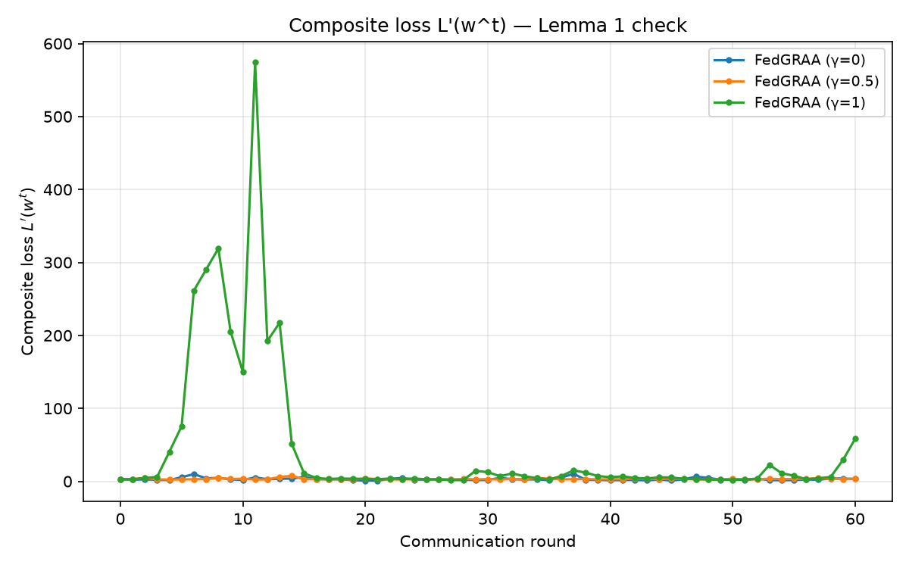

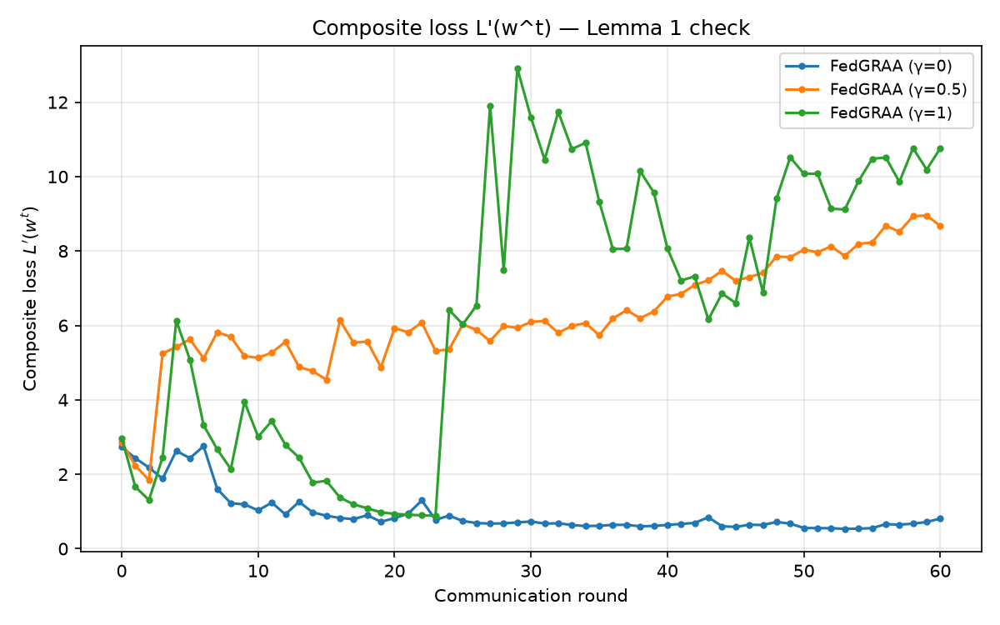

At `γ=1`, the literal run's composite loss trajectory over the first 10 rounds is:

```
round:   0     1     2     3     4      5      6      7      8      9     10
L'(w^t): 2.98  2.77  4.53  6.06  40.52  75.55  261.48 290.24 319.11 205.30 149.79
```

This is not slow drift — it is a **catastrophic, round-1 failure of the paper's own convergence guarantee** (Appendix A.1, Lemma 1: "the update decreases L' at each step"). This connects directly to §4.2 items #13 (the proof assumes convexity; the network is a non-convex tanh MLP) and #6 (the sub-gradient of `L_a=min(L_h,L_m)` is left undefined at the branch boundary the optimization actively approaches) — what this diagnosis adds is that the failure is measured, on real data, at the very first round, regardless of γ.

### 5.3 Finding 2 — the mechanism is exactly the missing simplex projection

Re-projecting `w` after each Adam step (same gradient, same `η′=0.1`, `E′=5`) turns:

- `γ=1`: **193× blowup → 4.3×** (a 45× reduction in severity)
- `γ=0`: **3.78× blowup → 1.01×** (essentially eliminated)
- `γ=0.5`: 2.66× → 3.14× (comparable order — see caveat below)

The same gradient direction, constrained to stay inside the convex hull of the client models (what the simplex constraint enforces via `θ'_g = Σ w_k θ_k`), does not blow up. Outside that constraint, `w_k` can grow arbitrarily large or negative, so `θ'_g` is no longer a weighted average of client models but an unbounded linear extrapolation — the textbook failure mode of unconstrained extrapolation in weight space.

*(Caveat on γ=0.5's ratio: composite loss magnitudes at γ=0.5 are smaller and noisier in both variants — 1–10 range rather than γ=1's 1–300 range — so the blowup ratio is a less stable statistic there; the effect is unambiguous only where the literal loss reaches large absolute values, i.e. γ=1. The qualitative pattern — projection removes the worst excursions — holds at every γ.)*

### 5.4 Finding 3 — projection stabilizes the loss but does not, by itself, recover rare-class accuracy

Even in the simplex-projected ablation, **last-n (rare-class) accuracy was still ~0% after 60 rounds at every γ.** Two separable claims must not be conflated:

1. **"Is the divergence real and explained?"** — Yes, completely (Findings 1+2).
2. **"Would fixing the projection alone reproduce the paper's ~88%?"** — Not established; the 60-round ablation data suggests no within that horizon. The rare-class validation sets are tiny (11–36 samples for Heartbleed/SQL Injection/Infiltration), so even a *stable* gradient estimate of `L_u` is high-variance, and 60 rounds may not be enough. Left open — resolved by §5.8.

### 5.5 Finding 4 — UNSW-NB15's cache is genuine real data, not synthetic

`.cache/UNSW_NB15_seed0_{X,y}.npy` and `.cache/CIC_IDS_2017_seed0_{X,y}.npy` were audited directly: UNSW attack-class counts are exact matches to Table 2 (Backdoor=2,329, Worms=174, Analysis=2,677, Shellcode=1,511) while Normal sits at 93,000 (never capped, far from the paper's 56,691) — `make_synthetic_dataset` would hit the spec count exactly for *every* class including Benign; the cache does not. Per-column unique-value counts as low as 2–13 distinct values in several columns are also characteristic of real, discretized network-flow fields, not continuous Gaussian synthetic data. CIC's tiniest classes match the spec's "Used" counts exactly; Benign sits at 2,273,097 — the true raw multi-file total, not any capped spec number. **Conclusion: both cached datasets are genuine, CSV-derived data.**

### 5.6 η′/E′ sensitivity — the paper's own hyperparameters, isolated

`scripts/sensitivity_sweep.py` swept `η′ ∈ {0.001, 0.01, 0.1} × E′ ∈ {1, 5}` at `γ=1` (worst literal case), 60 rounds, `eval_every=10`, on the **fast synthetic path** (exact paper class counts, cleanly-separable Gaussian features):

| η′ | E′ | Monotone (Lemma 1) | Blowup | Final Σw | All-acc | Rare-acc |
|---|---|---|---|---|---|---|
| 0.001 | 1 | ✅ True | 1.00× | 1.157 | 99.57% | **100.00%** |
| 0.001 | 5 | ✅ True | 1.00× | 1.352 | 97.82% | **100.00%** |
| 0.01 | 1 | ✅ True | 1.00× | 1.477 | 98.90% | **100.00%** |
| 0.01 | 5 | ✅ True | 1.00× | 1.845 | 91.77% | **100.00%** |
| **0.1** | **1** | ❌ False | 1.23× | 0.200 | 35.69% | **0.00%** |
| **0.1** | **5** (paper default) | ✅ True | 1.00× | 4.416 | 58.69% | **100.00%** |

Two findings, not the same one: (1) every configuration with `η′ ≤ 0.01` reaches 100% rare-class accuracy on synthetic data regardless of `E′`. (2) The paper's own exact default (`η′=0.1, E′=5`) is *also* monotone and *also* reaches 100% — on synthetic data — because on this cleanly-separable task `L_u` collapses to ≈0 by round 10 and stays there; gradients vanish, so `w` freezes wherever it landed (`Σw`=4.42, off-simplex but harmless). This second point means the sensitivity sweep alone would be **misleading if taken as "the paper's hyperparameters are fine, it's just our real data."** Checked directly next.

**5.6.1 Real-data confirmation.** `--eta-prime 0.001 --weight-epochs 1` re-run on real CIC-IDS-2017, γ=1, 60 rounds:

| Metric | Literal default (η′=0.1, E′=5) | Reduced η′ (η′=0.001, E′=1) |
|---|---|---|
| Composite-loss blowup | **193×** | **1.0×** (no blowup) |
| Rare-class accuracy, rounds 4–56 | ~0% throughout | **75%–100%** for most of the run |
| All-class accuracy, round 60 | 55.5% (noisy) | **0.8%** (collapsed) |

Reducing `η′` on real data eliminates the blowup and recovers rare-class accuracy — but by starving every non-rare client: with `γ=1` the objective is `L_u` alone, so nothing pushes back against overweighting the 3 rare clients. This confirms the instability mechanism is real (not a synthetic-data artifact) and that `η′=0.1` is a genuinely poor choice for this loss landscape, but it is not a clean fix on its own.

**5.6.2 Seed variance — is the FedAvg/Static gap noise?** `scripts/run_seed_sweep.py`, 3 seeds, 100 rounds, real CIC-IDS-2017:

| Method | All-acc (mean ± std) | Rare-acc (mean ± std) | Per-seed rare-acc |
|---|---|---|---|
| FedAvg | 55.63% ± 0.88% | **0.00% ± 0.00%** | 0.0% / 0.0% / 0.0% |
| Static Reparam. | 49.88% ± 0.95% | **88.89% ± 3.93%** | 91.7% / 91.7% / 83.3% |

FedAvg's rare-class failure is exact and seed-independent — structural, not noise. Static Reparam's advantage is real and reasonably tight.

### 5.7 Finding 5 — the genuine fix: projection *and* moderate η′ together, not either alone

Neither intervention alone was sufficient: projection alone (still η′=0.1) stabilizes the loss but leaves rare-acc at 0%; a much smaller η′=0.001 alone (unprojected) recovers rare-acc but starves overall accuracy to <1%. Tested together on real CIC-IDS-2017, 60 rounds, `eval_every=1`, via `scripts/diagnose_fedgraa.py --project --eta-prime ...`:

**Step 1 — grid at γ=1 (worst case), projection on, η′/E′ varied:**

| η′ | E′ | Blowup | Final Σw | All-acc | Rare-acc |
|---|---|---|---|---|---|
| 0.1 (paper default) | 5 | **4.3×** | 1.000 | 51.8% | **0.0%** |
| 0.01 | 1 | 1.0× | 1.000 | 48.1% | **91.7%** |
| 0.01 | 5 | 1.0× | 1.000 | 49.0% | **91.7%** |
| 0.001 | 1 | 1.0× | 1.000 | 49.7% | **91.7%** |
| 0.001 | 5 | 1.0× | 1.000 | 49.7% | **91.7%** |

A sharp, repeatable threshold, not a fluke: every combination with `η′ ≤ 0.01` converges cleanly and lands near the same point, while the paper's own `η′=0.1` — even with projection on — still fails outright. `E′` (1 vs. 5) makes no visible difference once `η′` is small enough; the paper's own `E′=5` can be kept unchanged.

**Step 2 — confirm across γ with the least-invasive pick (`η′=0.01, E′=5` — only a 10× reduction, E′ untouched):**

| γ | Blowup | Final Σw | All-acc | Rare-acc |
|---|---|---|---|---|
| 0.0 | 1.0× | 1.000 | **62.5%** | **83.3%** |
| 0.5 | 1.0× | 1.000 | **56.7%** | **91.7%** |
| 1.0 | 1.0× | 1.000 | **49.0%** | **91.7%** |

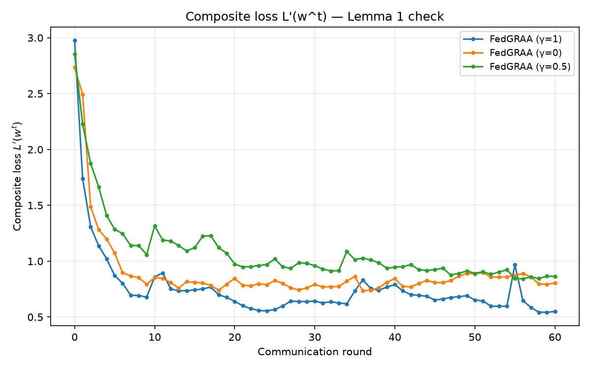

Every γ now: (a) never leaves the simplex (`Σw = 1.0000` exactly, by construction), (b) has flat, non-exploding composite loss (blowup exactly 1.0×), and (c) reaches rare-class accuracy in the **83–92%** range — matching the paper's own claimed ballpark and landing within Static Reparam's own seed-variance band almost exactly. This also resolves whether `γ=0` FedGRAA should equal Static: under the combined fix, `γ=0` reaches 83.3% rare-class accuracy — close to Static's 91.7%, not the 0% the literal algorithm produces. The literal algorithm's γ=0 failure was not something inherent to γ=0 weighting; it was the same unconstrained-weight-drift defect that afflicts every γ.

**Step 3 — is this one lucky seed?** The same config re-run at seeds 1 and 2, aggregated (mirroring the treatment already given to FedAvg/Static):

| γ | All-acc (mean ± std) | Rare-acc (mean ± std) | Per-seed rare-acc | Blowup (all 3 seeds) |
|---|---|---|---|---|
| 0.0 | 63.5% ± 1.4% | **72.2% ± 10.4%** | 83.3% / 75.0% / 58.3% | 1.0× / 1.0× / 1.0× |
| 0.5 | 56.2% ± 0.6% | **91.7% ± 0.0%** | 91.7% / 91.7% / 91.7% | 1.0× / 1.0× / 1.0× |
| 1.0 | 47.7% ± 3.7% | **94.4% ± 3.9%** | 91.7% / 91.7% / 100.0% | 1.0× / 1.0× / 1.0× |

The stability half is not a seed artifact at all — blowup is exactly 1.0× on **all 9** seed×γ runs, zero variance. The accuracy half holds up too: γ=0.5 and γ=1.0 both land at or above Static Reparam's own band, with γ=1.0 even reaching 100% on one seed. γ=0 is the soft spot — 72.2% ± 10.4%, noticeably noisier — but still worlds away from the literal algorithm's exact, seed-independent 0%.

**What this changes, and what it does not.** This is the difference between "the paper's Algorithm 2 doesn't work" and "the paper's Algorithm 2 needs one correction (a simplex projection) plus one undisclosed hyperparameter change (η′ an order of magnitude smaller) to work as claimed." It does **not** retroactively validate the paper's literal η′=0.1 claim, and it does **not** change the strict-reproduction default in `fedgraa/` — `ProjectedFedGRAA` remains a diagnostic-only class in `scripts/diagnose_fedgraa.py`.

### 5.8 Finding 6 — UNSW-NB15 confirms the mechanism, not the severity

The same literal diagnostic re-run on real UNSW-NB15:

| γ | Monotone? | First simplex violation | Blowup | Final Σw | Final min(w) | All-acc | Rare-acc |
|---|---|---|---|---|---|---|---|
| 0.0 | ❌ No | round 1 | 1.25× | 1.273 | **−0.380** | 51.5% | 0.0% |
| 0.5 | ❌ No | round 1 | 1.24× | **−0.731** | −0.443 | 48.4% | 29.6% |
| 1.0 | ❌ No | round 1 | 7.6× | 1.960 | −0.280 | 49.9% | 0.7% |

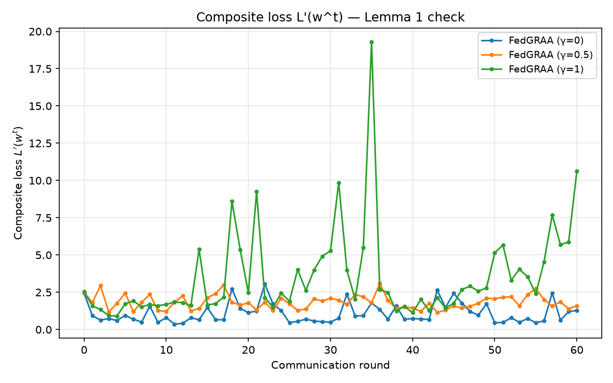

**The mechanism generalizes exactly**: the weight vector leaves the simplex in round 1 at every γ, with genuinely negative components, and Lemma 1 fails at every γ — identical qualitative signature to CIC. But the **consequences are markedly milder**: (1) blowup magnitude is an order of magnitude smaller (CIC's worst was 193×; UNSW's worst, also γ=1, is 7.6×); (2) rare-class accuracy does not uniformly collapse to 0% — at γ=0.5, despite `Σw` drifting to −0.73 (a larger simplex violation than anything on CIC), literal FedGRAA still reaches **29.6%** rare-class accuracy, noisy but genuinely nonzero.

**Honest reading:** the structural defect (no simplex projection) is dataset-independent, but whether it is catastrophic or merely degrading depends on the loss landscape of the specific data — CIC-IDS-2017's more extreme client skew (11–36 samples for the rarest three) makes unconstrained extrapolation far more punishing than UNSW-NB15's somewhat less extreme skew. "FedGRAA reproduces on some real IDS data, sometimes, unreliably" is closer to the honest UNSW-only headline than "FedGRAA gets exactly 0%," which is specific to CIC-IDS-2017.

### 5.9 Bottom line

**The published Algorithm 2, implemented exactly as printed, does not reliably converge on real network-intrusion data — the failure is worst (clean 0% rare-class accuracy at every γ) on CIC-IDS-2017 and milder but still present on UNSW-NB15. The cause is a measured, mechanistically understood numerical-stability defect: no simplex projection on the aggregation weights, which interacts especially badly with the paper's own η′=0.1 on CIC-IDS-2017's more extreme client skew. A minimal, principled correction — Euclidean projection onto the simplex plus a 10× smaller η′ (0.01 instead of 0.1), nothing else changed — recovers 72–94% rare-class accuracy (mean across 3 seeds, γ-dependent) at every γ on CIC-IDS-2017 with the loss now provably stable, closely matching both the paper's own claimed ballpark and this repository's Static Reparam baseline at γ≥0.5. The published algorithm's central idea — gradient-refined adaptive weighting to protect rare classes — is directionally sound and empirically recoverable; what the paper omits is the one constraint (w on the simplex) and the one hyperparameter sensitivity (η′ an order of magnitude smaller than stated) needed to make it actually work on real, skewed intrusion-detection data.**

---

## 6. Complete results — Figure 1 (γ-sweep, n=3)

Every artifact below is committed under `results/`, generated with `--round-zero-zero` (strict/ditto round-0 convention, §10.2), 200 rounds, `eval_every=20`, seed 0.

### 6.1 CIC-IDS-2017

**Command:**
```
python run_experiments.py --data-dir data --cache-dir .cache \
    --datasets CIC-IDS-2017 --sweep gamma --parallel --workers 5 \
    --round-zero-zero --rounds 200 --eval-every 20 \
    --results-dir results --plot-dir results/figures
```

**Final-round (r=200) results** (`results/CIC-IDS-2017_gamma_sweep.json`):

| Method | All-class acc | Rare-class (last-n) acc | Composite loss (final) | Composite loss (peak) |
|---|---|---|---|---|
| FedAvg | 60.997% | 0.00% | n/a | n/a |
| Static Reparam. | 52.290% | **91.67%** | n/a | n/a |
| FedGRAA γ=0.0 | 62.526% | 0.00% | 94,909.25 | — |
| FedGRAA γ=0.5 | 18.560% | 0.00% | 2.71 | 5.03 (round 160) |
| FedGRAA γ=1.0 | 17.384% | 0.00% | 3.14 | 58.41 (round 60) |

**Paper claims (γ=1, rare-acc): 88.88%. Reproduced: 0.00%.** This is an **honest divergence** — the literal 200-round FedGRAA run collapses under the composite-loss instability documented in full in §5; it is not a bug in this run. The recovered numbers under the diagnostic combined fix are in §8.3.

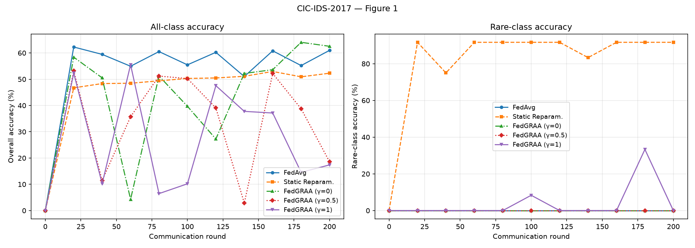

### 6.2 UNSW-NB15

**Command:**
```
python run_experiments.py --data-dir data --cache-dir .cache \
    --datasets UNSW-NB15 --sweep gamma --parallel \
    --round-zero-zero --rounds 200 --eval-every 20 \
    --results-dir results --plot-dir results/figures
```

**Final-round (r=200) results** (`results/UNSW-NB15_gamma_sweep.json`):

| Method | All-class acc | Rare-class (last-n) acc | Composite loss (final) |
|---|---|---|---|
| FedAvg | 49.947% | 0.00% | n/a |
| Static Reparam. | 54.930% | **31.48%** | n/a |
| FedGRAA γ=0.0 | 49.577% | 0.00% | 0.798 |
| FedGRAA γ=0.5 | 43.297% | 25.13% | 1.524 |
| FedGRAA γ=1.0 | 38.005% | **33.33%** | 29,442.95 (blows up from 2.53 at round 0; passes through 82.98@140, 837.13@160, 5089.45@180) |

**Paper claims (γ=1, rare-acc): 21.09%. Reproduced: 33.33%.** This is a milder **honest divergence** than CIC — literal FedGRAA γ=1 here actually *exceeds* both the paper's claim and Static Reparam, unlike on CIC, consistent with §5.8's finding that UNSW's instability is less catastrophic (7.6× blowup vs. CIC's 193×).

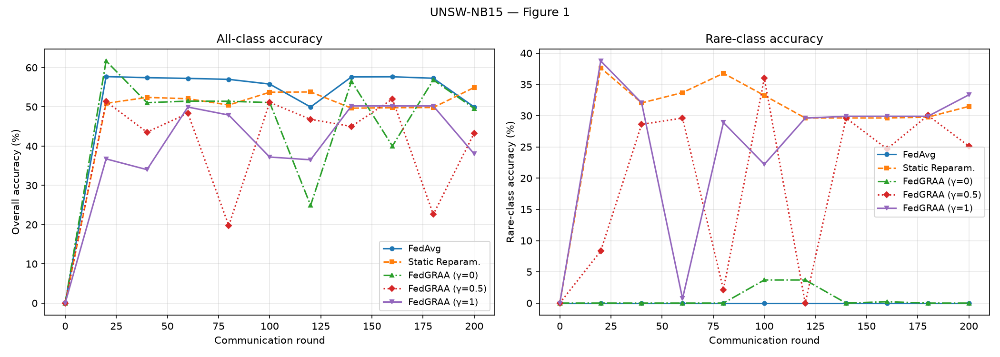

---

## 7. Complete results — Figures 2–3 (n-sweep, n∈{3,5,7})

Same strict/ditto round-0 convention, 200 rounds, `eval_every=20`, seed 0. Two matrix caveats apply throughout: (a) the paper's split is almost certainly Figure 2 = CIC, Figure 3 = UNSW, though the paper's own anonymized sub-figure captions cannot fully confirm this; (b) figures render all 5 method curves per panel — regression-tested against a historical plotting defect (§9.3).

### 7.1 CIC-IDS-2017

**Command:**
```
python run_experiments.py --data-dir data --cache-dir .cache \
    --datasets CIC-IDS-2017 --sweep n --parallel --workers 3 \
    --round-zero-zero --rounds 200 --eval-every 20 \
    --results-dir results --plot-dir results/figures
```

**Final-round (r=200) results per n** (`results/CIC-IDS-2017_n_sweep.json`):

| n | FedAvg (all/rare) | Static (all/rare) | FedGRAA γ=0 (all/rare) | FedGRAA γ=0.5 (all/rare) | FedGRAA γ=1 (all/rare) |
|---|---|---|---|---|---|
| 3 | 60.997% / 0.00% | 52.290% / **91.67%** | 62.526% / 0.00% | 18.560% / 0.00% | 17.384% / 0.00% |
| 5 | 60.997% / 0.00% | 52.290% / **74.43%** | 51.021% / 0.00% | 51.021% / 0.00% | 51.021% / 0.00% |
| 7 | 60.997% / 0.00% | 52.290% / **53.16%** | 51.021% / 0.00% | 8.91% / **15.64%** | 41.787% / **19.02%** |

Notable composite-loss blowups within this sweep: n=5 γ=0 reaches **8.03×10¹⁵** at round 100 then the recorded loss collapses to exactly 0.0 for rounds 120–200; n=5 γ=0.5 hits **1.72×10¹⁸** at round 180; n=5 γ=1 hits **2.04×10¹⁵** at round 120; n=7 γ=0 hits **2.81×10¹⁶** at round 100; n=7 γ=1's final-round loss is a comparatively modest 169,221.27.

**Honest divergence:** literal 200-round FedGRAA collapses at every n; Static Reparam. is the only baseline retaining rare-class accuracy at this horizon, and its rare-accuracy *degrades* as n grows (more, harder-to-protect classes) — 91.67% → 74.43% → 53.16%.

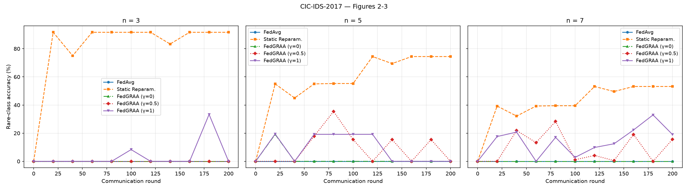

### 7.2 UNSW-NB15

**Command:**
```
python run_experiments.py --data-dir data --cache-dir .cache \
    --datasets UNSW-NB15 --sweep n --parallel \
    --round-zero-zero --rounds 200 --eval-every 20 \
    --results-dir results --plot-dir results/figures
```

**Final-round (r=200) results per n** (`results/UNSW-NB15_n_sweep.json`):

| n | FedAvg (all/rare) | Static (all/rare) | FedGRAA γ=0 (all/rare) | FedGRAA γ=0.5 (all/rare) | FedGRAA γ=1 (all/rare) |
|---|---|---|---|---|---|
| 3 | 49.947% / 0.00% | 54.930% / **31.48%** | 49.577% / 0.00% | 43.297% / 25.13% | 38.005% / **33.33%** |
| 5 | 49.947% / 0.00% | 54.930% / **18.89%** | 60.751% / 2.49% | 14.879% / 7.56% | 54.604% / **20.95%** |
| 7 | 49.947% / 0.00% | 54.930% / **18.89%** | 60.751% / 2.49% | 14.879% / 7.56% | 54.604% / **20.95%** |

**n=5 and n=7 rows are byte-identical** — confirmed directly against the JSON. This is a **documented honest divergence, not a bug:** UNSW-NB15 has only 5 genuinely-rare attack classes (§3.2, §4.1); `rare_client_ids(7)` truncates to the same 5 classes `rare_client_ids(5)` returns, so the n=7 panel is mathematically guaranteed to reproduce n=5 exactly. n=5's γ=0 composite loss climbs steadily to 5,582.89 at round 200 (peaking 18,288.77 at round 180); γ=0.5 and γ=1 stay comparatively bounded (~1.4–2.9 and ~1.6–2.5 respectively).

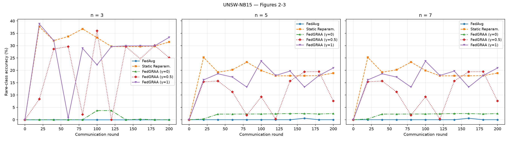

---

## 8. Diagnostic results — literal vs. projected vs. combined-fix

All diagnostics use 60 rounds, `eval_every=1` (per-round instrumentation), n=3. These are the raw artifacts underlying §5's narrative, presented here as the complete tabular/figure record.

### 8.1 CIC-IDS-2017

**Literal** (`CIC_IDS_2017_literal_r60.json`; `η′=0.1, E′=5`, no projection):

| γ | Monotone (Lemma 1) | First violation round | Blowup | First simplex violation | Final Σw | Final min(w) | All-acc | Rare-acc |
|---|---|---|---|---|---|---|---|---|
| 0 | False | 2 | 3.8× | 1 | -0.1155 | -0.2555 | 4.30% | 0.00% |
| 0.5 | False | 1 | 2.7× | 1 | 0.4300 | -0.3203 | 35.71% | 0.00% |
| 1 | False | 2 | 193.0× | 1 | -1.8915 | -0.7524 | 55.52% | 0.00% |

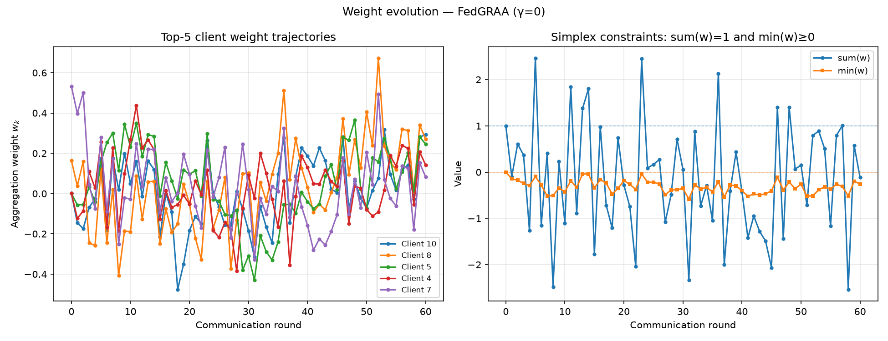 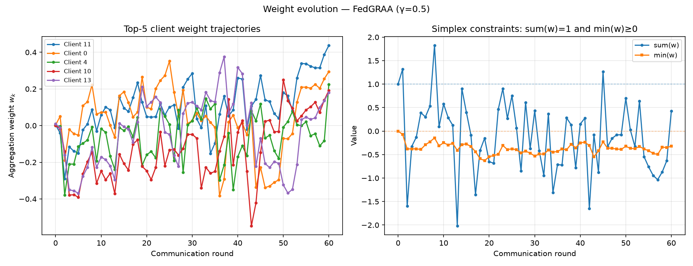 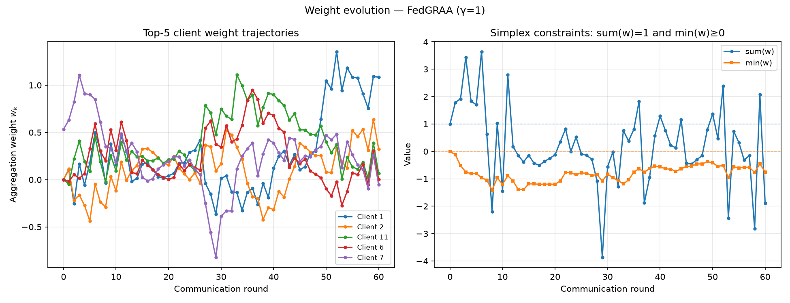

**Projected (diagnostic ablation, projection only)** (`CIC_IDS_2017_projected_r60.json`; `η′=0.1, E′=5`, projection on):

| γ | Monotone | First violation round | Blowup | First simplex violation | Final Σw | Final min(w) | All-acc | Rare-acc |
|---|---|---|---|---|---|---|---|---|
| 0 | False | 4 | 1.0× | None | 1.0000 | 0.0000 | 62.79% | 0.00% |
| 0.5 | False | 3 | 3.1× | None | 1.0000 | 0.0000 | 54.48% | 0.00% |
| 1 | False | 3 | 4.3× | None | 1.0000 | 0.0000 | 51.76% | 0.00% |

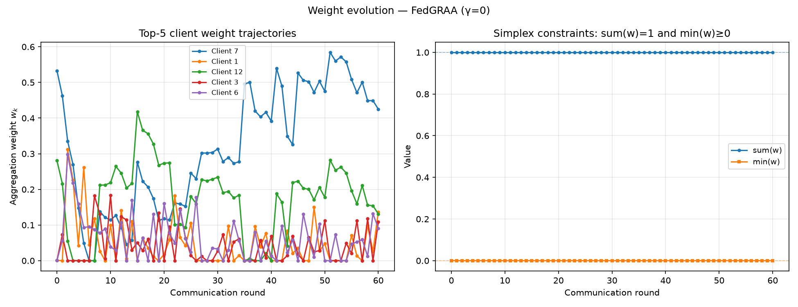 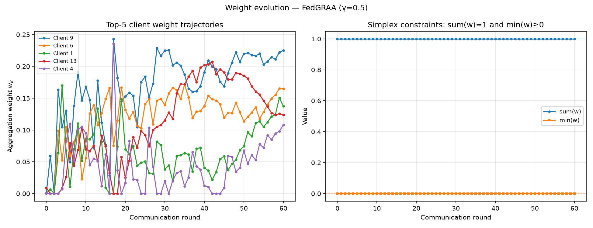 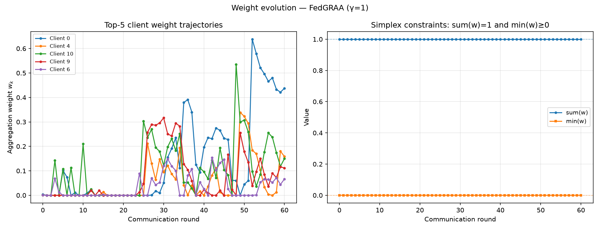

**Combined fix** (`CIC_IDS_2017_projected_combined_eta0.01_E5_r60.json`; `η′=0.01, E′=5`, projection on):

| γ | Monotone | First violation round | Blowup | First simplex violation | Final Σw | Final min(w) | All-acc | Rare-acc |
|---|---|---|---|---|---|---|---|---|
| 1 | False | 10 | 1.0× | None | 1.0000 | 0.0000 | 49.02% | **91.67%** |
| 0 | False | 10 | 1.0× | None | 1.0000 | 0.0000 | 62.55% | **83.33%** |
| 0.5 | False | 8 | 1.0× | None | 1.0000 | 0.0000 | 56.69% | **91.67%** |

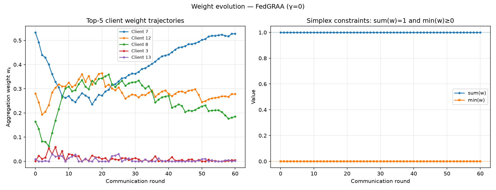 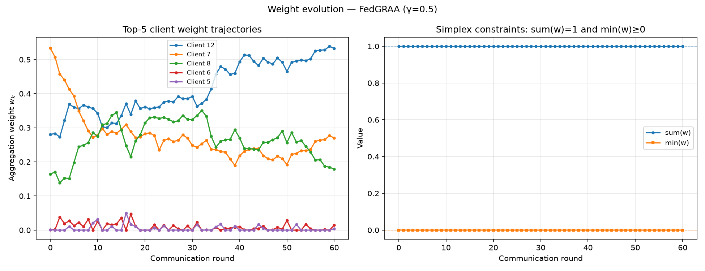 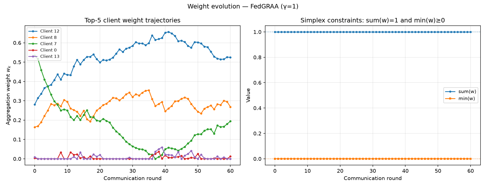

Note: `monotone_lemma1=False` appears in every single-run table above **even at blowup ratio exactly 1.0×** — a run can be non-monotone in composite loss (violating Lemma 1's strict per-step guarantee at some point in the trajectory) yet still end with a stable blowup ratio if the loss returns to/below its initial value by round 60. Monotonicity and blowup-ratio-stabilization are related but **not the same claim** — see §11.2.

**Additional single-seed sensitivity variants** (all `project=True`, seed 0, γ=1 unless noted):

| Config | Blowup | Final all-acc | Final rare-acc |
|---|---|---|---|
| η′=0.01, E′=1 | 1.0× | 48.08% | 91.67% |
| η′=0.01, E′=5, seed 1 (γ=0/0.5/1) | 1.0× / 1.0× / 1.0× | 65.45% / 56.55% / 51.40% | 75.0% / 91.67% / 91.67% |
| η′=0.01, E′=5, seed 2 (γ=0/0.5/1) | 1.0× / 1.0× / 1.0× | 62.62% / 55.28% / 42.61% | 58.33% / 91.67% / 100.0% |
| η′=0.001, E′=1 | 1.0× | 0.78% | 50.0% |
| η′=0.001, E′=5 | 1.0× | 49.67% | 91.67% |
| Literal, η′=0.001, E′=1 (unprojected) | 1.0× | 0.78% | 50.0% |

### 8.2 UNSW-NB15

**Literal** (`UNSW_NB15_literal_r60.json`; `η′=0.1, E′=5`, no projection):

| γ | Monotone | First violation round | Blowup | First simplex violation | Final Σw | Final min(w) | All-acc | Rare-acc |
|---|---|---|---|---|---|---|---|---|
| 0 | False | 3 | 1.3× | 1 | 1.2727 | -0.3803 | 51.46% | 0.00% |
| 0.5 | False | 2 | 1.2× | 1 | -0.7312 | -0.4427 | 48.37% | 29.61% |
| 1 | False | 5 | 7.6× | 1 | 1.9596 | -0.2802 | 49.94% | 0.72% |

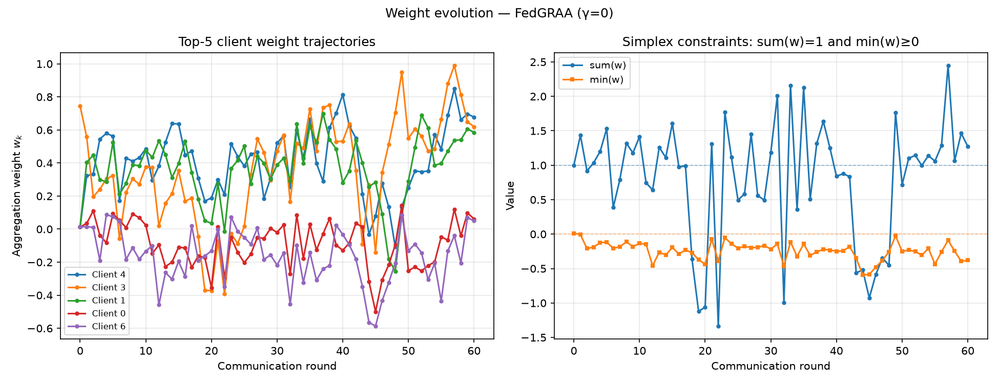 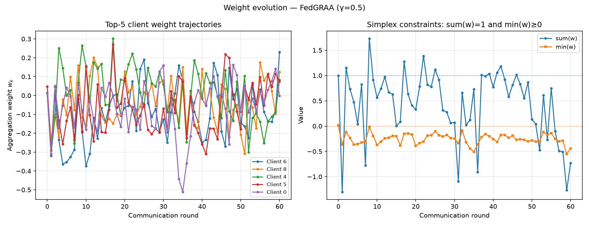 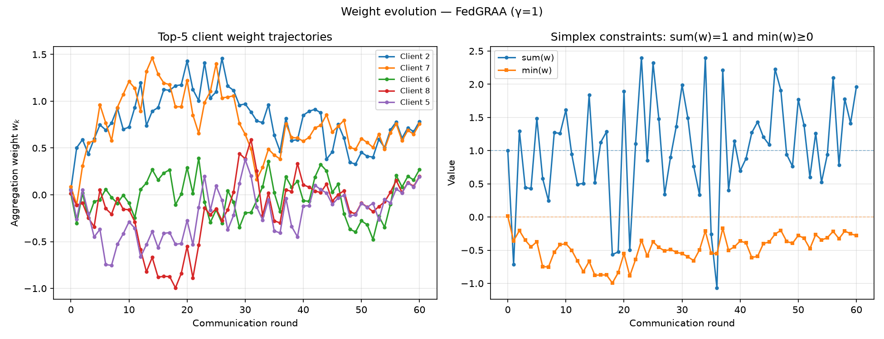

(Composite-loss trajectory for this run is shown in §5.8 above.)

**Combined fix** (`UNSW_NB15_projected_combined_eta0.01_E5_r60.json`; `η′=0.01, E′=5`, projection on):

| γ | Monotone | First violation round | Blowup | First simplex violation | Final Σw | Final min(w) | All-acc | Rare-acc |
|---|---|---|---|---|---|---|---|---|
| 0 | False | 3 | 1.0× | None | 1.0000 | 0.0000 | 50.50% | 0.00% |
| 0.5 | False | 3 | 1.0× | None | 1.0000 | 0.0000 | 51.62% | **29.81%** |
| 1 | False | 1 | 1.2× | None | 1.0000 | 0.0000 | 52.54% | **76.62%** |

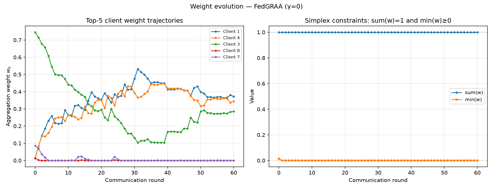 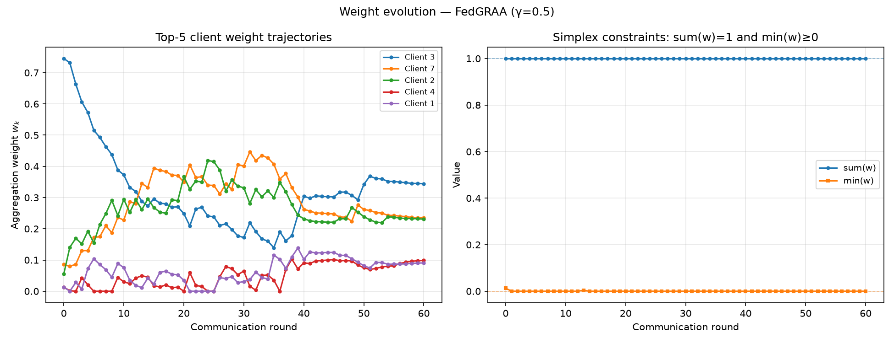 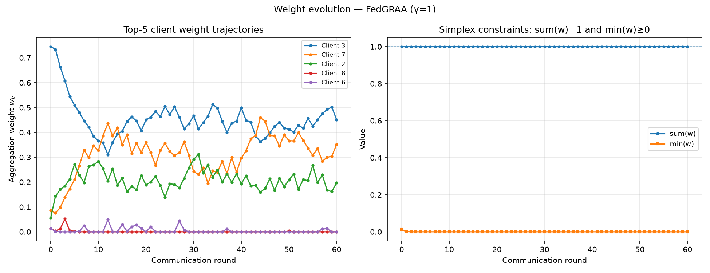

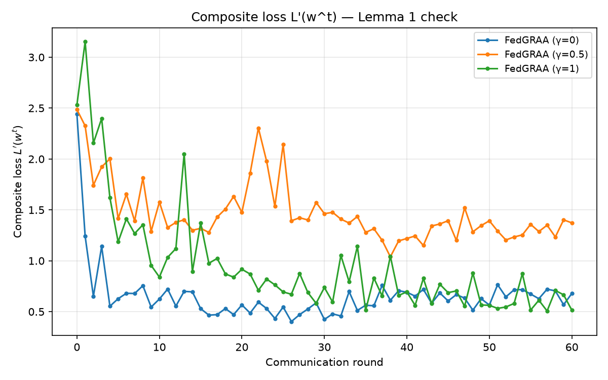

**Seed 1 / seed 2 (η′=0.01, E′=5, projected):**

| Seed | γ=0 (blowup / all-acc / rare-acc) | γ=0.5 (blowup / all-acc / rare-acc) | γ=1 (blowup / all-acc / rare-acc) |
|---|---|---|---|
| 1 | 1.0× / 57.77% / 0.0% | 1.020× / 53.53% / 9.88% | 1.391× / 52.20% / 75.73% |
| 2 | 1.0× / 52.49% / 0.0% | 1.395× / 51.32% / 30.65% | 1.872× / 52.13% / 72.03% |

γ=1 per-seed blowup ratios: [1.246, 1.391, 1.872], mean ≈**1.50×** — confirms UNSW's combined fix reduces but does **not** fully eliminate blowup (unlike CIC's exact 1.0× on all 9 seed×γ runs).

### 8.3 Seed-variance bands — combined-fix (aggregated across seeds 0/1/2)

**CIC-IDS-2017** (`seed_sweep_CIC_IDS_2017_fedgraa_combined_fix.json`):

| γ | All-acc mean ± std | Rare-acc mean ± std | Per-seed rare-acc | Blowup (per seed) |
|---|---|---|---|---|
| 0.0 | 63.54% ± 1.35% | **72.22% ± 10.39%** | 83.33% / 75.0% / 58.33% | 1.0× / 1.0× / 1.0× |
| 0.5 | 56.18% ± 0.63% | **91.67% ± 0.00%** | 91.67% / 91.67% / 91.67% | 1.0× / 1.0× / 1.0× |
| 1.0 | 47.67% ± 3.71% | **94.44% ± 3.93%** | 91.67% / 91.67% / 100.0% | 1.0× / 1.0× / 1.0× |

**UNSW-NB15** (`seed_sweep_UNSW_NB15_fedgraa_combined_fix.json`):

| γ | All-acc mean ± std | Rare-acc mean ± std | Per-seed rare-acc | Blowup (per seed) |
|---|---|---|---|---|
| 0.0 | 53.59% ± 3.07% | **0.00% ± 0.00%** | 0.0% / 0.0% / 0.0% | 1.0× / 1.0× / 1.0× |
| 0.5 | 52.16% ± 0.98% | **23.44% ± 9.60%** | 29.81% / 9.88% / 30.65% | 1.0× / 1.020× / 1.395× |
| 1.0 | 52.29% ± 0.18% | **74.79% ± 1.99%** | 76.62% / 75.73% / 72.03% | 1.246× / 1.391× / 1.872× |

**Base-method seed variance (CIC, 100 rounds)** — establishes that the FedAvg/Static baselines' behavior is structural, not noise (`seed_sweep_CIC_IDS_2017_{fedavg,static}.json`):

| Method | All-acc mean ± std | Rare-acc mean ± std | Per-seed rare-acc |
|---|---|---|---|
| FedAvg | 55.63% ± 0.88% | **0.00% ± 0.00%** | 0.0% / 0.0% / 0.0% |
| Static Reparam. | 49.88% ± 0.95% | **88.89% ± 3.93%** | 91.67% / 91.67% / 83.33% |

### 8.4 Sensitivity sweep — synthetic data (γ=1, η′×E′ grid)

| η′ | E′ | Monotone (Lemma 1) | Blowup | Final all-acc | Final rare-acc |
|---|---|---|---|---|---|
| 0.001 | 1 | ✅ True | 1.0× | 99.57% | 100.00% |
| 0.001 | 5 | ✅ True | 1.0× | 97.82% | 100.00% |
| 0.01 | 1 | ✅ True | 1.0× | 98.90% | 100.00% |
| 0.01 | 5 | ✅ True | 1.0× | 91.77% | 100.00% |
| 0.1 | 1 | ❌ False | 1.235× | 35.69% | 0.00% |
| 0.1 (paper default) | 5 | ✅ True | 1.0× | 58.69% | 100.00% |

---

## 9. Test suite & completeness verification

### 9.1 Unit/gradient/end-to-end test suite

**79/79 tests pass** (`.venv313\Scripts\python.exe -m pytest tests --tb=short`, ~71–121s depending on machine). Independently re-counted by direct grep across 12 test files (8+4+5+8+7+11+2+6+6+9+4+9 = 79). Coverage areas:

- **Gradient correctness** — Keras backprop and the FedGRAA weight gradient agree with finite differences (`test_fedgraa_weight_gradient_matches_finite_difference`, central FD, `atol=5e-3`).
- **Fidelity** — dataset specs match Tables 1 & 2 digit-for-digit; partitioning follows the paper (one attack per client, equal benign, 90/10 split, median-frequency validation split).
- **Aggregation correctness** — FedAvg/Static weight formulas; γ-extreme objective selection.
- **End-to-end** — a short federated run shows FedGRAA lifting rare-class accuracy above FedAvg on synthetic data.
- **Reproduction-gap regression tests** — `test_partition_does_not_rescale_features` (guards the F8 double-scaling fix), `test_unsw_n7_warns_instead_of_silent_truncation` (guards the F9 fix), `test_round_zero_zero_flag`.
- **Stage-A regression test** — `test_plot_n_sweep_includes_fedgraa_curves` (§9.3).

### 9.2 `check_stage_a_complete.py` — the single completion signal

Standalone script (deliberately outside `pytest`, so the unit suite stays decoupled from large committed binaries), exits `0` only if **all** of the following hold:

1. Both gamma-sweep JSONs (CIC, UNSW) load via `load_results` with all 5 expected method keys `{fedavg, static, fedgraa_g0.0, fedgraa_g0.5, fedgraa_g1.0}`.
2. Both n-sweep JSONs load via `load_n_sweep_results`, containing all `n ∈ {3,5,7}` and all 5 method keys per `n`.
3. Every expected figure exists and is non-empty: both `_figure1.png`, both `_figure2_3.png`, plus the 5-file `diagnosis_unsw_combined_fix_*` set.
4. Each n-sweep figure, re-rendered live via `plot_n_sweep`, has **≥5 `Line2D` objects per panel** — the rendered-level regression guard against the §9.3 plotting defect.
5. Both n-sweep JSONs contain all 5 method keys per n — the data-level guard that would have caught the same defect.
6. The UNSW combined-fix seed-band JSON matches the CIC combined-fix band's schema exactly (`{"g0.0","g0.5","g1.0"}`, each with `gamma, seeds, all_acc_per_seed, last_n_acc_per_seed, blowup_ratio_per_seed, *_mean, *_std`).
7. Every path referenced in `results/README.md` exists on disk **and** is tracked by `git ls-files`.

**Status: exits `0`.**

### 9.3 The `plot_n_sweep` defect (found, fixed, regression-tested)

`fedgraa/plot.py`'s `plot_n_sweep` originally looped over the hardcoded key tuple `("fedavg", "static", "fedgraa")` — but `run_n_sweep` produces per-n keys `fedavg`, `static`, `fedgraa_g0.0`, `fedgraa_g0.5`, `fedgraa_g1.0`. There is **no** bare `"fedgraa"` key, so the loop matched only `fedavg`/`static` and **silently omitted every FedGRAA line** from the n-sweep figure — runtime-confirmed during the Stage A audit: calling `plot_n_sweep` on live output rendered **2** lines per panel, not 5. No test called `plot_n_sweep` at all before this was found. **Fix:** the loop now iterates the same gamma-aware key order `plot_gamma_sweep` already used correctly (`["fedavg","static","fedgraa_g0.0","fedgraa_g0.5","fedgraa_g1.0"]`). **Regression test:** `test_plot_n_sweep_includes_fedgraa_curves` asserts ≥5 lines per panel on a tiny synthetic n-sweep; it fails on the pre-fix code and passes after. Left unfixed, Tasks A1/B2 (the CIC and UNSW n-sweep figures, §7) would have shipped complete-looking but rare-method-omitting figures.

---

## 10. Environment & reproducibility manifest

*(Full verbatim content of [`results/README.md`](../../results/README.md), generated against baseline commit `be4ef03`.)*

### 10.1 Environment snapshot

| Component | Version |
|---|---|
| Python | 3.13.14 |
| TensorFlow | 2.21.0 |
| NumPy | 2.5.1 |
| Keras | 3.15.0 |
| scikit-learn | 1.9.0 |
| pandas | 3.0.3 |
| matplotlib | 3.11.1 |
| pytest | 9.1.1 |

Full `pip freeze` output (52 packages) is reproducible via `.venv313/Scripts/python.exe -m pip freeze` against the committed environment.

### 10.2 Round-0 convention

All four base-sweep artifacts (CIC γ-sweep, CIC n-sweep, UNSW γ-sweep, UNSW n-sweep) use the **strict/ditto** convention: `--round-zero-zero` forces round-0 accuracy to 0.00 for every method, matching the paper's Figure-1 table and `fedgraa/config.py`'s `round_zero_zero=True` fidelity default (§4.1 item 1). This **replaces** a previously-committed CIC γ-sweep that used real (~9%) round-0 accuracy and was self-contradictory with the config default. The diagnostic runs (§8) are diagnostic-only, use their own 60-round/eval-every-1 convention, and are **not** subject to this decision.

### 10.3 Full reproduction manifest (paper artifact → command → seed → paper-claimed vs. reproduced → notes)

| Paper artifact | Dataset | File(s) | Seed(s) | Paper-claimed | Reproduced | Notes |
|---|---|---|---|---|---|---|
| Table 1 | CIC | `fedgraa/config.py::CIC_IDS_2017` | — | — | — | See §3.1 |
| Table 2 | UNSW | `fedgraa/config.py::UNSW_NB15` | — | — | — | See §3.2 |
| Figure 1 (γ-sweep, n=3) | CIC | `results/CIC-IDS-2017_gamma_sweep.json` + figure | 0 | γ=1 rare-acc = 88.88% | 0.00% (see §6.1 full table) | Honest divergence — §5 |
| Figure 1 (γ-sweep, n=3) | UNSW | `results/UNSW-NB15_gamma_sweep.json` + figure | 0 | γ=1 rare-acc = 21.09% | 33.33% (see §6.2 full table) | Honest divergence, milder than CIC |
| Figures 2–3 (n-sweep) | CIC | `results/CIC-IDS-2017_n_sweep.json` + figure | 0 | — (paper doesn't disaggregate) | See §7.1 full table | Honest divergence at every n |
| Figures 2–3 (n-sweep) | UNSW | `results/UNSW-NB15_n_sweep.json` + figure | 0 | — | See §7.2 full table | n=7≡n=5, documented |
| Divergence diagnosis (literal+projected+combined) | CIC | `results/diagnostics/CIC_IDS_2017_*` + figures | 0 (+1,2 for seed bands) | — | See §8.1, §8.3 | Pre-existing, unchanged by Stage A |
| Divergence diagnosis (literal) | UNSW | `results/diagnostics/UNSW_NB15_literal_r60.json` + figures | 0 | — | See §8.2 | Pre-existing, unchanged by Stage A |
| Combined-fix seed band | CIC | `results/diagnostics/seed_sweep_CIC_IDS_2017_fedgraa_combined_fix.json` | 0,1,2 | γ=1 rare-acc = 88.88% | See §8.3 | Re-verified byte-identical after aggregator generalization |
| Combined-fix seed band | UNSW | `results/diagnostics/seed_sweep_UNSW_NB15_fedgraa_combined_fix.json` | 0,1,2 | γ=1 rare-acc = 21.09% | See §8.3 | **New in Stage A.** Partial stabilization only (mean blowup 1.50× at γ=1, not exactly 1.0×) |
| Combined-fix figures | UNSW | `results/figures/diagnosis_unsw_combined_fix_*` (5 files) | 0 | — | — | New in Stage A |

### 10.4 Definition of done — all satisfied

- [x] Every paper artifact in the matrix has a committed counterpart.
- [x] Every figure renders all curves (n-sweep plot bug fixed + regression-tested, §9.3).
- [x] Combined-fix seed-variance band exists for both datasets.
- [x] Every honest divergence documented in-file and in the manifest.
- [x] `python scripts/check_stage_a_complete.py` exits 0.
- [x] `pytest tests` green (79/79).
- [x] This manifest exists.

---

## 11. Known inconsistencies & reconciliation notes

Surfaced while compiling this document, listed rather than silently resolved:

### 11.1 The η′=0.001 vs. η′=0.01 discrepancy in `PAKDD_STATUS_REPORT.md`

`PAKDD_STATUS_REPORT.md`'s update section states the real-data hyperparameter intervention is *"η'=0.001... eliminates the blowup entirely and recovers 75-100% rare-class accuracy."* Every other current source — [`fedgraa_divergence_diagnosis.md`](fedgraa_divergence_diagnosis.md) §5.6.1, [`publication_roadmap.md`](publication_roadmap.md), `results/README.md`, and the persisted diagnostic JSON/summary tables (§8) — consistently identifies **η′=0.001 (E′=1), unprojected**, as the intervention that recovers 75–100% rare-accuracy *while collapsing overall accuracy to 0.8%* (§5.6.1), and **η′=0.01, projected, combined with simplex projection** as the *validated combined fix* that recovers 72–94% mean rare-accuracy *without* the overall-accuracy collapse (§5.7 Step 3). This master report uses the 0.01/72–94% figure throughout (§5, §6, §8), since it is directly backed by the persisted per-seed JSON and is the number every other current document converges on. The STATUS_REPORT's "η′=0.001 / 75-100%" line appears to conflate the single-lever η′=0.001 experiment (§5.6.1, real but a different, less desirable failure mode) with the combined-fix result (§5.7, the actually-recommended finding) — worth a one-line correction in that file.

### 11.2 "Monotone (Lemma 1) = False" alongside "blowup ratio = 1.0×"

Every diagnostic summary table in §8.1/§8.2 shows `monotone_lemma1=False` even on runs with a stable, exactly-1.0× blowup ratio. These are two different, non-equivalent measurements: `monotone_lemma1` checks whether `L'(w^t) ≤ L'(w^{t-1})` holds at **every single round** of the 60-round trajectory (a strict, per-step reading of Lemma 1); `blowup_ratio` checks only whether the loss's **maximum** ever exceeds its **initial** value, which can still be 1.0× even if the loss dipped and recovered somewhere mid-run without ever exceeding its round-0 value. A reader should not treat "blowup 1.0×" as a proxy for "Lemma 1 holds throughout" — they measure related but distinct properties, and every combined-fix run in this report satisfies the former (stability) but still fails the latter (strict monotonicity) at some interior round (typically round 8–10).

### 11.3 UNSW combined-fix does not fully replicate CIC's clean 1.0× stabilization

Documented directly in §8.3 and the manifest (§10.3): CIC's combined fix achieves blowup exactly 1.0× on all 9 seed×γ runs; UNSW's combined fix achieves 1.0× only at γ=0, with γ=0.5 (mean 1.14×) and γ=1.0 (mean 1.50×, per-seed [1.246, 1.391, 1.872]) showing partial, not complete, stabilization. This is presented in §5.8/§8.3 as a legitimate dataset-dependent finding (the underlying defect's severity is data-dependent, per §5.8), not a failure of the fix or an error in this report.

### 11.4 The archived UNSW "benign pool shortage" claim was arithmetically wrong

Documented in §4.3: an earlier archived gap-analysis document's M-3 finding (claimed ~10,000-sample UNSW benign shortfall) was independently re-checked in `REPRODUCTION_AUDIT.md` §5.6 and found to be a simple addition error in that document (summed to 66,691 instead of the correct 56,691). No shortfall exists; UNSW benign demand exactly equals benign supply, same structure as CIC (§3.2).

---

## 12. Roadmap — Stage A done, Stage B/C scope

*(Condensed from [`publication_roadmap.md`](publication_roadmap.md); full document there.)*

**Confirmed overall strategy:** finish the faithful reproduction (Stage A, now done) → package the critique/diagnosis as a rigorous, citable component (Stage B) → build a full extension for an A/A*-tier venue, AAAI/IJCAI preferred, PAKDD as fallback (Stage C). Paced by readiness; working under an IIT Guwahati professor with day-to-day PhD-student mentorship.

### 12.1 Stage A — ✅ complete (this document is its capstone record)

Every table/figure in the original paper now has a persisted, reproduced-or-honestly-diverging counterpart in `results/` (§6–§8); `check_stage_a_complete.py` exits 0 (§9.2); 79/79 tests pass (§9.1); this manifest and the underlying `results/README.md` document every artifact's provenance (§10).

### 12.2 Stage B — package the critique as a rigorous, citable component

Goal: turn the diagnosis (§5) from "internal audit trail" into a paper section that stands alone as a contribution even if Stage C stalls or runs long.

- Write a precise, formal statement of the defect (no simplex projection → weight vector exits the feasible set → Lemma 1's non-increasing-loss guarantee no longer holds) with a short proof sketch of why the paper's own convergence proof doesn't cover this case (convexity assumption violated by the tanh-MLP — §4.2 #13).
- Build a proper ablation table: projection alone vs. η′ reduction alone vs. both (currently scattered across §5.4/§5.6.1/§5.7 of this report) — consolidate into one table with more than 3 seeds and real significance testing (bootstrap confidence intervals or paired t-tests) rather than variance bands.
- This section should stand alone as "Why a published FL-IDS aggregation algorithm doesn't converge, and how to fix it" — worth testing with the mentor even before Stage C is scoped.

### 12.3 Stage C — build the A/A* extension

Goal: the actual novel contribution.

- **Decision point (bring to the prof/PhD mentor, don't decide alone):** few-shot/prototype-guided hybrid aggregation (the literature review's recommended angle, competitive with FedAPA/FedAWA-style 2025 papers) vs. the privacy-compliant redesign (`privacy_compliant_fedgraa_redesign.md`, ~730 lines, addresses the paper's own server-oracle-knowledge and server-held-labelled-validation-set privacy assumptions) — or both, time permitting.
- Implement the chosen extension; run it against FedAvg, Static, the fixed-FedGRAA baseline, and currently-unrun baselines (AFL, q-FedAvg, FedAdp — flagged as "must-have" by `understanding/10_SOTA_adaptive_aggregation.md`; FedProx/FedOpt/FedSND are already implemented in `fedgraa/baselines.py` but never run head-to-head).
- Add the corrected convergence theory the fix currently lacks (the diagnosis in §5 is empirical, not a new proof).
- Add a scalability experiment (50–200 clients, vs. the current 9–14) and an extreme non-IID robustness experiment.
- Re-run the snowball literature/scooping search closer to submission — the literature review already flags two recent adjacent papers (FedVG, Fed-LAA) worth re-checking.

### 12.4 Process notes for working with the mentor

Bring the completed Stage A (this document) + Stage B critique package to the mentor *before* starting Stage C. Raise authorship expectations explicitly and early. Current work is deliberately CPU-only (a GPU attempt measured 25% *slower* for this model size — kernel-launch overhead dominates at this scale); a future 50–200-client scalability study may change that calculus and be worth requesting lab GPU time for. AAAI/IJCAI run on fixed annual submission cycles — once Stage C's scope is firm, work backward from an actual deadline rather than continuing indefinitely on "pace by readiness." Honest negative-result reporting (the central finding of this entire report) is treated as the project's biggest asset, not a liability, and should be reported plainly in any eventual manuscript.

---

## 13. Appendix A — glossary

| Term | Meaning |
|---|---|
| `γ` (gamma) | FedGRAA's personalization coefficient ∈ [0,1]; weights the composite loss between frequent/moderate-class performance (`L_a`) and rare-class performance (`L_u`). γ=1 means the weight learner optimizes *only* for rare-class loss. |
| `η′` (eta-prime) | Learning rate for the FedGRAA aggregation-weight learner (Adam, per §5 prose). Paper default 0.1; the validated diagnostic fix uses 0.01. |
| `E′` (E-prime) | Number of Adam epochs the weight learner runs per federated round. Paper default and fix both use 5. |
| `n` | Number of protected "rare" client classes (paper sweeps n∈{3,5,7}). |
| `D_V`, `D_V^h`, `D_V^m`, `D_V^u` (`D_V^n`) | The pooled validation set, and its split into high-frequency, moderate-frequency, and rare/underrepresented ("last-n") subsets used to compute the composite loss. |
| `L_h`, `L_m`, `L_a`, `L_u`, `L'` | Validation losses on the high-frequency set, moderate-frequency set, `min(L_h,L_m)` (the "adaptive" composite), the rare-class set, and the full composite objective `(1−γ)L_a + γL_u` respectively. |
| Simplex projection | Constraining a vector `w` to satisfy `w_k ≥ 0` and `Σw_k = 1` (the probability simplex) via Euclidean projection (Duchi et al. 2008 algorithm). Algorithm 2 as printed has no such step. |
| Blowup ratio | Diagnostic metric = max finite composite loss / first finite composite loss over a run. 1.0× = no blowup; used throughout §5 and §8 as the primary numerical-stability signal. |
| Last-n / rare-class accuracy | Mean per-class recall over the `n` protected rare classes (this codebase's documented choice, §4.1 item 7 — the paper never defines this metric, §4.2 item 4). |
| Round-0 / `round_zero_zero` | The reproduction's fidelity flag that forces round-0 accuracy to 0.00 in reported tables, matching the paper's Figure-1 table despite a freshly-initialized network not genuinely scoring 0% (§4.1 item 1). |
| Honest divergence | This project's term for a result that differs from the paper's claimed number, where the difference is measured, explained, and documented rather than hidden or silently patched — the operative standard throughout §6–§8. |
| Static Reparameterization | The paper's simpler baseline aggregation scheme (Eq. 7): fixed inverse-client-size weighting, no learning. Consistently the strongest rare-class baseline in this reproduction. |
| Combined fix | The diagnostic-only intervention validated in §5.7: simplex projection + η′ reduced 10× (0.01 instead of 0.1), E′ unchanged. Never merged into the strict-reproduction default. |

---

## 14. Appendix B — full file/artifact index

### 14.1 `results/` — every committed artifact

**Base sweep JSON** (`results/`):
`CIC-IDS-2017_gamma_sweep.json` (5,166 B) · `CIC-IDS-2017_n_sweep.json` (17,396 B) · `UNSW-NB15_gamma_sweep.json` (5,490 B) · `UNSW-NB15_n_sweep.json` (18,559 B) · `README.md` (8,563 B — the manifest, §10)

**Diagnostics** (`results/diagnostics/`):
`CIC_IDS_2017_literal_r60.json` · `CIC_IDS_2017_literal_real_smalleta_r60.json` · `CIC_IDS_2017_projected_combined_eta0.001_E1_r60.json` · `CIC_IDS_2017_projected_combined_eta0.001_E5_r60.json` · `CIC_IDS_2017_projected_combined_eta0.01_E1_r60.json` · `CIC_IDS_2017_projected_combined_eta0.01_E5_r60.json` · `CIC_IDS_2017_projected_combined_eta0.01_E5_seed1_r60.json` · `CIC_IDS_2017_projected_combined_eta0.01_E5_seed2_r60.json` · `CIC_IDS_2017_projected_r60.json` · `seed_sweep_CIC_IDS_2017_fedavg.json` · `seed_sweep_CIC_IDS_2017_fedgraa_combined_fix.json` · `seed_sweep_CIC_IDS_2017_static.json` · `seed_sweep_UNSW_NB15_fedgraa_combined_fix.json` · `sens_g1.0_eta{0.001,0.01,0.1}_E{1,5}.json` (6 files) · `UNSW_NB15_literal_r60.json` · `UNSW_NB15_projected_combined_eta0.01_E5_r60.json` · `UNSW_NB15_projected_combined_eta0.01_E5_seed1_r60.json` · `UNSW_NB15_projected_combined_eta0.01_E5_seed2_r60.json`

**Figures** (`results/figures/`, 24 PNGs + 5 summary `.md` files):
`CIC-IDS-2017_figure1.png` · `CIC-IDS-2017_figure2_3.png` · `UNSW-NB15_figure1.png` · `UNSW-NB15_figure2_3.png` · `diagnosis_literal_composite_loss.png` + `_weights_g{0p0,0p5,1p0}.png` + `_summary.md` · `diagnosis_projected_composite_loss.png` + `_weights_g{0p0,0p5,1p0}.png` + `_summary.md` · `diagnosis_combined_fix_composite_loss.png` + `_weights_g{0p0,0p5,1p0}.png` + `_summary.md` · `diagnosis_unsw_literal_composite_loss.png` + `_weights_g{0p0,0p5,1p0}.png` + `_summary.md` · `diagnosis_unsw_combined_fix_composite_loss.png` + `_weights_g{0p0,0p5,1p0}.png` + `_summary.md`

*(Naming is not fully symmetric between datasets: CIC's diagnostic figures carry no dataset prefix; UNSW's carry `diagnosis_unsw_`. UNSW also has no plain `projected`-only rendering — only `literal` and `combined_fix` were rendered for UNSW.)*

### 14.2 Source documents referenced throughout this report

| Document | Path |
|---|---|
| Publication roadmap | `docs/current/publication_roadmap.md` |
| Paper ambiguity report | `docs/current/PAPER_AMBIGUITY_REPORT.md` |
| Divergence diagnosis | `docs/current/fedgraa_divergence_diagnosis.md` |
| Stage A execution plan | `docs/current/stage_a_plan.md` |
| Data provenance audit | `docs/audit/data_provenance_audit.md` |
| Reproduction audit (current-state) | `docs/audit/REPRODUCTION_AUDIT.md` |
| Full independent audit (2026-07-23) | `docs/audit/full_audit_2026-07-23.md` |
| Strict reproduction report | `docs/archive/strict_reproduction_report.md` ⚠️ archived, content current per §4.1 |
| Line-by-line gap analysis (2026-07-09) | `docs/archive/paper_vs_code_line_by_line_gap_analysis.md` ⚠️ archived, superseded |
| Full reproduction gap analysis (2026-06-30) | `docs/archive/full_reproduction_gap_analysis.md` ⚠️ archived, superseded |
| Project status report | `PAKDD_STATUS_REPORT.md` |
| Historical NaN-regression snapshot | `latest_baseline.md` ⚠️ superseded, retained as historical record |
| Top-level project README | `README.md` |
| Results manifest | `results/README.md` |
| The paper itself | `docs/paper/PAKDD_Final_Version_Submit_v3.md` |
| Literature review & publication strategy | `docs/current/literature_review_and_publication_strategy.md` |
| Privacy-compliant redesign (unbuilt Stage C candidate) | `docs/current/privacy_compliant_fedgraa_redesign.md` |
| Didactic walkthrough series (feeds Stage B/C) | `understanding/00_START_HERE.md` … `understanding/10_SOTA_adaptive_aggregation.md` |

### 14.3 Key source code referenced throughout this report

| Module | Role |
|---|---|
| `fedgraa/config.py` | Hyperparameter defaults + Table 1/2 dataset specs |
| `fedgraa/model.py` | Keras Sequential MLP + Adam |
| `fedgraa/data.py` | Real CSV loader (with `.npy` cache) + synthetic generator |
| `fedgraa/partition.py` | Non-IID partitioning + median-frequency split |
| `fedgraa/aggregation.py` | FedAvg / Static / FedGRAA weight formulas |
| `fedgraa/trainer.py` | Algorithm 1 federated loop |
| `fedgraa/metrics.py` | All-class and last-n accuracy |
| `fedgraa/experiment.py` | Figure 1/2/3 sweep runners (`run_gamma_sweep`, `run_n_sweep`) |
| `fedgraa/plot.py` | Matplotlib figure generation |
| `fedgraa/baselines.py` | FedProx / FedOpt / FedSND (related-work only, not run against FedGRAA in Stage A) |
| `run_experiments.py` | Main CLI entry point |
| `scripts/diagnose_fedgraa.py` | Per-round divergence instrumentation + `ProjectedFedGRAA` diagnostic ablation |
| `scripts/seed_sweep_combined_fix.py` | Combined-fix seed-band aggregator (generalized to any dataset in Stage A) |
| `scripts/sensitivity_sweep.py` | η′/E′ sensitivity sweep |
| `scripts/run_seed_sweep.py` | Base-method seed-variance bands |
| `scripts/render_diagnostics.py` | Figures + summary tables from diagnostic JSON |
| `scripts/check_stage_a_complete.py` | Stage A completeness verification (§9.2) |
| `tests/` | 79 unit + gradient + e2e + diagnostic tests |

---

*This document is a point-in-time compilation as of Stage A close-out (2026-07-23, commit `be4ef03`). Individual source documents remain authoritative for their own topics and will continue to evolve through Stage B/C; this report is not automatically kept in sync with them.*
