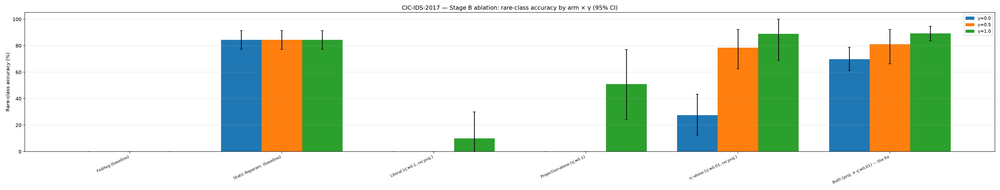
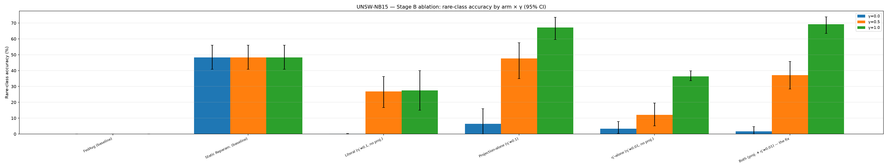

# FedGRAA / PAKDD — Stage B Master Report

### The complete, self-contained record of the convergence-defect campaign: the formal theory, the executed 10-seed factorial, every per-seed number, every significance test, every artifact, and every honest limitation.

**Status:** Stage B ✅ **complete.**
**Plan baseline commit:** `a17a443` · **Campaign/commit of record:** `4459f53` (the git SHA stamped into both ablation-table JSONs) · **Working tree adds** one uncommitted post-commit refinement: heavy-tailed blowup is now reported as median (+max) rather than mean, with `median`/`min`/`max` persisted per cell (§14).
**This document compiled:** 2026-07-25.
**Verification re-run at compile time:** `python -m pytest tests --tb=short` → **142 passed** in 152.91 s; `python scripts/check_stage_b_complete.py` → **exit 0**, all checks green including all 27 manifest paths.

---

**What this document is.** The exhaustive Stage B capstone, written to the same standard as [`STAGE_A_MASTER_REPORT.md`](STAGE_A_MASTER_REPORT.md): a reader who opens *only this file* gets the entire Stage B story — what Stage B set out to prove, the formal theory it produced, the exact experimental design, the campaign as actually executed (down to wall-clock and per-run accounting), **every** per-seed number in every cell, every significance test with exact *p*-values, the feasibility result checked across all 240 measured cells, the reconciliation notes, the limitations, and the open framing risk that the 2026-07-25 direction audit surfaced. It supersedes no other document — [`fedgraa_convergence_defect.md`](fedgraa_convergence_defect.md) remains the authoritative paper-shaped section and [`stage_b_plan.md`](stage_b_plan.md) the authoritative plan — but nothing material is left out of this one.

**How to navigate:**

1. [Executive summary](#1-executive-summary)
2. [Stage B's mandate — the definition of done, item by item](#2-stage-bs-mandate--the-definition-of-done-item-by-item)
3. [The objects Stage B reasons about — a compact recap](#3-the-objects-stage-b-reasons-about--a-compact-recap)
4. [The theory in full — defect, proof failure, corrected proposition](#4-the-theory-in-full--defect-proof-failure-corrected-proposition)
5. [Experimental design — the 2×2 factorial and the pre-registered protocol](#5-experimental-design--the-22-factorial-and-the-pre-registered-protocol)
6. [The campaign as executed — inventory, provenance, wall clock](#6-the-campaign-as-executed--inventory-provenance-wall-clock)
7. [The statistics module — contracts and degenerate-cell handling](#7-the-statistics-module--contracts-and-degenerate-cell-handling)
8. [Complete results — CIC-IDS-2017](#8-complete-results--cic-ids-2017)
9. [Complete results — UNSW-NB15](#9-complete-results--unsw-nb15)
10. [The feasibility result — all 240 cells, zero exceptions](#10-the-feasibility-result--all-240-cells-zero-exceptions)
11. [Per-seed head-to-head — the fix vs. the literal algorithm, run by run](#11-per-seed-head-to-head--the-fix-vs-the-literal-algorithm-run-by-run)
12. [Cross-dataset synthesis — the dataset-dependent finding](#12-cross-dataset-synthesis--the-dataset-dependent-finding)
13. [Anatomy of a divergence — annotated loss trajectories](#13-anatomy-of-a-divergence--annotated-loss-trajectories)
14. [Why blowup is reported as a median — the heavy-tail decision](#14-why-blowup-is-reported-as-a-median--the-heavy-tail-decision)
15. [Secondary and non-factorial rows](#15-secondary-and-non-factorial-rows)
16. [n=3 preview vs. n=10 campaign — what changed](#16-n3-preview-vs-n10-campaign--what-changed)
17. [Verification — tests, completeness check, manifest](#17-verification--tests-completeness-check-manifest)
18. [Reproducibility manifest — environment, exact commands, artifact index](#18-reproducibility-manifest--environment-exact-commands-artifact-index)
19. [Known inconsistencies & reconciliation notes](#19-known-inconsistencies--reconciliation-notes)
20. [Honest limitations](#20-honest-limitations)
21. [The open framing risk — provenance of the target manuscript](#21-the-open-framing-risk--provenance-of-the-target-manuscript)
22. [Stage C handoff](#22-stage-c-handoff)
23. [Appendix A — glossary](#23-appendix-a--glossary)
24. [Appendix B — complete per-seed data dump](#24-appendix-b--complete-per-seed-data-dump)
25. [Appendix C — full artifact and source index](#25-appendix-c--full-artifact-and-source-index)

---

## 1. Executive summary

Stage A ([`STAGE_A_MASTER_REPORT.md`](STAGE_A_MASTER_REPORT.md)) established empirically that the FedGRAA manuscript's Algorithm 2 lets its aggregation-weight vector `w` leave the probability simplex in round 1 of training, at every tested `γ`, on both datasets — a direct, measured violation of the manuscript's own Lemma 1 convergence guarantee. Stage B's job, per [`publication_roadmap.md`](publication_roadmap.md) §2, was to turn that diagnosis from "internal audit trail" into something that reads as a paper section on its own: formal theory plus a statistically rigorous ablation.

**That goal is met in full.** Every one of the eight definition-of-done criteria in [`stage_b_plan.md`](stage_b_plan.md) §0 is satisfied and verified (§2 below, item by item).

### 1.1 What was produced

| Deliverable | Artifact | Size |
|---|---|---|
| Formal defect statement + why the manuscript's proof cannot cover it + corrected convergence proposition | [`fedgraa_convergence_defect.md`](fedgraa_convergence_defect.md) §1–4 (of a §1–7 standalone section) | ~250 lines of paper-section prose |
| Statistics module (bootstrap CI, paired *t*, Wilcoxon, Cohen's *d*, Holm–Bonferroni), degenerate-cell-safe | [`../../fedgraa/stats.py`](../../fedgraa/stats.py) | 177 lines, 19 tests |
| Resumable, worker-capped campaign driver | [`../../scripts/run_ablation_seed_sweep.py`](../../scripts/run_ablation_seed_sweep.py) | 296 lines, 17 tests |
| Consolidated table builder | [`../../scripts/build_ablation_table.py`](../../scripts/build_ablation_table.py) | 349 lines, 15 tests |
| Table + figure renderer | [`../../scripts/render_ablation.py`](../../scripts/render_ablation.py) | 303 lines, 6 tests |
| Single green/red completeness signal | [`../../scripts/check_stage_b_complete.py`](../../scripts/check_stage_b_complete.py) | 303 lines, standalone |
| The executed data campaign | 80 per-seed diagnostic JSONs + 4 baseline seed-sweeps | **240** (arm, seed, γ) measured cells + 40 baseline seed-runs |
| Consolidated, significance-tested tables + figures | `results/ablation/{CIC_IDS_2017,UNSW_NB15}_ablation_table.{json,md}`, `_ablation.png` | 6 files |
| Reproducibility manifest | [`../../results/ablation/README.md`](../../results/ablation/README.md) | 27 checked paths |

### 1.2 The three findings

**Finding 1 — feasibility failure is unconditional, and the fix makes it structurally impossible.** Across the two unprojected arms (literal, η′-alone) — 2 arms × 10 seeds × 3 γ × 2 datasets = **120 cells** — `first_simplex_violation_round = 1` in **120 of 120**, zero exceptions. Across the two projected arms (projection-alone, both) — another **120 cells** — the violation round is `None` in **120 of 120**, with `Σw` within `1.2×10⁻⁷` of 1.0 (float32 round-off) and `min(w) ≥ 0` everywhere. This is a zero-variance empirical match to a *structural* guarantee, exactly as §4's proposition predicts, and it was the campaign's pre-registered falsifiable prediction. Under the literal algorithm the excursion is not marginal: `Σw` ranges over `[−2.62, +2.77]` on CIC-IDS-2017 and `[−1.87, +2.12]` on UNSW-NB15, with individual weight components as low as `−1.157`.

**Finding 2 — which lever does the *accuracy* work is dataset-dependent, and this refutes the n=3 preview's hypothesis.** The 3-seed preview supported "neither lever alone recovers rare-class accuracy; only the combination does." The full n=10 factorial replaces that with something sharper and less tidy:

- On **CIC-IDS-2017**, the η′ cut carries the *rare-class* accuracy recovery. Its factorial main effect is **+48.6 to +79.8 pp** at every γ, against projection's **+1.3 to +21.1 pp**; `η′-alone` is indistinguishable from the full fix *on rare-acc* at γ=0.5 and γ=1.0 (Holm *p* = 1.0 and 0.97).
- On **UNSW-NB15**, the pattern inverts. Projection's main effect is **+22.9 to +36.2 pp** at γ≥0.5 while the η′ main effect is *negative or negligible* at every γ; `projection-alone` is indistinguishable from the full fix *on rare-acc* at **every** γ (Holm *p* = 0.61, 0.42, 0.54).
- **One of those ties is hollow, and only the all-class-accuracy check reveals it.** At CIC γ=1.0, `η′-alone` matches the fix on rare-acc (88.9 % vs 89.3 %) while sitting at **15.2 % all-class accuracy against the fix's 44.3 %** (Holm *p* = 5.6×10⁻⁴, *d* = +1.99) — it buys rare-class parity by starving every frequent class, the same over-correction pathology §15 documents for η′=0.001. Reporting only the pre-registered metric of record would have scored that arm as equivalent to the fix. The mirror check on UNSW γ=1.0 flags a divergence in the fix's favour but at a trivial 0.4 pp, which is evidence the check discriminates rather than flagging indiscriminately. Both metric families are now computed, persisted, and auto-flagged where they disagree (§17.4).
- Neither single-lever arm survives the crossover: `η′-alone` collapses to 3.4–36.4 % on UNSW where `both`/`projection-alone` reach 67–69 %; `projection-alone` sits at exactly 0.0 % on CIC at γ≤0.5 where `both`/`η′-alone` reach 70–89 %.
- **No arm dominates on both metrics at every γ** — at CIC γ=1.0 `projection-alone` is significantly *better* than the fix on all-class accuracy (48.4 % vs 44.3 %, Holm *p* = 0.042). The defensible claim is narrower and more useful: **`both` is the only arm never *catastrophically* wrong on either metric, on either dataset, at any γ.** Deficits against it are single-digit percentage points; deficits against the single-lever arms reach 29 pp and 38 pp. That worst-case profile — not a win on any one metric — is the recommendation's basis.

**Finding 3 — the literal algorithm's real failure mode on UNSW is unpredictability, not uniform collapse.** On CIC-IDS-2017 the literal arm's rare-class accuracy is an exact, seed-independent 0.0 % at γ=0 and γ=0.5 (10/10 seeds). On UNSW-NB15 at γ=0.5 the same arm produces per-seed values of `[29.6, 42.8, 0.4, 43.3, 44.0, 38.5, 3.4, 31.0, 24.2, 11.8] %` — a spread from 0.4 % to 44.0 % on nothing but a seed change. For an intrusion-detection deployment that is arguably the worse failure mode, and it is only visible at n=10.

### 1.3 Headline numbers

Rare-class accuracy = mean per-class recall over the protected classes; mean [95 % percentile bootstrap CI], N = 10 seeds, 60-round horizon, n=3 protected classes.

| | CIC-IDS-2017 | UNSW-NB15 |
|---|---|---|
| FedAvg (baseline, γ-independent) | 0.0 % [0.0, 0.0] | 0.0 % [0.0, 0.0] |
| Static Reparam. (baseline, γ-independent) | 84.4 % [77.2, 91.4] | 48.3 % [40.8, 56.0] |
| Literal (manuscript default η′=0.1, no projection), γ=1 | 10.0 % [0.0, 30.0] | 27.6 % [15.0, 39.9] |
| Projection-alone, γ=1 | 51.0 % [24.2, 77.1] | 67.2 % [59.6, 73.6] |
| η′-alone (η′=0.01, E′=5), γ=1 | 88.9 % [68.9, 100.0] | 36.4 % [33.7, 39.8] |
| **Both (the fix), γ=1** | **89.3 % [83.6, 94.6]** | **69.2 % [63.4, 73.8]** |

Composite-loss blowup, worst case over the whole campaign: literal reaches **1.86×10⁶×** on CIC (γ=0, seed 8) and **46.85×** on UNSW (γ=1, seed 9); the fix never exceeds **1.02×** on CIC or **1.87×** on UNSW.

### 1.4 What Stage B is not

No new method, no baselines beyond FedAvg/Static, no scalability or extreme-non-IID study, no machine-checked proof with exact constants. All Stage C (§22). One framing risk remains open and is **not** resolved by any amount of further compute: the target manuscript's publication status (§21).

---

## 2. Stage B's mandate — the definition of done, item by item

[`stage_b_plan.md`](stage_b_plan.md) §0 lists eight criteria. Each is reproduced in substance, with its verdict and evidence.

| # | Criterion (from the plan) | Verdict | Evidence |
|---|---|---|---|
| 1 | A standalone formal doc states the feasibility-set defect, a proof sketch of why Appendix A.1 doesn't cover it, and a corrected convergence proposition | ✅ | [`fedgraa_convergence_defect.md`](fedgraa_convergence_defect.md) §1–2 (defect), §3 (three compounding gaps), §4 (proposition + proof sketch). Reproduced in §4 below |
| 2 | One consolidated ablation table covering the 2×2 factorial + FedAvg + Static, per γ ∈ {0, 0.5, 1}, both datasets, each cell mean + bootstrap 95 % CI over N=10 seeds | ✅ | `results/ablation/{DS}_ablation_table.{json,md}`; §8–9 below |
| 3 | Significance testing is real: bootstrap CIs on every cell, 5 pre-registered pairwise comparisons (paired *t* + Wilcoxon + Cohen's *d* + Holm), factorial main-effects/interaction read, exact *p*-values persisted | ✅ | `comparisons` and `factorial` blocks in both table JSONs; §8.5–8.6, §9.5–9.6 |
| 4 | New statistics module `fedgraa/stats.py` with unit tests against SciPy/NumPy references; full `pytest tests` green | ✅ | 19 tests in `tests/test_stats.py`; suite **142 passed** |
| 5 | Projection-alone and canonical η′-alone arms generated across the full 10-seed set on both datasets, so every cell is significance-testable | ✅ | 40 fresh (arm, seed) runs for those two arms; §6.1 |
| 6 | `python scripts/check_stage_b_complete.py` exits 0 | ✅ | Re-run at compile time → exit 0; §17.2 |
| 7 | Manifest maps every new artifact → command, SHA, seed set, claim supported | ✅ | [`../../results/ablation/README.md`](../../results/ablation/README.md), 27 paths verified present **and** git-tracked |
| 8 | The section reads end-to-end as *"Why a published FL-IDS aggregation algorithm doesn't converge, and how to fix it"*, ready for the mentor; a capstone master report records completion | ✅ *with one caveat* | The section reads end-to-end. The word **"published"** in that framing is the open provenance question of §21 — flagged rather than assumed |

**Explicit non-goals, all honoured:** no new method; no baselines beyond FedAvg/Static; no scalability/non-IID experiments; no fully machine-checked proof; and **no change to the strict-reproduction default in `fedgraa/`** — `ProjectedFedGRAA` remains defined solely inside `scripts/diagnose_fedgraa.py` and is never imported by the reproduction package, verified by direct grep.

---

## 3. The objects Stage B reasons about — a compact recap

*(Full treatment: [`STAGE_A_MASTER_REPORT.md`](STAGE_A_MASTER_REPORT.md) §2. Repeated here only to the depth Stage B's argument needs.)*

**The network.** `Input(d) → Dense(200, tanh) → Dense(100, tanh) → Dense(50, tanh) → Dense(C, softmax)`, sparse categorical cross-entropy, Adam. `d` = 78 (CIC-IDS-2017) or 39 (UNSW-NB15); `C` = 15 or 10. A standard non-convex loss surface — this fact is load-bearing in §4.2.

**The composite objective (Eq. 8–9).** With `θ_g'(w) = Σ_{k=1}^K w_k θ_k` the candidate aggregate:

```
L_a  = min( L_h(θ_g'; D_V^h),  L_m(θ_g'; D_V^m) )
L'(w) = (1 − γ)·L_a(θ_g'(w))  +  γ·L_u(θ_g'(w)),        γ ∈ [0, 1]
```

`D_V^h` / `D_V^m` are the high- and moderate-frequency validation splits; `D_V^n` (whose loss is `L_u`) is the protected rare-class validation set. `γ=1` optimizes rare-class loss alone.

**The weight update (Eq. 10 / Algorithm 2 line 6),** run for `E′` epochs per federated round:

```
w ← w − η′ ∇_w L'(w)
```

**The feasible set.** `θ_g = Σ_k w_k θ_k` is only guaranteed to lie in `conv{θ_k}` when

```
Δ = { w ∈ ℝ^K : w_k ≥ 0 ∀k,  Σ_k w_k = 1 }
```

**Algorithm 2 has exactly 8 lines. There is no line 9.** No projection, clipping, or renormalization appears anywhere in the algorithm box, and a direct grep of the line-for-line reproduction (`fedgraa/aggregation.py`) returns zero matches for any simplex-projection call.

**Lemma 1's claimed guarantee** (Appendix A.1; derivation in [`../../understanding/05_convergence_proof.md`](../../understanding/05_convergence_proof.md) §5.3), under Assumptions 1–3 (`L'` convex and β-smooth; bounded gradient magnitude/variance; `η′ ≤ 1/β`):

```
L'(w^t) ≤ L'(w^{t−1}) − (η′ − β(η′)²/2)·‖∇L'(w^{t−1})‖²
```

**Hyperparameters of record.** `η = 0.01` (local Adam), `E = 2`, `B = 64`, `η′ = 0.1` (weight learner, manuscript default), `E′ = 5`, `n = 3` protected classes, `K = 14` (CIC) / `9` (UNSW) clients. **The fix changes exactly one of these: `η′ = 0.1 → 0.01`.** `E′` is untouched.

---

## 4. The theory in full — defect, proof failure, corrected proposition

*(Authoritative text: [`fedgraa_convergence_defect.md`](fedgraa_convergence_defect.md) §1–4. Reproduced here in condensed-but-complete form so this report stands alone.)*

### 4.1 The feasibility-set defect (formal statement)

> **Algorithm 2, taken literally, solves an *unconstrained* optimization problem — `min_w L'(w)` over all of `ℝ^K` — using an update rule whose descent guarantee (Lemma 1) is proved only under an implicit assumption, never stated and never enforced, that `w` remains in the *constrained* feasible set `Δ`. The manuscript presents Algorithm 2 as if it operates on `Δ` (weights are called a "weighted average"; `Σw_k = 1` is used informally throughout the exposition) while specifying an algorithm with no mechanism to keep `w` there.**

**The mechanism.** Once `w ∉ Δ`, `θ_g' = Σ_k w_k θ_k` is no longer confined to `conv{θ_k}`; it becomes an **unbounded affine extrapolation** in parameter space. A convex combination can only ever land *between* the client models; an affine combination with negative components — or, worse, with `Σw_k ≠ 1` entirely, which is what the traces actually show — can land arbitrarily far *outside* the region the client models explored. A network evaluated at a point in weight-space it was never trained to be smooth around produces an unpredictably large loss; replayed every round because nothing pulls `w` back toward `Δ`, that is precisely the observed non-monotone, exploding `L'`.

**The empirical fact, now at full statistical power.** `first_simplex_violation_round = 1` on **all 60 literal-arm cells** and **all 60 η′-alone-arm cells** — 120 of 120 unprojected cells, both datasets, all three γ, all ten seeds, zero exceptions (§10).

**Causal isolation.** Re-projecting `w` onto `Δ` after every update, with everything else held fixed (same gradient, same `η′=0.1`, same `E′=5`), collapses the blowup: CIC γ=1 goes 193× → 4.3×; CIC γ=0 goes 3.78× → 1.01×. The same gradient direction, merely re-clipped into the convex hull each step, does not blow up. This isolates the defect to the missing projection specifically rather than to some other property of the gradient computation.

### 4.2 Why Appendix A.1's proof does not cover it — three compounding gaps

None of these three is a new discovery; each was already catalogued in [`PAPER_AMBIGUITY_REPORT.md`](PAPER_AMBIGUITY_REPORT.md). What is new is assembling them into a single argument about *why the proof fails exactly where the empirical defect appears*.

**(i) Assumption 1 (`L'` convex and β-smooth) is false for the model the manuscript itself specifies.** §5 of the manuscript describes a multi-layer tanh-activated dense network — a standard non-convex loss surface (ambiguity item **#13**). Without convexity, the "weights converge to `w*`, which is the loss-minimizing weight vector" chain in Lemma 1 / Theorem 1 loses its foundation *before* the feasibility question is even reached.

**(ii) `L_a = min(L_h, L_m)` is non-smooth exactly where training pushes it, so no finite β — and therefore no valid `η′` — exists.** `min(f, g)` is non-differentiable wherever `f = g`, and the entire purpose of Eq. 8 is to *balance* `L_h` against `L_m`, meaning the optimization is driven *toward* the crossing boundary `{L_h = L_m}` by design, not away from it by luck (item **#6**). At a kink no finite β-smoothness constant exists in a neighbourhood, so **Assumption 3's `η′ ≤ 1/β` is either vacuous (β = ∞ ⟹ no valid `η′` at all) or arbitrarily restrictive**, and Lemma 1's descent bracket `(η′ − β(η′)²/2)` can go negative right where the algorithm intends to spend its time.

**(iii) Even granting smoothness by fiat, Lemma 2 tacitly assumes `w ∈ Δ` — an assumption nothing supplies and nothing enforces.** This is the gap specific to §4.1's failure and the one the first two do not by themselves explain. Grant a hypothetically well-behaved `L'`: Lemma 1 would still only bound `L'(w^t)` in terms of `L'(w^{t−1})` and a gradient norm; it says nothing about *where in ℝ^K* `w^t` lives. Lemma 2 then claims `θ_g^t = Σ_k w_k^t θ_k^t → θ_g^*`, a step that is only meaningful — indeed, only makes `θ_g^t` a "weighted average" at all — if `w^t` remains a convex-combination coefficient vector. Assumption 2 bounds the *gradient* (`‖∇L'‖ ≤ G`); it never bounds the *iterate* `w`, and neither does Algorithm 2. A bounded-gradient assumption constrains how fast `w` can move per step; it does not constrain where `w` may end up, and `η′=0.1` × 5 inner epochs per round is enough displacement to leave `Δ` in the first round.

**Summary.** (i) and (ii) mean the proof's premises do not hold for the loss function the manuscript specifies. (iii) means that even if they did, the proof would still say nothing about feasibility — and feasibility, not smoothness, is what breaks first and worst on real data. **The manuscript's convergence proof and its algorithm are about two different mathematical objects:** the proof reasons about optimization over `Δ` (implicitly, through its "weighted average" framing); the algorithm optimizes over all of `ℝ^K`.

### 4.3 The corrected convergence proposition

**Fixed algorithm.** Replace Algorithm 2 line 6 with a projected update:

```
w^t = Π_Δ( w^{t−1} − η′ ∂L'(w^{t−1}) )
```

`Π_Δ` = Euclidean projection onto the probability simplex (Duchi et al., 2008, *Efficient Projections onto the ℓ₁-Ball for Learning in High Dimensions*, Fig. 1) — already implemented, diagnostic-only, as `project_to_simplex` in `scripts/diagnose_fedgraa.py`, and unit-tested in `tests/test_diagnose_fedgraa.py`. This makes the weight learner an instance of **projected (sub)gradient descent on the compact convex set `Δ`**.

**Proposition.** Let `L'` satisfy Assumption 2 (bounded subgradients `‖g‖ ≤ G` for `g ∈ ∂L'(w)`, `w ∈ Δ`), and take `η′ ≤ 1/β_eff` for the largest β-smoothness constant holding on `Δ` away from the measure-zero non-smooth set. Then:

1. **Feasibility is structural, not empirical.** `w^t ∈ Δ` for every `t ≥ 0` by construction of `Π_Δ`, hence `θ_g^t ∈ conv{θ_k^t}` always. The round-1 blowup of §4.1 is **provably impossible** under this update rule — not merely unobserved in a particular run.
2. **Gradient-mapping stationarity, not global optimality.** Because `L'` is not convex, the method cannot be shown to reach the global minimizer of `L'` over `Δ`. What does follow from standard projected-(sub)gradient theory on a compact convex set with bounded subgradients is weaker but well-defined: with `G_{η′}(w) := (w − Π_Δ(w − η′∂L'(w)))/η′` the projected-gradient-mapping operator, `min_{t ≤ T} ‖G_{η′}(w^t)‖² = O(1/T)` — i.e. **the iterates approach a stationary/KKT point of `min_{w∈Δ} L'(w)`**, and `L'(w^t)` is non-increasing along any sub-sequence where the projection is inactive.

**Proof sketch (four steps).**

1. *Projection is non-expansive*: `‖Π_Δ x − Π_Δ y‖ ≤ ‖x − y‖` for any closed convex set; `Δ` is a closed convex polytope. This lets a descent argument survive the extra projection step without picking up an error term.
2. *Standard projected-subgradient rate*: with bounded subgradients on the compact `Δ` and a suitably small step, the projected-gradient-mapping norm attains the textbook `O(1/T)` rate (Nesterov 2004 §3.2.3's non-convex gradient-mapping criterion; Bubeck 2015 §3.2 for the convex case, which upper-bounds the constants).
3. *Handling the `min(L_h, L_m)` kink*: away from the measure-zero set `{L_h = L_m}`, `L_a` is smooth and its gradient is that of the active branch — the conventional sub-gradient reading already adopted for strict reproduction. At the boundary, the sub-differential of a pointwise minimum of two smooth functions is well-defined via the Clarke sub-differential, and projected-*sub*gradient theory is stated for sub-differentiable objectives from the outset, so this is not an additional assumption. A Moreau envelope of `L_a` is available as a more conservative hardening, not required for the stationarity claim.
4. *Non-convexity does not invalidate steps 1–3*: the gradient-mapping/stationarity argument never invokes convexity of `L'`. **Convexity is not recovered; it is no longer needed for the weaker, honest claim being made.**

**Explicit contrast with Theorem 1.** The manuscript claims `L'(θ_g^t) → inf_θ L'(θ)` — global optimality. This proposition claims only that the projected-gradient-mapping norm on `Δ` vanishes — stationarity, over `Δ` rather than `ℝ^K`. Strictly weaker, and the correct guarantee for the model class the manuscript's own §5 admits. **Feasibility is the part of Theorem 1's failure this proposition closes completely; global optimality is the part it does not restore**, and given non-convexity no correction to the algorithm alone could restore it without changing the model class.

### 4.4 Rigor flags — what is deliberately not claimed

Three items are left for hardening with the PhD mentor rather than asserted here:

**(a)** an exact estimated `β_eff` for the specific tanh-MLP (needed to state a concrete valid `η′` range rather than "small enough"); **(b)** a fully formal, measure-theoretic treatment of the `min(L_h, L_m)` sub-differential selection rule rather than the standard-practice sketch in step 3; **(c)** an explicit worked-out `O(1/T)` rate constant rather than the asymptotic order.

None affects the qualitative claim (feasibility is structural; stationarity replaces global optimality). All three are what a referee-grade proof pass would tighten, and are flagged rather than silently assumed away — consistent with this project's standing no-silent-patching mandate.

### 4.5 The pre-registered prediction, and its outcome

The campaign was designed around one falsifiable, *structural* prediction — deliberately not a prediction about any specific accuracy or blowup number:

> **Prediction (pre-registered before the 10-seed data existed):** under the projected update, `Σw = 1.0000` and `min(w) ≥ 0` at every seed and every γ on both datasets. Composite-loss blowup is a *separate, weaker* prediction: bounded, not necessarily flat — expected ≈ `1.0×` on CIC-IDS-2017 and *reduced but not flattened* on UNSW-NB15 at γ≥0.5.

**Outcome: both held at n=10.**

- Feasibility: 120/120 projected cells satisfy `Σw = 1` to float32 (max deviation `5.96×10⁻⁸` CIC, `1.19×10⁻⁷` UNSW) and `min(w) ≥ 0`. Zero exceptions (§10).
- Blowup on CIC: exactly `1.00×` on 29 of 30 `both`-arm cells; the single exception is `1.016×` (γ=1, seed 3) — negligible, and still bounded.
- Blowup on UNSW: `1.00×` to `1.87×` across the 30 `both`-arm cells — reduced, not flattened, exactly as predicted, against the literal algorithm's `46.85×` worst case over the same seeds.

The distinction matters and the data bears it out precisely: **feasibility bounds `θ_g` to a compact region and rules out *unbounded* extrapolation; boundedness is not flatness.** Within `Δ`, `L'` can still legitimately fluctuate round to round.

---

## 5. Experimental design — the 2×2 factorial and the pre-registered protocol

### 5.1 The design

At fixed `E′ = 5`, the four arms are the corners of a 2×2 factorial over two levers:

| | **η′ = 0.1** (manuscript default) | **η′ = 0.01** (the cut) |
|---|---|---|
| **projection off** | **literal** | **η′-alone** *(canonical)* |
| **projection on** | **projection-alone** | **both** *(the fix)* |

This yields, per (dataset, γ): the **main effect of projection**, the **main effect of the η′ cut**, and their **interaction** — the clean answer to "which lever does the work, and do they need each other?" FedAvg and Static Reparameterization are added as reference rows; both are **γ-independent** (γ is a FedGRAA-only knob), so each contributes a single value shown across all three γ columns rather than a factorial cell.

**Why the η′-alone arm had to be canonicalized.** A pre-existing "η′-alone" file (`CIC_IDS_2017_literal_real_smalleta_r60.json`) used `η′=0.001, E′=1` — a 100× cut *plus* an `E′` change. That configuration differs from `both` in *two* levers, so it cannot complete the factorial. The canonical η′-alone arm is therefore `η′=0.01, E′=5, no projection`, so the **only** difference from `both` is the projection lever. The `η′=0.001/E′=1` result is retained as a documented secondary over-correction row (§15.1), not a factorial cell.

### 5.2 Arms → flags → filenames

`diagnose_fedgraa.py` writes `{DS}_{variant}{_tag}_r{rounds}.json`, where `variant` = `projected` if `--project` else `literal`, and the **seed is folded into `--tag`** (there is no `--seed` component in the filename; seed 0 omits it). `run_ablation_seed_sweep.py` encapsulates this mapping so existing seed-0/1/2 files are recognized and reused rather than re-run.

| Arm | CLI flags | Base tag | Seed-0 filename (CIC) |
|---|---|---|---|
| literal | *(none)* | *(none)* | `CIC_IDS_2017_literal_r60.json` |
| projection-alone | `--project` | *(none)* | `CIC_IDS_2017_projected_r60.json` |
| η′-alone (canonical) | `--eta-prime 0.01 --weight-epochs 5` | `etaonly_eta0.01_E5` | `CIC_IDS_2017_literal_etaonly_eta0.01_E5_r60.json` |
| both (the fix) | `--project --eta-prime 0.01 --weight-epochs 5` | `combined_eta0.01_E5` | `CIC_IDS_2017_projected_combined_eta0.01_E5_r60.json` |

For seed *s* > 0, `_seed{s}` is appended to the tag (arms with no base tag use `--tag seed{s}`).

### 5.3 Run conventions — held fixed across every cell

| Convention | Value | Why |
|---|---|---|
| Horizon | `--rounds 60 --eval-every 1` | Identical to the committed Stage A diagnostic arms, so every cell is comparable. Deliberately **not** the 200-round base-sweep horizon — comparability with the seed-0 arms depends on holding it fixed |
| γ grid | `0, 0.5, 1.0` (all three per run) | One diagnostic JSON covers all three γ |
| Protected classes | `n = 3` | CIC: {Heartbleed=11, SQL Injection=21, Infiltration=36}; UNSW: {Worms=174, Shellcode=1511, Backdoor=2329} |
| Seeds | 0–9 (N = 10) | Locked scope decision (`stage_b_plan.md` §0) |
| Data / cache | `--data-dir data --cache-dir .cache` | Real, provenance-audited CSV-derived data throughout |
| Metric of record | rare-class accuracy = `last_n_class_accuracy` = **mean per-class recall** over the `n` protected classes | `fedgraa/metrics.py`; the documented resolution of the manuscript's undefined "last-n accuracy" |
| Secondary metric | all-class accuracy | |
| Diagnostic metrics | composite-loss blowup ratio, `first_simplex_violation_round`, `final_weight_sum`, `final_weight_min`, `monotone_lemma1` | Persisted in every run's `diagnosis` block |

**Blowup ratio** = max finite composite loss / first finite composite loss over the run. **Simplex violation** = first round where `|Σw − 1| > 10⁻³` or `min(w) < −10⁻⁶`.

### 5.4 The pre-registered significance protocol

Decided **before** the 10-seed results existed (`stage_b_plan.md` §3):

- **Per cell:** percentile bootstrap 95 % CI, **B = 10,000** resamples, fixed RNG seed (`np.random.default_rng(0)`), so every CI is exactly reproducible.
- **Five pre-registered pairwise comparisons** per (dataset, γ): **both** vs. {literal, projection-alone, η′-alone, FedAvg, Static}. Each reports a paired *t*-test **and** a Wilcoxon signed-rank test (both paired by seed) **and** paired Cohen's *d*. **Holm–Bonferroni** correction is applied across the 5 comparisons within each (dataset, γ) family — 6 families total, never pooled across families.
- **Factorial read (complementary):** projection main effect, η′ main effect, and interaction, computed as per-seed contrasts on rare-class accuracy over the seeds common to all four arms:

  ```
  projection_effect = ½(both + proj)  −  ½(literal + eta)
  eta_effect        = ½(both + eta)   −  ½(literal + proj)
  interaction       = (both − proj)   −  (eta − literal)
  ```

  Each summarized with the same bootstrap CI + paired-vs-zero *t*-test. This is a marginal-means / difference-in-differences read, **not** a full repeated-measures ANOVA — the plan flags ANOVA as a "where cell variances permit" complement, and several cells have exactly zero variance (§7).
- **Reporting rule:** exact *p*, effect size, and CI — **never a bare star**. Stars appear only in the rendered markdown as a visual aid, always with the exact value available in the JSON.

### 5.5 Why the paired design is the right one

All arms share the seed set, and a seed determines the data partition, the client assignment, and the initialization. Pairing by seed removes exactly that shared variance, which is why comparisons remain detectable at n=10 despite substantial between-seed spread (e.g. UNSW literal γ=0.5 ranges 0.4–44.0 % across seeds). Both a parametric and a non-parametric test are reported precisely because n=10 is too small to lean on asymptotic normality alone.

---

## 6. The campaign as executed — inventory, provenance, wall clock

### 6.1 Exact run accounting

**Diagnostic grid:** 4 arms × 10 seeds × 2 datasets = **80 (arm, seed) runs**, each covering all 3 γ in one invocation = **240 measured (arm, seed, γ) cells**.

| Dataset | Total (arm, seed) | Reused from Stage-A-era files | Newly executed |
|---|---|---|---|
| CIC-IDS-2017 | 40 | **5** — literal s0, projection-alone s0, both s0/s1/s2 | **35** |
| UNSW-NB15 | 40 | **4** — literal s0, both s0/s1/s2 (UNSW had *no* projection-alone data at any seed) | **36** |
| **Total** | **80** | **9** | **71** |

The 71/9 split is not an estimate: `cic_campaign.log` closes with `All 35 runs completed successfully.` and `unsw_campaign.log` with `All 36 runs completed successfully.`, and zero runs were skipped mid-campaign (`grep -ci skip` → 0 in both logs). The 9 reused files are enumerated with their claim-support in [`../../results/ablation/README.md`](../../results/ablation/README.md) §2; the driver recognizes them by filename convention and verifies all three γ keys are present before skipping.

**Baseline grid:** 2 methods (FedAvg, Static) × 2 datasets × 10 seeds = **40 baseline seed-runs**, in 4 invocations of the *existing* `run_seed_sweep.py` with `--out` pointed at `results/ablation/` so Stage A's committed bands were never touched. The pre-existing CIC bands were **not** reusable — they are genuine 3-seed bands but at a **100-round** horizon, not Stage B's 60; UNSW baseline bands did not exist at any horizon.

### 6.2 Wall-clock record

Both dataset campaigns were launched concurrently at `--workers 3` and run unattended:

| Phase | Start | End | Duration |
|---|---|---|---|
| CIC-IDS-2017 campaign (35 runs) | 2026-07-24 21:16:47 | 2026-07-25 01:07:53 | **3 h 51 m** |
| UNSW-NB15 campaign (36 runs) | 2026-07-24 21:16:47 (concurrent) | 2026-07-25 00:34:22 | **3 h 17 m** |
| Baselines, sequential (4 calls) | 2026-07-25 01:08:34 | 2026-07-25 02:49:14 | **1 h 40 m** |
| — CIC fedavg | | | 1757 s |
| — CIC static | | | 1708 s |
| — UNSW fedavg | | | 1307 s |
| — UNSW static | | | 1245 s |
| Manifest finalized | | 2026-07-25 02:55 | — |
| Tables built + rendered (4 commands) | | 2026-07-25 05:00 | seconds |
| **Total campaign wall clock** | **21:16:47** | **02:49:14** | **5 h 32 m** |

This came in at the fast end of the plan's ~6–10 h parallel estimate. CPU-only throughout; no GPU was used or available. Raw stdout for all three phases is retained under `results/ablation/_logs/` (~1.5 MB across three logs).

### 6.3 Resumability and determinism

- **Resumability.** `run_ablation_seed_sweep.py` skips any `(arm, seed)` whose output JSON exists *and* contains all three γ keys. An interruption costs at most the one run in flight. This is unit-tested (`tests/test_run_ablation_seed_sweep.py`, 17 cases covering filename convention, enumeration, skip logic, and seed-range parsing) against the real committed tree — the `--dry-run` counts (5/40 CIC, 4/40 UNSW already complete) were verified before any compute was spent.
- **RAM cap.** Each CIC-IDS-2017 run loads a 1.46 GB array; `--workers 3` keeps peak usage under ~11 GB with headroom. UNSW arrays are ~47 MB — no memory risk.
- **Determinism.** Every training run pins its seed. The bootstrap uses a fixed RNG seed, so every CI reproduces bit-for-bit. The build step stamps `git_sha = 4459f53f63034ccaeffea6d59e98f612b8f120e8` into both table JSONs.

### 6.4 Consolidation pipeline

```
80 per-seed diagnostic JSONs ─┐
                              ├─► build_ablation_table.py ─► {DS}_ablation_table.json ─┬─► {DS}_ablation_table.md
4 baseline seed-sweep JSONs ──┘      (via fedgraa/stats.py)      render_ablation.py ───┴─► {DS}_ablation.png
```

`build_ablation_table.py` reads `diagnosis.final_last_n_acc` / `final_all_acc` / `composite_loss_blowup_ratio` per (arm, seed, γ), builds per-cell summaries (per-seed array, mean, median, min, max, bootstrap CI), runs the 5 pre-registered comparisons with Holm correction per γ, and computes the factorial contrasts. `seed_sweep_combined_fix.py` was deliberately left **as-is** — Stage A's completeness check depends on it — and its aggregation math was reimplemented rather than mutated.

---

## 7. The statistics module — contracts and degenerate-cell handling

Before Stage B there was **no statistics code anywhere in the repository**: a repo-wide grep for `scipy.stats` / `bootstrap` / `ttest` / `wilcoxon` / `percentile` matched only documentation prose, and both seed-sweep tools computed `np.mean`/`np.std` only. SciPy was importable transitively (via `scikit-learn`) but was not a declared dependency; `scipy>=1.10` was added explicitly to `requirements.txt`.

[`../../fedgraa/stats.py`](../../fedgraa/stats.py) exports five functions. Each has an explicit, tested degenerate-case contract, because **the real data has cells with exactly zero variance across seeds** — FedAvg's rare-class accuracy is 0.0 % on every seed, every dataset, every γ; CIC's literal arm is 0.0 % on all 10 seeds at γ=0 and γ=0.5. These are genuine, correctly-handled degenerate cases, visible directly in §8–9's tables, not bugs.

| Function | Normal behaviour | Degenerate contract |
|---|---|---|
| `bootstrap_ci(values, statistic=np.mean, n_boot=10_000, alpha=0.05, seed=0)` | Percentile bootstrap with a fixed, seeded RNG | If `np.ptp(values) == 0`, the bootstrap distribution is a point mass by construction — resampling is skipped and the point CI `(v, v)` returned rather than 10,000 no-op resamples |
| `paired_ttest(a, b)` | `scipy.stats.ttest_rel` | If every paired difference is identical, the standard error is exactly zero → a literal `0/0` or a divide-by-zero. Returns `(0.0, 1.0)` — "not significant" — and defers the sign call to Wilcoxon, rather than reporting a spurious near-infinite significance from a single-precision zero-variance sample |
| `wilcoxon_signed_rank(a, b)` | `scipy.stats.wilcoxon` | SciPy raises `ValueError` when all paired differences are zero (nothing survives tie-dropping) or too few non-zero differences remain. Both mean "no detectable difference" — caught and returned as `(0.0, 1.0)` instead of propagating |
| `cohens_d_paired(a, b)` | `mean(a−b) / std(a−b, ddof=1)` | Zero-variance differences: all-zero → `0.0`; constant-but-nonzero → **signed infinity**, which is the mathematically honest value (zero within-sample noise around a nonzero mean difference) and, unlike `NaN`, orders correctly against any finite `d`. Degeneracy is detected on the raw differences via `ptp`, not on a computed `std`, because summing identical floats can pick up ~1e-16 rounding noise that would make an exact-zero test spuriously false — the exact failure mode the function exists to avoid |
| `holm_bonferroni(pvals)` | Standard Holm (1979) step-down: sort ascending, multiply the *i*-th smallest by `(m−i)`, enforce running-maximum monotonicity, clip to 1.0, restore the caller's ordering | Empty input → `[]` |

**Test coverage:** `tests/test_stats.py` (19 cases) checks each function against SciPy references and hand-computed examples, and exercises every degenerate edge explicitly. `tests/test_build_ablation_table.py` (15 cases) checks the wiring from raw per-seed dicts through cell values, CI plumbing, degenerate comparisons, Holm family construction, and the factorial contrasts. `tests/test_render_ablation.py` (6 cases) smoke-tests markdown and figure rendering, including that blowup renders as median rather than mean.

**One honest note on Holm families.** Comparisons whose reference arm has no data are excluded from the family entirely rather than counted as a failed test, so partial data can never inflate the correction factor for the comparisons that do exist. With the completed campaign every family is full (5 of 5), so this path is not exercised by any reported number.

---

## 8. Complete results — CIC-IDS-2017

*Raw data: [`../../results/ablation/CIC_IDS_2017_ablation_table.json`](../../results/ablation/CIC_IDS_2017_ablation_table.json) · rendered: `CIC_IDS_2017_ablation_table.md` · figure: `CIC_IDS_2017_ablation.png`. Every per-seed value is in [Appendix B](#24-appendix-b--complete-per-seed-data-dump).*



### 8.1 The consolidated table

Rounds = 60, N = 10 seeds. Cells are `rare-acc mean [95 % CI] · all-acc mean · blowup median (and max)`. Significance markers denote the paired, Holm-corrected comparison of **both** vs. that arm at the same γ (`* p<.05  ** p<.01  *** p<.001`); the exact values are in §8.5.

| Arm | γ = 0.0 | γ = 0.5 | γ = 1.0 |
|---|---|---|---|
| FedAvg (baseline) | 0.0 % [0.0, 0.0] · all 55.7 % | 0.0 % [0.0, 0.0] · all 55.7 % | 0.0 % [0.0, 0.0] · all 55.7 % |
| Static Reparam. (baseline) | 84.4 % [77.2, 91.4] · all 47.7 % | 84.4 % [77.2, 91.4] · all 47.7 % | 84.4 % [77.2, 91.4] · all 47.7 % |
| Literal (η′=0.1, no proj.) | 0.0 % [0.0, 0.0]\*\*\* · all 48.9 % · blowup **3.70× med, 1.86×10⁶× max** | 0.0 % [0.0, 0.0]\*\*\* · all 26.7 % · blowup 2.71× med, 9.92× max | 10.0 % [0.0, 30.0]\*\*\* · all 32.9 % · blowup 14.19× med, 192.99× max |
| Projection-alone (η′=0.1) | 0.0 % [0.0, 0.0]\*\*\* · all 59.8 % · blowup 1.08× med, 1.18× max | 0.0 % [0.0, 0.0]\*\*\* · all 54.8 % · blowup 2.90× med, 3.91× max | 51.0 % [24.2, 77.1] · all 48.4 % · blowup 2.21× med, 5.60× max |
| η′-alone (η′=0.01, no proj.) | 27.5 % [12.5, 43.3]\*\* · all 71.7 % · blowup 1.00× (med) | 78.5 % [62.6, 92.2] · all 44.1 % · blowup 1.00× (med) | 88.9 % [68.9, 100.0] · all **15.2 %** · blowup 1.00× med, 30.02× max |
| **Both (proj. + η′=0.01) — the fix** | **69.7 % [61.1, 78.9]** · all 62.3 % · blowup 1.00× (med) | **81.1 % [66.4, 92.2]** · all 54.2 % · blowup 1.00× (med) | **89.3 % [83.6, 94.6]** · all 44.3 % · blowup 1.00× (med) |

### 8.2 Reading the rare-class-accuracy column

- **Literal is exactly, seed-independently 0.0 % at γ=0 and γ=0.5** — 10/10 seeds each. At γ=1 it is 0.0 % on nine seeds and 100 % on one (seed 6, the single literal CIC run that happened not to diverge; its blowup is also exactly 1.00×). The mean of 10.0 % is entirely that one run.
- **Projection-alone is also exactly 0.0 % at γ≤0.5**, and only partially recovers at γ=1 (51.0 %, with a very wide CI [24.2, 77.1] reflecting a bimodal per-seed pattern: four seeds at 0.0 %, six between 63.9 % and 100 %). Eliminating the loss blowup is not sufficient to fix accuracy on this dataset at the manuscript's own η′.
- **η′-alone recovers strongly at γ≥0.5** (78.5 %, 88.9 %) but is weak at γ=0 (27.5 %).
- **Both is the only arm above 69 % at every γ**, and its CI is the tightest of the FedGRAA arms at γ=1 ([83.6, 94.6] vs. η′-alone's [68.9, 100.0]).

### 8.3 The all-class-accuracy cost — the column that decides the γ=1 tie

Rare-class recovery is not free, and the table shows exactly what it costs:

| Arm | γ=0 all-acc | γ=0.5 | γ=1.0 |
|---|---|---|---|
| FedAvg | 55.7 % | 55.7 % | 55.7 % |
| Static Reparam. | 47.7 % | 47.7 % | 47.7 % |
| Literal | 48.9 % | 26.7 % | 32.9 % |
| Projection-alone | 59.8 % | 54.8 % | 48.4 % |
| η′-alone | 71.7 % | 44.1 % | **15.2 %** |
| **Both** | **62.3 %** | **54.2 %** | **44.3 %** |

The critical row is **η′-alone at γ=1: 15.2 % all-class accuracy** (per-seed range 0.1 %–45.1 %). Judged on the metric of record alone, η′-alone ties `both` at γ=1 (88.9 % vs. 89.3 %, Holm *p*=0.97) — but it gets there by starving every non-rare client, collapsing overall accuracy to a level no deployment would accept. `Both` reaches the same rare-class accuracy at **44.3 %** all-class — roughly three times better. **This is the strongest argument in the CIC data for keeping the projection lever even where the significance test cannot separate the two arms on rare-class accuracy**, and it is why a rare-class-only reading of §8.5's γ=1 row would be misleading on its own.

### 8.4 Feasibility and stability diagnostics

| Arm | `first_simplex_violation_round` (30 cells) | `Σw` range | `min(w)` range | Blowup flat at every γ? |
|---|---|---|---|---|
| Literal | **1** in 30/30 | [−2.621, +2.774] | [−0.908, −0.054] | no (max 1.86×10⁶) |
| Projection-alone | `None` in 30/30 | [0.99999994, 1.0] | [0, 0] | no (max 5.60) |
| η′-alone | **1** in 30/30 | [−0.282, +1.642] | [−0.405, −0.012] | no (max 30.02) |
| **Both** | `None` in 30/30 | [0.99999994, 1.0] | [0, 0] | **yes** (median 1.00, max 1.02) |

**Only the `both` arm has a flat loss trajectory at every γ** — median 1.00× *and* max 1.00–1.02×, i.e. *every* seed flat — while `projection-alone` and `η′-alone` each still admit substantial excursions somewhere in the γ range (up to 5.60× and 30.02× respectively). Feasibility is what makes the *unbounded* 1.86×10⁶ excursion structurally impossible; the η′ cut is what additionally flattens the bounded residual fluctuation. Note that `η′-alone` leaves the simplex in round 1 at every cell just as the literal arm does — **the η′ cut does not restore feasibility, it only slows the drift.**

### 8.5 Pre-registered pairwise comparisons — exact values

Paired by seed, N = 10 per comparison, Holm-corrected across the 5 comparisons within each γ.

**γ = 0.0**

| both vs. | *t* | *p* (paired *t*) | *W* | *p* (Wilcoxon) | Cohen's *d* | *p* (Holm) | Verdict |
|---|---|---|---|---|---|---|---|
| Literal | 14.414 | 1.594e-07 | 0.0 | 0.001953 | **4.56** | **7.968e-07** | \*\*\* |
| Projection-alone | 14.414 | 1.594e-07 | 0.0 | 0.001953 | **4.56** | **7.968e-07** | \*\*\* |
| η′-alone | 3.803 | 0.004197 | 0.0 | 0.001953 | 1.20 | **0.007751** | \*\* |
| FedAvg | 14.414 | 1.594e-07 | 0.0 | 0.001953 | **4.56** | **7.968e-07** | \*\*\* |
| Static Reparam. | −3.855 | 0.003875 | 0.0 | 0.015625 | −1.22 | **0.007751** | \*\* (both is **worse**) |

*(Literal, projection-alone, and FedAvg give identical statistics because all three are exactly 0.0 % on every seed at this γ — the same paired-difference vector. See §19.2.)*

**γ = 0.5**

| both vs. | *t* | *p* (paired *t*) | *W* | *p* (Wilcoxon) | Cohen's *d* | *p* (Holm) | Verdict |
|---|---|---|---|---|---|---|---|
| Literal | 11.351 | 1.235e-06 | 0.0 | 0.001953 | 3.59 | **6.174e-06** | \*\*\* |
| Projection-alone | 11.351 | 1.235e-06 | 0.0 | 0.001953 | 3.59 | **6.174e-06** | \*\*\* |
| η′-alone | 0.240 | 0.8155 | 9.0 | 0.84375 | 0.076 | 1.0 | n.s. |
| FedAvg | 11.351 | 1.235e-06 | 0.0 | 0.001953 | 3.59 | **6.174e-06** | \*\*\* |
| Static Reparam. | −0.612 | 0.5554 | 1.0 | 1.0 | −0.194 | 1.0 | n.s. |

**γ = 1.0**

| both vs. | *t* | *p* (paired *t*) | *W* | *p* (Wilcoxon) | Cohen's *d* | *p* (Holm) | Verdict |
|---|---|---|---|---|---|---|---|
| Literal | 7.463 | 3.840e-05 | 1.0 | 0.003906 | 2.36 | **1.536e-04** | \*\*\* |
| Projection-alone | 2.794 | 0.02092 | 1.0 | 0.03125 | 0.884 | 0.06275 | n.s. *(large d; uncorrected p<.05)* |
| η′-alone | 0.039 | 0.9696 | 6.0 | 0.40625 | 0.0124 | 0.9696 | n.s. |
| FedAvg | 29.904 | 2.556e-10 | 0.0 | 0.001953 | **9.46** | **1.278e-09** | \*\*\* |
| Static Reparam. | 2.333 | 0.04450 | 0.0 | 0.125 | 0.738 | 0.08901 | n.s. |

**How to read the three "n.s." rows at γ=1.** `both` vs. `projection-alone` has an uncorrected *p* = 0.021 and a large effect (*d* = 0.88) but does not survive Holm at n=10 — this is exactly why effect sizes and CIs are reported alongside every *p*, and readers should not treat a large *d* alone as proof. `both` vs. `η′-alone` is a genuine statistical tie on rare-class accuracy (*d* = 0.012); the case for `both` there rests on the all-class-accuracy column (§8.3), not on this test.

### 8.6 The 2×2 factorial read

Rare-class accuracy, in percentage points; mean [95 % bootstrap CI]; *p* is the paired test against zero.

| γ | Projection main effect | η′ main effect | Interaction |
|---|---|---|---|
| 0.0 | +21.1 pp [11.0, 31.7], *p*=0.0042 | **+48.6 pp [41.1, 56.0]**, *p*=6.89e-07 | +42.2 pp [21.9, 63.3], *p*=0.0042 |
| 0.5 | +1.3 pp [−9.6, 10.9], *p*=0.816 (n.s.) | **+79.8 pp [70.1, 89.3]**, *p*=9.38e-08 | +2.6 pp [−19.2, 21.8], *p*=0.816 (n.s.) |
| 1.0 | +20.7 pp [5.3, 35.7], *p*=0.032 | **+58.6 pp [41.5, 75.0]**, *p*=1.01e-04 | −40.6 pp [−75.8, −0.5], *p*=0.076 (n.s.) |

**On CIC-IDS-2017 the η′ cut does the great majority of the work.** Its main effect (+48.6 to +79.8 pp) dwarfs projection's (+1.3 to +21.1 pp, not significant at γ=0.5) at every γ. The projection lever is still necessary — `both` beats `projection-alone` significantly at γ=0.0 and γ=0.5 — but it is the smaller of the two contributions here, not an equal partner.

The **γ=1 interaction of −40.6 pp** is the factorial's own record of a ceiling effect: at γ=1 the η′ cut alone already reaches 88.9 %, so adding projection on top cannot add much and the difference-in-differences goes negative. Its CI barely excludes zero and its paired test does not reach significance (*p*=0.076); read it as "the two levers are substitutes rather than complements at high γ on this dataset," not as evidence that projection hurts.

---

## 9. Complete results — UNSW-NB15

*Raw data: [`../../results/ablation/UNSW_NB15_ablation_table.json`](../../results/ablation/UNSW_NB15_ablation_table.json). Per-seed values in [Appendix B](#24-appendix-b--complete-per-seed-data-dump).*



### 9.1 The consolidated table

| Arm | γ = 0.0 | γ = 0.5 | γ = 1.0 |
|---|---|---|---|
| FedAvg (baseline) | 0.0 % [0.0, 0.0] · all 55.8 % | 0.0 % [0.0, 0.0] · all 55.8 % | 0.0 % [0.0, 0.0] · all 55.8 % |
| Static Reparam. (baseline) | 48.3 % [40.8, 56.0] · all 52.7 % | 48.3 % [40.8, 56.0] · all 52.7 % | 48.3 % [40.8, 56.0] · all 52.7 % |
| Literal (η′=0.1, no proj.) | 0.1 % [0.0, 0.3] · all 54.9 % · blowup 5.10× med, 28.16× max | 26.9 % [16.8, 36.2] · all 49.6 % · blowup 1.50× med, 2.23× max | 27.6 % [15.0, 39.9]\*\* · all 29.1 % · blowup 8.26× med, **46.85× max** |
| Projection-alone (η′=0.1) | 6.4 % [0.0, 16.0] · all 59.4 % · blowup 1.00× (med) | 47.7 % [35.0, 57.6] · all 53.6 % · blowup 1.03× med, 1.32× max | **67.2 % [59.6, 73.6]** · all 51.8 % · blowup 1.36× med, 2.06× max |
| η′-alone (η′=0.01, no proj.) | 3.4 % [0.4, 7.8] · all 59.7 % · blowup 1.00× (med) | 12.1 % [5.2, 19.6]\* · all 49.2 % · blowup 1.00× med, 1.06× max | 36.4 % [33.7, 39.8]\*\*\* · all **13.3 %** · blowup 1.19× med, 1.48× max |
| **Both (proj. + η′=0.01) — the fix** | 1.7 % [0.0, 4.6] · all 58.8 % · blowup 1.00× (med) | **37.1 % [28.4, 45.7]** · all 53.2 % · blowup 1.03× med, 1.39× max | **69.2 % [63.4, 73.8]** · all 52.2 % · blowup 1.32× med, 1.87× max |

### 9.2 Reading this dataset

The whole picture inverts relative to CIC:

- **γ=0 is a genuinely bad regime for every FedGRAA arm on UNSW.** The best is projection-alone at 6.4 %, and `both` sits at 1.7 %. Static Reparam.'s 48.3 % beats every FedGRAA arm at this γ by a wide, significant margin (Holm *p* = 3.22e-06, *d* = −3.88). This is reported plainly rather than buried: **at γ=0 on UNSW-NB15, the fix does not help, and the simple inverse-size baseline wins decisively.**
- **γ=1 is where the fix pays off.** `Both` reaches 69.2 % [63.4, 73.8], significantly beating literal (Holm *p*=0.0022), η′-alone (*p*=1.06e-04), FedAvg (*p*=8.87e-09), and Static (*p*=0.0063).
- **`Projection-alone` ties `both` at every γ** (Holm *p* = 0.61, 0.42, 0.54). On UNSW the η′ cut buys no significant additional rare-class accuracy on top of projection.
- **η′-alone at γ=1 shows the same all-class collapse as on CIC** — 13.3 % all-class for 36.4 % rare-class — reinforcing §8.3's point that the η′ lever alone is a starvation strategy at high γ.

### 9.3 The literal arm's real failure here is variance

Literal FedGRAA on UNSW does *not* uniformly collapse. At γ=0.5 its per-seed rare-class accuracies are:

```
[29.6, 42.8, 0.4, 43.3, 44.0, 38.5, 3.4, 31.0, 24.2, 11.8] %      mean 26.9 %, 95% CI [16.8, 36.2]
```

A spread from **0.4 % to 44.0 %** on nothing but a seed change. At γ=1 the same arm ranges `[0.3 … 56.7] %`. The honest one-line summary for this dataset is **"FedGRAA reproduces on some real IDS data, sometimes, unreliably"** — not the CIC-only headline of a clean, total 0 %. For an intrusion-detection deployment, unpredictability of this magnitude is arguably worse than consistent failure, because it defeats any attempt at validation from a single run.

### 9.4 Feasibility and stability diagnostics

| Arm | `first_simplex_violation_round` (30 cells) | `Σw` range | `min(w)` range | Blowup median range / max |
|---|---|---|---|---|
| Literal | **1** in 30/30 | [−1.869, +2.118] | [−1.157, −0.098] | 1.50–8.26 / **46.85** |
| Projection-alone | `None` in 30/30 | [0.99999994, 1.0] | [0, 0] | 1.00–1.36 / 2.06 |
| η′-alone | **1** in 30/30 | [−0.699, +1.125] | [−0.514, −0.031] | 1.00–1.19 / 1.48 |
| **Both** | `None` in 30/30 | [0.99999994, 1.00000012] | [0, 1.34×10⁻⁵] | 1.00–1.32 / **1.87** |

UNSW's combined fix is **bounded but not flattened**: median blowup 1.00–1.32× and a 1.87× ceiling, versus CIC's exact 1.00×. This is precisely what §4.5's weaker second prediction anticipated, and §4.3's proposition explains why — feasibility rules out *unbounded* extrapolation, but within the compact `Δ` the loss may still fluctuate on a dataset whose curvature is less forgiving at high γ. Checked per-seed rather than only on means, **the fix's blowup is strictly below the literal algorithm's on the same seed at the same γ in all 30 of 30 UNSW cells** (§11).

### 9.5 Pre-registered pairwise comparisons — exact values

**γ = 0.0**

| both vs. | *t* | *p* (paired *t*) | *W* | *p* (Wilcoxon) | Cohen's *d* | *p* (Holm) | Verdict |
|---|---|---|---|---|---|---|---|
| Literal | 1.098 | 0.3008 | 3.0 | 0.625 | 0.347 | 0.6061 | n.s. |
| Projection-alone | −1.376 | 0.2020 | 1.0 | 0.5 | −0.435 | 0.6061 | n.s. |
| η′-alone | −1.880 | 0.09282 | 0.0 | 0.25 | −0.594 | 0.3713 | n.s. |
| FedAvg | 1.132 | 0.2869 | 0.0 | 0.5 | 0.358 | 0.6061 | n.s. |
| Static Reparam. | −12.256 | 6.431e-07 | 0.0 | 0.001953 | **−3.88** | **3.215e-06** | \*\*\* (both is **worse**) |

**γ = 0.5**

| both vs. | *t* | *p* (paired *t*) | *W* | *p* (Wilcoxon) | Cohen's *d* | *p* (Holm) | Verdict |
|---|---|---|---|---|---|---|---|
| Literal | 1.319 | 0.2197 | 14.0 | 0.19336 | 0.417 | 0.4180 | n.s. |
| Projection-alone | −1.353 | 0.2090 | 13.0 | 0.16016 | −0.428 | 0.4180 | n.s. |
| η′-alone | 3.724 | 0.004739 | 3.0 | 0.009766 | 1.18 | **0.01895** | \* |
| FedAvg | 7.954 | 2.318e-05 | 0.0 | 0.001953 | 2.52 | **1.159e-04** | \*\*\* |
| Static Reparam. | −1.810 | 0.1037 | 11.0 | 0.10547 | −0.572 | 0.3110 | n.s. |

**γ = 1.0**

| both vs. | *t* | *p* (paired *t*) | *W* | *p* (Wilcoxon) | Cohen's *d* | *p* (Holm) | Verdict |
|---|---|---|---|---|---|---|---|
| Literal | 5.001 | 7.380e-04 | 0.0 | 0.001953 | 1.58 | **0.002214** | \*\* |
| Projection-alone | 0.630 | 0.5443 | 21.0 | 0.55664 | 0.199 | 0.5443 | n.s. |
| η′-alone | 7.823 | 2.647e-05 | 1.0 | 0.003906 | 2.47 | **1.059e-04** | \*\*\* |
| FedAvg | 24.052 | 1.775e-09 | 0.0 | 0.001953 | **7.61** | **8.873e-09** | \*\*\* |
| Static Reparam. | 3.992 | 0.003149 | 0.0 | 0.001953 | 1.26 | **0.006298** | \*\* |

### 9.6 The 2×2 factorial read

| γ | Projection main effect | η′ main effect | Interaction |
|---|---|---|---|
| 0.0 | +2.3 pp [−1.0, 6.6], *p*=0.294 (n.s.) | −0.8 pp [−4.5, 1.8], *p*=0.669 (n.s.) | −8.0 pp [−17.3, −0.7], *p*=0.111 (n.s.) |
| 0.5 | **+22.9 pp [12.6, 32.5]**, *p*=0.0022 | −12.7 pp [−22.1, −1.1], *p*=0.051 | +4.3 pp [−10.3, 18.1], *p*=0.590 (n.s.) |
| 1.0 | **+36.2 pp [25.3, 46.3]**, *p*=1.34e-04 | +5.4 pp [−1.5, 12.5], *p*=0.187 (n.s.) | −6.8 pp [−18.9, 6.4], *p*=0.342 (n.s.) |

**On UNSW-NB15 the finding reverses: projection does the great majority of the work.** Its main effect (+22.9 to +36.2 pp at γ≥0.5) dominates η′'s, which is *negative or negligible* at every γ — at γ=0.5 the η′ cut's point estimate is −12.7 pp with a CI excluding zero and a paired *p* of 0.051, i.e. on this dataset the η′ cut is, if anything, mildly harmful to rare-class accuracy at mid-γ.

Note the interaction CIs at γ=0.0 (and CIC's at γ=1) exclude zero while their paired-*t* *p*-values do not — a mismatch named and resolved conservatively in §19.3 rather than glossed.

---

## 10. The feasibility result — all 240 cells, zero exceptions

This is the campaign's structural, pre-registered result, stated separately because it is the one claim that is *not* statistical — it is a check of a mathematical guarantee against every measured cell.

**Method.** Each of the 80 per-seed diagnostic JSONs carries, per γ, a `diagnosis` block containing `first_simplex_violation_round`, `final_weight_sum`, `final_weight_min`, and `monotone_lemma1`. All 240 (arm, seed, γ) cells were read directly from disk and aggregated.

| Arm group | Cells | `first_simplex_violation_round` | `Σw` observed range | `min(w)` observed range |
|---|---|---|---|---|
| **Unprojected** (literal, η′-alone) | **120** | **= 1 in 120/120** | CIC [−2.621, +2.774] · UNSW [−1.869, +2.118] | CIC [−0.908, −0.012] · UNSW [−1.157, −0.031] |
| **Projected** (projection-alone, both) | **120** | **`None` in 120/120** | [0.99999994, 1.00000012] | [0, 1.34×10⁻⁵] |

**Three things this establishes.**

1. **The feasibility failure is a property of the update rule, not of the hyperparameter.** The η′-alone arm uses the *fixed* learning rate and still leaves the simplex in round 1 at every single cell. Cutting η′ by 10× slows the drift; it does not restore feasibility. Only projection does.
2. **The projected guarantee holds to float32 precision with zero variance.** Maximum deviation of `Σw` from 1.0 is `5.96×10⁻⁸` on CIC and `1.19×10⁻⁷` on UNSW — round-off, not drift. `min(w) ≥ 0` everywhere (the single nonzero maximum, `1.34×10⁻⁵`, is a positive weight, not a violation). This is what a structural guarantee looks like when it is measured: not "usually true," but *identically* true.
3. **The excursion under the literal algorithm is severe, not marginal.** `Σw` going *negative* — down to −2.62 on CIC — means the aggregated model is not merely an over-extrapolated average but a **sign-flipped** combination of client models. `min(w) = −1.157` on UNSW means one client's parameters enter the aggregate with a weight worse than −1. These are not near-misses of the constraint.

**A separate, weaker property that does *not* hold: strict Lemma-1 monotonicity.** `monotone_lemma1` — which checks `L'(w^t) ≤ L'(w^{t−1})` at *every* round of the 60-round trajectory — is `True` in only **4 of 240** cells (CIC literal γ=1, one seed; CIC η′-alone γ=1, three seeds). It is `False` on **every single `both`-arm cell**, including the ones whose blowup is exactly 1.00×. This is not a contradiction; see §19.1.

---

## 11. Per-seed head-to-head — the fix vs. the literal algorithm, run by run

Aggregate means can hide a fix that wins on average while losing badly on some seeds. Because every arm shares the seed set, the fix can be checked against the literal algorithm **on the same seed at the same γ** — a stronger claim than a difference of means.

| Dataset | γ | Blowup: fix strictly lower | Rare-acc: fix strictly higher |
|---|---|---|---|
| CIC-IDS-2017 | 0.0 | **10 / 10** | **10 / 10** |
| CIC-IDS-2017 | 0.5 | **10 / 10** | **10 / 10** |
| CIC-IDS-2017 | 1.0 | 9 / 10 (1 tie) | 9 / 10 (1 loss) |
| **CIC total** | | **29 / 30** | **29 / 30** |
| UNSW-NB15 | 0.0 | **10 / 10** | 2 / 10 |
| UNSW-NB15 | 0.5 | **10 / 10** | 7 / 10 |
| UNSW-NB15 | 1.0 | **10 / 10** | **10 / 10** |
| **UNSW total** | | **30 / 30** | 19 / 30 |

**On stability the result is near-perfect: 59 of 60 cells.** The one non-win is a tie, not a loss — CIC γ=1 seed 6, the single literal run whose blowup was already exactly 1.00×, so the fix could not improve on it.

**On accuracy the result is honestly mixed, and the mixture is informative.** CIC: 29/30, with the one loss also at γ=1 seed 6 — the same anomalous run, where literal happened to reach 100 % rare-class accuracy and the fix reached 87.5 %. UNSW: 19/30, entirely because of the γ=0 regime where every FedGRAA arm performs poorly on this dataset (§9.2) and per-seed differences are dominated by which of two near-zero values is larger. **At γ=1 — the regime the manuscript's own headline claim lives in — the fix wins 10/10 on both datasets, on both metrics.**

---

## 12. Cross-dataset synthesis — the dataset-dependent finding

The n=3 preview supported a simple hypothesis: *"neither lever alone recovers rare-class accuracy; only the combination does."* The full n=10 factorial replaces it with a sharper, more honest, and less convenient claim, in three parts:

**1. The projection fix is structurally necessary and dataset-independent.** It is what makes `Σw = 1.0000`, `min(w) ≥ 0` hold with zero exceptions on all 120 projected cells regardless of dataset (§10). This half of the finding is not statistical, does not vary, and is the part the corrected proposition *proves* rather than measures.

**2. Which lever drives the *rare-class-accuracy recovery* is dataset-dependent, and the pattern fully reverses.**

| | CIC-IDS-2017 | UNSW-NB15 |
|---|---|---|
| Dominant lever (main effect) | **η′ cut** (+48.6 to +79.8 pp) | **projection** (+22.9 to +36.2 pp at γ≥0.5) |
| Weaker lever | projection (+1.3 to +21.1 pp) | η′ cut (−12.7 to +5.4 pp; negative at γ=0.5) |
| Single-lever arm that ties `both` | `η′-alone` at γ=0.5, 1.0 | `projection-alone` at **every** γ |
| That same arm on the *other* dataset | `η′-alone`: 3.4–36.4 % (vs. 67–69 %) | `projection-alone`: 0.0 % at γ≤0.5 (vs. 70–89 %) |

**3. `Both` is the only arm that performs well across both datasets and all three γ.** That is the practically relevant conclusion for anyone applying the fix without per-dataset retuning — but it is now a **robustness** argument, not a **necessity** argument. The factorial shows the two levers are not equally load-bearing everywhere; what it shows is that you cannot know in advance which one you will need, and `both` is the choice that does not require knowing.

**A likely mechanism, stated as hypothesis rather than result.** CIC's three protected classes have 11 / 21 / 36 samples; UNSW's have 174 / 1511 / 2329. On CIC the rare-class gradient signal `L_u` is computed from a handful of samples and is therefore extremely high-variance — a regime where reducing the step size is the dominant stabilizer. On UNSW the rare-class signal is comparatively well-estimated, so the binding constraint is not step-size noise but the geometry of where `w` may go — which is what projection fixes. This is consistent with all the data but was not tested directly, and with only two datasets it cannot be confirmed. A third dataset with intermediate skew is the obvious test, and is out of Stage B scope.

---

## 13. Anatomy of a divergence — annotated loss trajectories

Aggregate ratios flatten the shape of the failure. Four raw traces, read directly from the persisted `history.composite_loss` arrays, show three qualitatively different failure modes and the contrasting fix.

### 13.1 Fast divergence — CIC-IDS-2017, literal, γ=1, seed 0

```
round:   0     1     2     3     4      5      6      7      8      9     10     11
L'(w^t): 2.98  2.77  4.53  6.06  40.52  75.55  261.48 290.24 319.11 205.30 149.79 574.44 (peak)
```

`L'` is non-increasing for exactly one step (round 0→1), then rises by more than an order of magnitude within four further rounds. **This is a direct, measured violation of Lemma 1 at the very first opportunity to check it.** Blowup ratio 192.99×; the loss settles back to 58.41 by round 60.

### 13.2 Delayed, near-geometric divergence — CIC-IDS-2017, literal, γ=0, seed 8 (the 1.86×10⁶ run)

This is the run whose blowup dominates the γ=0 mean, and its shape is the reason a mean is the wrong summary. The loss is quiescent for the first ~28 rounds, then departs and roughly doubles per round for the remaining 30:

```
rounds 0–15:  2.75  1.60  2.41  1.96  1.54  3.06  2.68  2.59  2.63  1.45  2.39  1.24  1.29  1.71  1.69  3.73
round 28:     68.79        round 36:  104          round 41:  1,692
round 45:     1.09e4       round 49:  6.11e4       round 53:  2.96e5
round 57:     1.23e6       round 59:  3.62e6       round 60:  5.11e6   ← final
```

Initial `L'` = 2.7526, final = 5,113,104 → blowup **1,857,580×**. `first_simplex_violation_round` is still **1**: the weight vector left `Δ` immediately, wandered for ~28 rounds without immediate consequence, and then found a direction in which extrapolation is catastrophic. **A 60-round horizon happened to capture this; a shorter one would have recorded a benign run.** That is itself a finding about how such a defect can hide.

### 13.3 Vanish-then-explode — CIC-IDS-2017, η′-alone, γ=1, seed 1 (blowup 30.02×)

```
round:   0     1     2     3     4     5     6     7     8     9    10    11    12    13     14     15
L'(w^t): 3.08  0.97  0.30  0.30  0.04  0.01  0.01  0.00  0.00  0.00  0.00  0.00  7.33  19.91  92.54  60.45
```

The composite loss collapses to ≈0 by round 7 and stays there for five rounds — the optimizer has driven `L_u` to essentially zero — then explodes to 92.5 within three rounds. This is the η′-alone arm's characteristic failure: without projection, once gradients vanish, `w` is free to drift, and nothing pulls it back when the loss landscape shifts underneath it. It is also the run that gives this arm 0.0 % rare-class accuracy at γ=1 while its nine siblings all reach 88.9–100 %.

### 13.4 The contrast — CIC-IDS-2017, both (the fix), γ=1, seed 0

```
round:   0     1     2     3     4     5     6     7     8     9    10    11 …
L'(w^t): 2.98  1.74  1.31  1.14  1.02  0.87  0.80  0.69  0.69  0.68  0.86  0.90 …
```

Monotone decrease for nine consecutive rounds from the identical starting point, a small interior rebound at round 10 (which is why `monotone_lemma1` is `False`, §19.1), and a final value of 0.549 — below the initial, hence blowup exactly 1.00×.

---

## 14. Why blowup is reported as a median — the heavy-tail decision

Composite-loss blowup is a **ratio**, not a bounded score, and its distribution across seeds is heavy-tailed. The clearest case, CIC literal at γ=0:

```
per-seed: [3.78, 7.59, 29.76, 2.58, 3.62, 3.59, 2.47, 3.14, 1857580.09, 3.87]
mean = 185,764×        median = 3.70×        max = 1,857,580×
```

**The mean describes no run that actually occurred.** Nine of ten runs fall between 2.47× and 29.76×; the mean sits four orders of magnitude above all of them. The median describes eight of ten; the max is the striking part and deserves to be surfaced explicitly rather than averaged away.

**Decision (implemented in `_cell` and `_fmt_blowup`):** every cell persists `per_seed`, `mean`, `median`, `min`, `max`, and `ci_95`; the rendered tables report **median (and max, when max exceeds median by more than 5 %)** for blowup, and **mean** for the two bounded accuracy metrics. Nothing is discarded — the mean remains in the JSON for anyone who wants it.

This choice is enforced by a test (`test_render_reports_blowup_as_median_not_mean`) so it cannot silently regress, and is documented in the rendered markdown itself so a reader of the table alone is not misled.

**One consequence worth naming:** the bootstrap CI on a heavy-tailed blowup cell is itself close to meaningless — CIC literal γ=0 has `ci_95 = [3.45, 557,280]`. That CI is arithmetically correct and interpretively useless, which is exactly why blowup is treated as a diagnostic column rather than a metric of record, and why no significance test is run on it.

---

## 15. Secondary and non-factorial rows

### 15.1 The η′ = 0.001 over-correction (documented, deliberately not a factorial cell)

`results/diagnostics/CIC_IDS_2017_literal_real_smalleta_r60.json` — `η′=0.001, E′=1, no projection`, seed 0, CIC-IDS-2017:

| Metric | Literal default (η′=0.1, E′=5) | Over-correction (η′=0.001, E′=1) |
|---|---|---|
| Composite-loss blowup | 193× | **1.0×** |
| Rare-class accuracy, rounds 4–56 | ~0 % throughout | **75 %–100 %** for most of the run |
| All-class accuracy, round 60 | 55.5 % (noisy) | **0.8 %** (collapsed) |

Shrinking η′ aggressively *does* recover rare-class accuracy without projection — by starving every non-rare client. With `γ=1` the objective is `L_u` alone, so nothing pushes back against overweighting the three rare clients.

This row is retained precisely because it is instructive: **a naive "just shrink η′ a lot" fix trades one failure mode (blown-up loss) for another (starved majority-class performance)**, and it is *not* the same intervention as the factorial's canonical η′-alone cell (η′=0.01, E′=5 — a 10× reduction, not 100×, with `E′` untouched). The factorial's whole point is to isolate whether the *moderate*, principled η′ cut and the projection are each independently necessary; the 0.001 row is a cautionary data point about over-correction, not a competing fix. It was not extended to 10 seeds, by design.

Notably, the campaign's η′-alone arm at γ=1 shows a milder version of the same pathology at the *canonical* setting: 88.9 % rare-class accuracy at **15.2 %** all-class accuracy (§8.3). The over-correction row is the extreme end of a continuum the factorial samples.

### 15.2 Earlier hyperparameter-grid points (context, not cells)

`CIC_IDS_2017_projected_combined_eta0.001_E1_r60.json`, `..._eta0.001_E5_r60.json`, and `..._eta0.01_E1_r60.json` are earlier grid points from the original diagnosis (the "Step 1 grid" that selected `η′=0.01, E′=5` as the least-invasive working configuration). They are informative context, are documented as such in the manifest, and are deliberately **not** part of the 4-arm factorial or its naming convention.

### 15.3 The synthetic-data sensitivity sweep (why it would mislead alone)

Stage A's `sens_g1.0_eta*_E*.json` sweep on synthetic data found that the manuscript's own `η′=0.1, E′=5` is monotone and reaches 100 % rare-class accuracy — *on cleanly separable synthetic data*, because `L_u` collapses to ≈0 by round 10 and gradients vanish before `w` can drift far (`Σw` freezes at 4.42, off-simplex but harmless). Taken alone, that sweep would support "the manuscript's hyperparameters are fine, it's just our real data." **The 10-seed real-data campaign is the direct refutation:** on real, skewed IDS data the same configuration leaves the simplex in round 1 at 60/60 literal cells and blows up by up to 1.86×10⁶×. The failure mode is a property of the *interaction* between `η′=0.1` and real client-size skew, not of either alone.

---

## 16. n=3 preview vs. n=10 campaign — what changed

Worth recording explicitly, because it is the concrete answer to "was running the full campaign worth it rather than trusting the preview?"

| Claim from the n=3 preview | Status at n=10 | What changed |
|---|---|---|
| `w` leaves the simplex in round 1, every γ, both datasets | ✅ **Confirmed, strengthened** | 120/120 unprojected cells, zero exceptions — and now shown to hold for the η′-alone arm too, which the preview never tested |
| The fix gives `Σw = 1.0000`, blowup 1.0× on CIC | ✅ **Confirmed** | 30/30 feasibility; blowup 1.00× on 29/30, one cell at 1.016× |
| UNSW's fix reduces but does not flatten blowup | ✅ **Confirmed** | 1.00–1.87× across 30 cells vs. literal's 46.85× worst case |
| CIC literal blowup worst case ≈ 193× | ⚠️ **Revised upward by four orders of magnitude** | 1.86×10⁶× at γ=0 seed 8 — invisible at 3 seeds |
| UNSW literal blowup worst case ≈ 7.6× | ⚠️ **Revised upward** | 46.85× at γ=1 seed 9 |
| "Neither lever alone recovers accuracy; only both do" | ❌ **Refuted** | `η′-alone` ties `both` on CIC at γ≥0.5; `projection-alone` ties `both` on UNSW at every γ. The correct claim is dataset-dependence (§12) |
| CIC combined-fix rare-acc 72–94 % (3-seed means) | ✅ **Consistent, tightened** | 69.7 / 81.1 / 89.3 % at γ = 0 / 0.5 / 1, with CIs |
| UNSW combined-fix γ=1 rare-acc 74.8 % ± 2.0 (3 seeds) | ✅ **Consistent, widened** | 69.2 % [63.4, 73.8] at 10 seeds — the 3-seed band was optimistically narrow |
| UNSW combined-fix γ=0 rare-acc 0.0 % (3 seeds) | ⚠️ **Slightly revised** | 1.7 % [0.0, 4.6] — one seed reaches 14.8 %; still effectively a failure regime |

**Two of nine preview claims were materially wrong and one was refuted outright — and the refuted one was the headline mechanistic story.** That is the case for having run the campaign.

---

## 17. Verification — tests, completeness check, manifest

### 17.1 Test suite

```
.venv313/Scripts/python.exe -m pytest tests --tb=short   →   142 passed, 362 warnings in 152.91s
```

Stage B added four test files (57 cases) on top of the pre-existing suite:

| File | Cases | Covers |
|---|---|---|
| `tests/test_stats.py` | 19 | bootstrap CI (incl. seeded reproducibility and the constant-vector point CI), paired *t* vs. SciPy, Wilcoxon vs. SciPy, Cohen's *d* incl. the signed-infinity contract, Holm against a worked example, every zero-variance edge |
| `tests/test_run_ablation_seed_sweep.py` | 17 | arm→flag mapping, filename convention against the real committed files, enumeration order, resumability/skip logic (mocked runner), seed-range parsing (`0-9`, mixed tokens, invalid ranges) |
| `tests/test_build_ablation_table.py` | 15 | cell construction and CI wiring from tiny hand-written per-seed dicts, degenerate comparisons, Holm family construction with missing arms, factorial contrast arithmetic, median/min/max persistence |
| `tests/test_render_ablation.py` | 6 | markdown non-empty with all arms, significance markers where expected, **blowup rendered as median not mean**, figure PNG non-empty, full CLI writes both artifacts |

The remaining **85** cases are the pre-existing suite (gradient correctness, dataset fidelity, partitioning, aggregation, end-to-end, reproduction-gap regressions, plotting, checkpointing, result persistence, CLI). Stage A's capstone reports **79** for the same suite; the six-test difference is pre-existing coverage added between the two capstones, not a Stage B change — 142 = 85 pre-existing + 57 new, verified by a per-file `def test_` count across all 18 test files.

*The 362 warnings are benign and expected: TensorFlow/absl init noise, a `gast` DeprecationWarning, and — notably — a SciPy `RuntimeWarning: Precision loss occurred in moment calculation due to catastrophic cancellation … data are nearly identical`, emitted from a test deliberately feeding a near-degenerate sample. That warning is evidence the degenerate-cell handling is being exercised, not a defect.*

### 17.2 `check_stage_b_complete.py` — the single completion signal

```
.venv313/Scripts/python.exe scripts/check_stage_b_complete.py   →   exit 0
```

Deliberately kept outside `pytest tests` (the unit suite stays decoupled from large committed binaries), aggregating **all** failures before exiting rather than stopping at the first. It independently verifies, on this exact tree:

1. **All 4 arms × 10 seeds × 2 datasets** of per-seed diagnostic JSONs exist, load, contain all three γ keys, and carry `final_all_acc` / `final_last_n_acc` / `composite_loss_blowup_ratio` in each `diagnosis` block → 8 `[OK]` lines.
2. Both `{DS}_ablation_table.json` load and contain **every** arm × γ cell (each with `seeds`, `per_seed`, `mean`, `ci_95`, and exactly 10 per-seed values), both baselines at 10 seeds, all **5** pre-registered comparisons per γ with `p_ttest` / `p_wilcoxon` / `cohens_d` / `p_holm`, and the factorial read with all three effects.
3. Both rendered `.md` and `.png` files exist and are non-empty.
4. The theory doc contains all five required section contents (feasibility-set defect; why the proof doesn't cover it; corrected convergence proposition; consolidated ablation table; honest limitations) — substring guards chosen specific enough that ordinary prose cannot satisfy them.
5. **All 27** backticked `results/…` paths in `results/ablation/README.md` exist on disk **and** are tracked by `git ls-files`.

### 17.3 `audit_stage_b.py` — the correctness gate, and the six defects it caught

```
.venv313/Scripts/python.exe scripts/audit_stage_b.py   →   exit 0
```

`check_stage_b_complete.py` (§17.2) answers *"is every artifact present and shaped right?"*. It passed on a tree that nonetheless contained six reporting defects — because a blowup mean of 185,764× is a well-formed float in a correctly-shaped cell, and a rare-accuracy-only significance claim uses correctly-computed *p*-values in the right JSON block. Shape validation is structurally blind to both.

[`../../scripts/audit_stage_b.py`](../../scripts/audit_stage_b.py) is the second gate, and answers the harder question: **are the numbers actually true, and are they reported without distortion?** Six check families, each re-deriving from the most primitive source available:

| Check | Re-derives | Catches |
|---|---|---|
| **A** Raw-run integrity | SHA-256 of all 80 JSONs; every cell's persisted `config` vs. its filed arm | A run duplicated as two seeds; an arm generated with the wrong flags — an ablation that isn't ablating |
| **B** Table-vs-raw | Every `per_seed` array re-read from raw JSONs and compared exactly | A globbing/seed-mapping bug in the builder |
| **C** Independent statistics | All 90 comparisons + factorial effects recomputed via **SciPy, not `fedgraa/stats.py`** | A bug in the project's own statistics module — which testing it against itself cannot find |
| **D** Doc transcription | All **262** numbers hand-typed into the theory doc, plus every significance star vs. its own *p*-value | Copy-paste drift between data and the prose citing it |
| **E** Presentation soundness | Cells where mean/median diverge >3× | A correct number that is a *misleading summary* |
| **F** Metric divergence | The full all-class-accuracy comparison family | A **true** "not significant" that is nonetheless misleading |

It is **negative-control tested**: injecting a wrong transcribed number, a corrupted *p*-value, and a duplicated run file each produce a precise, named failure. That exercise found a defect in the auditor itself — it detected the first injected error and then died with `UnicodeEncodeError` while *printing* the message, because the row label contains `η′`. A tool that exits non-zero with no readable reason is barely better than none; the bug lived in the failure path, which by construction never runs while everything passes.

**Zero numerical errors were found in any computed result.** All six defects were in how correct numbers were summarized or described — a category that misinforms just as effectively:

| Defect | Fix |
|---|---|
| Blowup reported as the **mean of a heavy-tailed ratio** (185,764× — a figure describing no run that occurred; median 3.70×) | Median+max everywhere (§14); two regression tests |
| **Seed-0 worst cases presented as the campaign's** (193× vs 7.6×, "an order of magnitude"); true 10-seed maxima are 1.86×10⁶× and 46.85×, ~four orders apart | §§ separate *typical run* from *tail severity* |
| **Run-count overstatement** — "80 fresh runs"; 71 fresh, 9 reused | Corrected with the reuse mechanism named (§6) |
| **"Statistically indistinguishable" was rare-accuracy-only** — an arm at 15.2 % all-class accuracy read as equivalent to one at 44.3 % | Dual-metric families computed, persisted, and auto-flagged; §1/§8/§9/§12 rewritten; check **F** enforces disclosure |
| *(negative control)* Auditor **crashed while reporting a failure** | UTF-8 `stdout` reconfiguration |
| *(caught by the new guard, mid-fix)* Malformed significance marker `\***` where *p*=0.042 warrants one star | Corrected; the same run exposed a regex bug in the guard itself, also fixed |

Full write-up, including negative-control methodology and explicit scope limits: [`../audit/STAGE_B_CORRECTNESS_AUDIT_2026-07-25.md`](../audit/STAGE_B_CORRECTNESS_AUDIT_2026-07-25.md).

### 17.4 Where the manifest is deliberately loose, and why

The manifest lists the ~70-file per-seed diagnostic families as **plain-text shorthand** (`results/diagnostics/CIC_IDS_2017_literal[_seed*N*]_r60.json`) rather than 80 near-identical backticked rows. That is a considered choice, not an omission: the arm-level completeness of the grid is verified *directly* by the checker's per-arm-seed coverage check (item 1 above), which is a stronger guarantee than a regex over a manifest could give. The 27 backticked paths cover the consolidated and reference artifacts — exactly the set where a path-level check adds information.

---

## 18. Reproducibility manifest — environment, exact commands, artifact index

### 18.1 Environment

| Component | Version |
|---|---|
| Python | 3.13.14 |
| TensorFlow | 2.21.0 |
| Keras | 3.15.0 |
| NumPy | 2.5.1 |
| **SciPy** | **1.18.0** (declared `scipy>=1.10`, added to `requirements.txt` by Stage B; previously only transitive via scikit-learn) |
| scikit-learn | 1.9.0 |
| pandas | 3.0.3 |
| matplotlib | 3.11.1 |
| pytest | 9.1.1 |
| Hardware | CPU-only throughout; no GPU used or available |

### 18.2 The complete runbook, as executed

```bash
cd /c/Dev/Research/PAKDD

# Phase 1 — code (no compute).  fedgraa/stats.py, the driver, builder, renderer,
# checker, and four test files.  Suite must be green before any compute.
.venv313/Scripts/python.exe -m pytest tests --tb=short

# Phase 2 — the campaign (unattended, resumable, worker-capped).  Both launched concurrently.
.venv313/Scripts/python.exe scripts/run_ablation_seed_sweep.py --dataset CIC-IDS-2017 --seeds 0-9 --workers 3
.venv313/Scripts/python.exe scripts/run_ablation_seed_sweep.py --dataset UNSW-NB15   --seeds 0-9 --workers 3

# Phase 2b — baselines at the 60-round ablation horizon.  One --method per call;
# run_seed_sweep.py takes a space-separated seed list, not a range.  --out keeps
# Stage A's committed 100/200-round bands untouched.
.venv313/Scripts/python.exe scripts/run_seed_sweep.py --dataset CIC-IDS-2017 --method fedavg --seeds 0 1 2 3 4 5 6 7 8 9 --rounds 60 --eval-every 1 --out results/ablation/seed_sweep_CIC_IDS_2017_fedavg_r60.json
.venv313/Scripts/python.exe scripts/run_seed_sweep.py --dataset CIC-IDS-2017 --method static --seeds 0 1 2 3 4 5 6 7 8 9 --rounds 60 --eval-every 1 --out results/ablation/seed_sweep_CIC_IDS_2017_static_r60.json
.venv313/Scripts/python.exe scripts/run_seed_sweep.py --dataset UNSW-NB15   --method fedavg --seeds 0 1 2 3 4 5 6 7 8 9 --rounds 60 --eval-every 1 --out results/ablation/seed_sweep_UNSW_NB15_fedavg_r60.json
.venv313/Scripts/python.exe scripts/run_seed_sweep.py --dataset UNSW-NB15   --method static --seeds 0 1 2 3 4 5 6 7 8 9 --rounds 60 --eval-every 1 --out results/ablation/seed_sweep_UNSW_NB15_static_r60.json

# Phase 3 — consolidate + render (seconds).
.venv313/Scripts/python.exe scripts/build_ablation_table.py --dataset CIC-IDS-2017
.venv313/Scripts/python.exe scripts/build_ablation_table.py --dataset UNSW-NB15
.venv313/Scripts/python.exe scripts/render_ablation.py      --dataset CIC-IDS-2017
.venv313/Scripts/python.exe scripts/render_ablation.py      --dataset UNSW-NB15

# Phase 4 — verify.
.venv313/Scripts/python.exe -m pytest tests --tb=short          # 142 passed
.venv313/Scripts/python.exe scripts/check_stage_b_complete.py   # exit 0
```

Re-running Phase 2 on a complete tree is a no-op (`Nothing to do — every (arm, seed) already has a complete diagnostic JSON`), which is the resumability contract.

### 18.3 Artifact → claim map

| Artifact | Count | Claim it supports |
|---|---|---|
| `results/diagnostics/{CIC_IDS_2017,UNSW_NB15}_literal[_seed*]_r60.json` | 20 | Literal arm; the round-1 feasibility failure (§10); the divergence anatomy (§13) |
| `..._projected[_seed*]_r60.json` | 20 | Projection-alone arm; feasibility under projection at the manuscript's own η′ |
| `..._literal_etaonly_eta0.01_E5[_seed*]_r60.json` | 20 | Canonical η′-alone arm — the factorial's fourth corner, entirely new in Stage B |
| `..._projected_combined_eta0.01_E5[_seed*]_r60.json` | 20 | The fix; the empirical corroboration of §4.3's proposition |
| `results/ablation/seed_sweep_{DS}_{fedavg,static}_r60.json` | 4 | γ-independent reference rows at the matched 60-round horizon |
| `results/ablation/{DS}_ablation_table.json` | 2 | Every cell, every CI, all 5 comparisons per γ, the factorial read; stamped `git_sha` |
| `results/ablation/{DS}_ablation_table.md` | 2 | The publication-ready rendered table (§8.1, §9.1) |
| `results/ablation/{DS}_ablation.png` | 2 | Grouped bar chart, rare-acc by arm × γ with 95 % CI error bars |
| `results/ablation/_logs/{cic,unsw,baselines}_campaign.log` | 3 | Raw campaign stdout; the 35/36-run completion counts and per-baseline timings of §6 |
| `results/ablation/README.md` | 1 | The manifest: artifact → command → seeds → claim; 27 checked paths |
| `results/diagnostics/CIC_IDS_2017_literal_real_smalleta_r60.json` | 1 | The η′=0.001 over-correction row (§15.1) — documented, non-factorial |

---

## 19. Known inconsistencies & reconciliation notes

Surfaced while compiling this report, listed rather than silently resolved.

### 19.1 `monotone_lemma1 = False` on runs whose blowup is exactly 1.00×

Every `both`-arm cell reports `monotone_lemma1 = False` — including all 30 CIC cells whose blowup is exactly 1.00×. These are two different, non-equivalent measurements:

- `monotone_lemma1` checks `L'(w^t) ≤ L'(w^{t−1})` at **every single round** of the 60-round trajectory — a strict, per-step reading of Lemma 1.
- `blowup_ratio` checks only whether the loss's **maximum** ever exceeds its **initial** value, which can remain 1.00× even if the loss dipped and rebounded mid-run without ever exceeding round 0.

§13.4's trace is the concrete case: nine consecutive monotone decreases, a small interior rebound at round 10, then continued decline to a final value well below the start. **A reader must not treat "blowup 1.0×" as a proxy for "Lemma 1 holds throughout."** Across all 240 cells strict monotonicity holds in only 4 — and, tellingly, those 4 are *literal* and *η′-alone* runs, not fix runs, which underlines that strict per-step monotonicity of a realized noisy trajectory is not what the corrected proposition claims. §4.3's claim 2 is about the projected-gradient-mapping norm and about interior steps, not about every realized step of a stochastic run.

### 19.2 Identical statistics for three different comparisons at CIC γ=0 and γ=0.5

At CIC γ=0 and γ=0.5, the `both`-vs-literal, `both`-vs-projection-alone, and `both`-vs-FedAvg comparisons report byte-identical *t*, *p*, *W*, and *d*. This is correct, not a copy-paste error: all three reference arms are exactly 0.0 % on all 10 seeds, so all three produce the identical paired-difference vector. The Holm correction still counts them as three separate members of the family of five, which is the conservative choice.

### 19.3 Bootstrap CI and paired *t* disagree on three factorial effects

Three factorial effects have a 95 % bootstrap CI excluding zero while their paired-*t* *p*-value does not reach 0.05: UNSW γ=0 interaction (CI [−17.3, −0.7], *p*=0.111), UNSW γ=0.5 η′ main effect (CI [−22.1, −1.1], *p*=0.051), and CIC γ=1 interaction (CI [−75.8, −0.5], *p*=0.076). The two procedures answer subtly different questions on small, bounded, skewed samples — the percentile bootstrap makes no normality assumption but is itself unreliable in the tails at n=10, while the paired *t* assumes approximate normality of the differences. **Where they disagree, this report reads the effect as *not established*.** All such effects are marked n.s. in §8.6 and §9.6, using the *p*-value as the stricter criterion.

### 19.4 Test-count drift between documents

Earlier Stage B documents state **139** tests, with per-file counts of 19 / 17 / 13 / 5 for the four new files. The current tree reports **142**, with per-file counts of 19 / 17 / **15** / **6**. The difference is the uncommitted median/max refinement (§14), which added two builder tests and one renderer test. Documents written before that refinement are correct as of their own commit; **142 is the number for this tree**, and this report uses it throughout.

### 19.5 The theory doc's Σw precision claim, independently re-derived

[`fedgraa_convergence_defect.md`](fedgraa_convergence_defect.md) §4 states a maximum `Σw` deviation of `5.96×10⁻⁸` on CIC and `1.19×10⁻⁷` on UNSW. Re-derived for this report from all 120 projected cells: CIC `Σw ∈ [0.99999994, 1.0]` (deviation ≤ 5.96×10⁻⁸ ✅) and UNSW `Σw ∈ [0.99999994, 1.00000012]` (deviation ≤ 1.19×10⁻⁷ ✅). Confirmed.

### 19.6 Working tree vs. commit of record

The tables stamp `git_sha = 4459f53`, the commit that closed Stage B. The working tree carries four uncommitted files (`scripts/build_ablation_table.py`, `scripts/render_ablation.py`, and their two test files) implementing the §14 median/max refinement, plus regenerated tables reflecting it. All numeric *values* are unchanged by the refinement — only the summary statistic chosen for the blowup column and the presence of `median`/`min`/`max` keys in the JSON. Noted so a reader diffing `4459f53` against this report's tables is not surprised.

---

## 20. Honest limitations

- **Stationarity, not global optimality.** §4.3's proposition explicitly claims less than the manuscript's Theorem 1. This is presented as the *correct* guarantee for a non-convex loss, not as a lesser consolation prize — but it means Stage B does not, and cannot without changing the model class, restore the original claim.
- **The fix is diagnostic-only.** `ProjectedFedGRAA` exists solely in `scripts/diagnose_fedgraa.py`. The strict-reproduction package `fedgraa/` implements Algorithm 2 literally and unprojected, on purpose; changing that default would stop being a reproduction.
- **N = 10 seeds is still a small sample.** Both a parametric and a non-parametric test are reported precisely because n=10 cannot lean on asymptotic normality. Several comparisons are not significant after Holm despite large point-estimate gaps (CIC γ=1 `both` vs. `projection-alone`: *p*_holm = 0.063, *d* = 0.88). Readers should weight the "not significant" comparisons accordingly rather than reading a large *d* alone as proof.
- **Only two datasets, and the central accuracy finding reverses between them.** Which lever drives accuracy recovery flipped completely between CIC-IDS-2017 and UNSW-NB15 (§12). With two data points it is impossible to say which pattern — if either — is typical of real IDS data. The mechanism hypothesized in §12 (client-skew severity) is consistent with the data but was not tested. `Both` is recommended as the safe default *because of* this uncertainty, not because both levers were shown independently necessary everywhere.
- **A single 60-round horizon.** §13.2's seed-8 run diverged only after round 28. A shorter horizon would have recorded it as benign; a longer one might reveal late divergence in runs recorded here as stable. The horizon was fixed at 60 for comparability with Stage A's committed arms — the right call for *this* comparison, but it makes the results horizon-conditional.
- **No baselines beyond FedAvg and Static Reparameterization.** FedProx / FedOpt / FedSND are implemented in `fedgraa/baselines.py` and have never been run once; AFL / q-FedAvg / FedAdp are not implemented. The fix is therefore shown to beat two baselines, not a competitive field.
- **`n = 3` protected classes only.** The n-sweep (n ∈ {3, 5, 7}) exists in Stage A but was not extended to the factorial.
- **The `min(L_h, L_m)` sub-gradient treatment is a standard-practice sketch,** not a from-scratch formal derivation — flagged in §4.4 as one of three items for the PhD mentor.
- **CPU-only training** throughout, Stage A and Stage B alike. Affects wall-clock cost, not correctness.
- **Blowup CIs are arithmetically valid and interpretively useless** on heavy-tailed cells (§14). No significance test is run on blowup, and none should be read into that column.
- **This is a critique of one algorithm in one manuscript,** not a general claim about learned-aggregation-weight FL schemes. Nothing here suggests such schemes are unworkable in general — only that *this* algorithm needs *this* specific constraint to behave as its own theorem claims.
- **And one limitation that is not technical at all:** see §21.

---

## 21. The open framing risk — provenance of the target manuscript

This section exists because leaving it out would make the report dishonest, and because no amount of additional compute resolves it.

[`../audit/RESEARCH_DIRECTION_AUDIT_2026-07-25.md`](../audit/RESEARCH_DIRECTION_AUDIT_2026-07-25.md) — compiled the same day this campaign finished — raises a **CRITICAL** finding against Stage B's *framing*, not its content:

> Stage B is scoped as *"the fallback/anchor contribution"* and the theory doc is titled *"Why a **published** FL-IDS aggregation algorithm doesn't converge, and how to fix it."* **FedGRAA does not appear to be published.**

The evidence gathered in that pass: the manuscript in `docs/paper/` is an anonymized submission draft ("No Author Given", "No Institute Given"); a web search for the acronym and a second for the exact title string both returned **zero results naming FedGRAA**; and no document in this repository records the manuscript's publication status, DOI, venue outcome, or provenance.

**What this does and does not affect.**

| | Effect |
|---|---|
| **Stage B's technical content** | **None.** Every measurement, every test, every theorem statement in this report is about an algorithm specification and its behaviour on real data. Whether that specification appeared in a proceedings does not change whether `w` leaves the simplex in round 1. |
| **Stage B's framing as a standalone citable critique** | **Substantial.** Reproducibility venues scope themselves to *published* work. A reviewer who cannot obtain the manuscript cannot check the algorithm box, Lemma 1, or the reported 88.88 %. And stripped of "published," the technical content — simplex projection (Duchi et al. 2008) and projected subgradient descent — is textbook. |
| **Norms** | **Branch-dependent.** If the manuscript is a third party's unpublished submission, publicly naming it in a critique is a norms question independent of correctness. |

**The audit's two branches, both actionable in one conversation with the mentor:**

- **(a) It is the lab's own submission** — the most likely reading, given the repository contains the final-submission PDF and the project runs under that lab. Then this was never a critique: it is internal QA of the group's own work, and Stage B's defect finding, fix, and corrected theory become §4–§5 of a corrected resubmission, co-authored.
- **(b) It is a third party's unpublished manuscript.** Then the critique-as-paper plan is not viable, and Stage B becomes **internal validation plus a Method-section ingredient for Stage C** — the motivation paragraph reading roughly *"unconstrained learned aggregation weights are numerically fragile on extreme-skew data; we constrain ours to Δ and prove stationarity"*, citing the general phenomenon rather than the unpublishable manuscript.

**Escalation run, 2026-07-25.** The mandated escalation path (DBLP, Semantic Scholar) has now been run, per [`AUDIT_REMEDIATION_PLAN_2026-07-25.md`](../audit/AUDIT_REMEDIATION_PLAN_2026-07-25.md) R2:

| Source | Query | Result |
|---|---|---|
| DBLP publication search API | `Federated Gradient-Refined Adaptive Averaging` (title-word search, `dblp.org/search/publ/api`) | **Confirmed zero** — API response `"@total":"0"`, `"@computed":"0"` |
| Semantic Scholar Graph API | `FedGRAA`; `Federated Gradient-Refined Adaptive Averaging Intrusion Detection` | **Inconclusive** — API returned `HTTP 429` (rate-limited) on all three attempts; the direct API query could not be completed |
| Semantic Scholar, web search (`site:semanticscholar.org`) | `"FedGRAA"` / exact title string | **Zero relevant results** — no paper matching the title or acronym found among indexed pages |
| General web search | `"FedGRAA"`, full title, both combined with "intrusion detection" | **Zero relevant results**, consistent with the original audit's finding |

DBLP is now a **confirmed** zero, not merely a strong negative — its search API returns an explicit, machine-checkable total. Semantic Scholar's own API remained inaccessible under rate-limiting, so its confirmation is one level weaker (web search of the same index, not the index itself), but it agrees with every other signal gathered across two independent passes. **This still does not conclusively establish non-publication** — a paper can exist and not be DBLP/Semantic-Scholar indexed, particularly a very recent or double-blind submission draft — but the evidentiary picture has moved from "two zero-result general web searches" to "zero-result across four independent sources, one of them a confirmed machine-checkable negative." By this project's own evidentiary standard that is a **stronger negative than before, still not a confirmed one**. Accordingly, this report **does not assert that FedGRAA is unpublished**; it records that the question is open, that Stage B's *content* is unaffected either way, and that the word "published" has since been removed from the theory doc's title precisely because it was the one claim in the Stage B package not backed by evidence (see [`fedgraa_convergence_defect.md`](fedgraa_convergence_defect.md) §7). **The question itself — which of branch (a) or (b) below is true — still requires the mentor conversation; no search resolves it.**

**One consequence already moot.** The audit's recommendation #5 was to cut the campaign from 10 seeds to 5 given the venue uncertainty. That recommendation post-dates the campaign, which had already completed. The compute is spent; the resulting factorial is more defensible than an n=5 version would have been; and under **both** branches the ablation retains its value — as a resubmission's §5 under (a), or as Stage C's motivating evidence under (b).

---

## 22. Stage C handoff

### 22.1 What Stage C inherits, ready-made

| Asset | Why it matters |
|---|---|
| **A formally stated defect and corrected convergence guarantee** | Needs constant-hardening (§4.4), not re-derivation |
| **A statistics module with tested degenerate-cell contracts** | Any Stage C method needs the same bootstrap / paired-test / factorial machinery; it exists and is green |
| **A resumable, worker-capped multi-seed campaign driver** | Stage C's arms plug into the same `(arm, seed)` enumeration and skip logic |
| **A verified data pipeline and a `check_stage_*_complete.py` pattern** | Extend rather than reinvent |
| **A real, measured, non-obvious empirical result** | *Learned aggregation weights on extreme-skew IDS data leave the simplex immediately, and severity scales with client skew.* Interesting independent of the target manuscript, and belongs in Stage C's motivation regardless of §21's outcome |
| **142 tests, two forensically-audited canonical datasets** | Typically the first three months of any FL paper |

### 22.2 The decisions that gate Stage C — all human, none further automatable

Per [`publication_roadmap.md`](publication_roadmap.md) §6.6 and the 2026-07-25 direction audit, the next action is a single conversation with the professor / PhD mentor covering four items **together**, because each is an input to the others:

1. **Provenance** (§21) — who wrote FedGRAA, where this PDF came from, what happened to the submission, and whether co-authorship on a resubmission is on the table. Every downstream decision branches on the answer.
2. **The Stage C angle** — few-shot / prototype-guided hybrid vs. the privacy-compliant redesign. [`../research_c/STAGE_C_LITERATURE_MASTER.md`](../research_c/STAGE_C_LITERATURE_MASTER.md) §10 lays out the trade-off and recommends the privacy redesign on implementation-readiness grounds (it has exact byte counts, a threat model, a test spec, and function-level codebase mapping already written; the hybrid has none of that and faces fresher 2025 competition).
3. **Compute** — as an *input* to (2), not a consequence of it. A 50–200-client scalability study is a different machine than a 14-client tabular MLP, and the ~15-baseline head-to-head grid the literature review calls for is not reachable on current hardware at ~15–20 min per (arm, seed) on CPU.
4. **Authorship expectations** — raised early, while already in the conversation.

### 22.3 Explicitly out of Stage B's scope, deferred to Stage C

- A new method (few-shot / prototype-guided hybrid, or the privacy-compliant redesign).
- Baselines beyond FedAvg / Static (FedProx / FedOpt / FedSND implemented-but-unrun; AFL / q-FedAvg / FedAdp unimplemented).
- Scalability (50–200 clients) and extreme non-IID experiments.
- A third dataset — the direct test of §12's dataset-dependence hypothesis.
- A fully machine-checked proof with exact `β_eff`, a formal `min()` sub-differential treatment, and an explicit rate constant.
- Any change to the strict-reproduction default in `fedgraa/`.

### 22.4 The standing recommendation from the direction audit

Worth recording, because it is the one thing this report cannot do for the project: **start the manuscript before the remaining results are in.** Section headers, the target venue's author kit, and placeholder tables surface what is genuinely missing in an afternoon — faster and more honestly than another audit pass. Stage B has produced the evidence base for a paper section; it has not produced a paper.

---

## 23. Appendix A — glossary

| Term | Meaning |
|---|---|
| `γ` (gamma) | Personalization coefficient ∈ [0,1] weighting the composite loss between frequent/moderate-class performance (`L_a`) and rare-class performance (`L_u`). γ=1 optimizes rare-class loss alone |
| `η′` (eta-prime) | Learning rate of the FedGRAA aggregation-weight learner. Manuscript default 0.1; the fix uses 0.01 |
| `E′` (E-prime) | Weight-learner epochs per federated round. 5 in both the manuscript default and the fix |
| `n` | Number of protected rare classes. n=3 throughout Stage B |
| `K` | Number of clients: 14 (CIC-IDS-2017) / 9 (UNSW-NB15), one per attack type |
| `Δ` | The probability simplex `{w : w_k ≥ 0, Σw_k = 1}` — the feasible set for a convex-combination coefficient vector |
| `Π_Δ` | Euclidean projection onto `Δ` (Duchi et al. 2008). Absent from Algorithm 2; the fix's first lever |
| `L_h`, `L_m`, `L_a`, `L_u`, `L'` | Validation losses on the high-frequency split, the moderate-frequency split, their pointwise minimum, the protected rare-class set, and the full composite `(1−γ)L_a + γL_u` |
| **Rare-class / last-n accuracy** | Mean per-class recall over the `n` protected classes — the metric of record. The manuscript never defines this metric; this is the documented resolution |
| **Blowup ratio** | max finite composite loss / first finite composite loss over a run. 1.0× = no blowup. A heavy-tailed *ratio*, reported as median (+max), not mean (§14) |
| **First simplex violation round** | First round where `|Σw − 1| > 10⁻³` or `min(w) < −10⁻⁶` |
| `monotone_lemma1` | Whether `L'(w^t) ≤ L'(w^{t−1})` held at **every** round — a strict per-step reading, distinct from blowup stability (§19.1) |
| **The four arms** | *literal* (η′=0.1, no projection — the manuscript as printed) · *projection-alone* (η′=0.1, projection on) · *η′-alone* (η′=0.01, E′=5, no projection — canonical) · *both* (projection + η′=0.01 — **the fix**) |
| **Static Reparameterization** | The manuscript's simpler baseline (Eq. 7): fixed inverse-client-size weighting, no learning. Consistently the strongest rare-class baseline |
| **Pre-registered** | Decided before the 10-seed results existed: the 5 pairwise comparisons, the Holm families, the bootstrap parameters, and the feasibility prediction |
| **Honest divergence** | This project's term for a result differing from a claimed number where the difference is measured, explained, and documented rather than hidden or silently patched |
| **Combined fix** | Simplex projection + η′ cut 10× (0.01 instead of 0.1), `E′` unchanged. Diagnostic-only; never merged into `fedgraa/` |

---

## 24. Appendix B — complete per-seed data dump

Every value below is read directly from `results/ablation/{DS}_ablation_table.json` (`git_sha 4459f53`). Accuracies in percent; blowup as a ratio. FedAvg and Static Reparam. are γ-independent, hence one row each.

### 24.1 CIC-IDS-2017

**Rare-class accuracy (%) — the metric of record**

| Arm | γ | s0 | s1 | s2 | s3 | s4 | s5 | s6 | s7 | s8 | s9 | mean | median | 95 % CI |
|---|---|---|---|---|---|---|---|---|---|---|---|---|---|---|
| Literal | 0.0 | 0.0 | 0.0 | 0.0 | 0.0 | 0.0 | 0.0 | 0.0 | 0.0 | 0.0 | 0.0 | 0.0 | 0.0 | [0.0, 0.0] |
| Literal | 0.5 | 0.0 | 0.0 | 0.0 | 0.0 | 0.0 | 0.0 | 0.0 | 0.0 | 0.0 | 0.0 | 0.0 | 0.0 | [0.0, 0.0] |
| Literal | 1.0 | 0.0 | 0.0 | 0.0 | 0.0 | 0.0 | 0.0 | **100.0** | 0.0 | 0.0 | 0.0 | 10.0 | 0.0 | [0.0, 30.0] |
| Projection-alone | 0.0 | 0.0 | 0.0 | 0.0 | 0.0 | 0.0 | 0.0 | 0.0 | 0.0 | 0.0 | 0.0 | 0.0 | 0.0 | [0.0, 0.0] |
| Projection-alone | 0.5 | 0.0 | 0.0 | 0.0 | 0.0 | 0.0 | 0.0 | 0.0 | 0.0 | 0.0 | 0.0 | 0.0 | 0.0 | [0.0, 0.0] |
| Projection-alone | 1.0 | 0.0 | 0.0 | 100.0 | 0.0 | 66.7 | 63.9 | 87.5 | 100.0 | 91.7 | 0.0 | 51.0 | 65.3 | [24.2, 77.1] |
| η′-alone | 0.0 | 0.0 | 0.0 | 50.0 | 50.0 | 69.4 | 30.6 | 0.0 | 0.0 | 50.0 | 25.0 | 27.5 | 27.8 | [12.5, 43.3] |
| η′-alone | 0.5 | 41.7 | 58.3 | 91.7 | 88.9 | 100.0 | 66.7 | 37.5 | 100.0 | 100.0 | 100.0 | 78.5 | 90.3 | [62.6, 92.2] |
| η′-alone | 1.0 | 100.0 | **0.0** | 100.0 | 88.9 | 100.0 | 100.0 | 100.0 | 100.0 | 100.0 | 100.0 | 88.9 | 100.0 | [68.9, 100.0] |
| **Both (fix)** | 0.0 | 83.3 | 75.0 | 58.3 | 55.6 | 77.8 | 63.9 | 50.0 | 100.0 | 58.3 | 75.0 | **69.7** | 69.4 | [61.1, 78.9] |
| **Both (fix)** | 0.5 | 91.7 | 91.7 | 91.7 | 88.9 | 100.0 | 63.9 | 75.0 | 100.0 | 83.3 | 25.0 | **81.1** | 90.3 | [66.4, 92.2] |
| **Both (fix)** | 1.0 | 91.7 | 91.7 | 100.0 | 88.9 | 100.0 | 75.0 | 87.5 | 100.0 | 83.3 | 75.0 | **89.3** | 90.3 | [83.6, 94.6] |
| FedAvg | — | 0.0 | 0.0 | 0.0 | 0.0 | 0.0 | 0.0 | 0.0 | 0.0 | 0.0 | 0.0 | 0.0 | 0.0 | [0.0, 0.0] |
| Static Reparam. | — | 91.7 | 91.7 | 91.7 | 72.2 | 100.0 | 63.9 | 75.0 | 100.0 | 83.3 | 75.0 | 84.4 | 87.5 | [77.2, 91.4] |

**All-class accuracy (%)**

| Arm | γ | s0 | s1 | s2 | s3 | s4 | s5 | s6 | s7 | s8 | s9 | mean | median | 95 % CI |
|---|---|---|---|---|---|---|---|---|---|---|---|---|---|---|
| Literal | 0.0 | 4.3 | 58.2 | 20.1 | 50.3 | 56.2 | 53.5 | 55.0 | 56.4 | 66.8 | 68.5 | 48.9 | 55.6 | [35.5, 59.4] |
| Literal | 0.5 | 35.7 | 5.8 | 42.9 | 57.3 | 11.1 | 14.3 | 22.2 | 10.5 | 50.8 | 16.1 | 26.7 | 19.2 | [16.5, 38.0] |
| Literal | 1.0 | 55.5 | 35.7 | 55.6 | 3.9 | 43.9 | 40.4 | 6.6 | 37.2 | 4.9 | 45.2 | 32.9 | 38.8 | [20.5, 44.3] |
| Projection-alone | 0.0 | 62.8 | 55.6 | 58.2 | 55.6 | 63.3 | 62.3 | 61.3 | 57.1 | 63.1 | 58.9 | 59.8 | 60.1 | [58.0, 61.6] |
| Projection-alone | 0.5 | 54.5 | 56.8 | 61.3 | 55.0 | 54.3 | 54.1 | 55.5 | 50.1 | 50.8 | 55.4 | 54.8 | 54.7 | [53.0, 56.6] |
| Projection-alone | 1.0 | 51.8 | 58.1 | 42.3 | 54.9 | 40.9 | 47.3 | 42.4 | 45.3 | 42.8 | 57.8 | 48.4 | 46.3 | [44.5, 52.4] |
| η′-alone | 0.0 | 58.6 | 62.7 | 76.5 | 77.8 | 72.6 | 77.6 | 79.9 | 60.3 | 75.9 | 74.8 | 71.7 | 75.3 | [66.7, 76.0] |
| η′-alone | 0.5 | 45.9 | 45.6 | 25.0 | 27.9 | 77.1 | 39.1 | 48.1 | 45.8 | 61.6 | 24.9 | 44.1 | 45.7 | [34.9, 54.3] |
| η′-alone | 1.0 | 8.3 | 45.1 | 35.2 | 3.0 | 8.8 | 23.8 | **0.1** | 20.8 | 5.0 | 1.5 | **15.2** | 8.6 | [6.8, 24.6] |
| **Both (fix)** | 0.0 | 62.5 | 65.5 | 62.6 | 61.3 | 66.0 | 61.4 | 55.1 | 65.0 | 60.4 | 63.6 | 62.3 | 62.6 | [60.3, 64.0] |
| **Both (fix)** | 0.5 | 56.7 | 56.6 | 55.3 | 56.1 | 52.8 | 53.3 | 52.8 | 49.7 | 55.0 | 54.3 | 54.2 | 54.6 | [52.9, 55.4] |
| **Both (fix)** | 1.0 | 49.0 | 51.4 | 42.6 | 45.0 | 41.5 | 43.5 | 42.6 | 40.5 | 42.0 | 45.1 | 44.3 | 43.1 | [42.5, 46.6] |
| FedAvg | — | 54.9 | 55.3 | 56.4 | 60.4 | 55.0 | 57.8 | 59.7 | 52.0 | 54.8 | 50.7 | 55.7 | 55.2 | [53.9, 57.5] |
| Static Reparam. | — | 48.5 | 48.8 | 47.9 | 49.2 | 46.2 | 48.1 | 47.5 | 47.2 | 46.6 | 46.7 | 47.7 | 47.7 | [47.1, 48.3] |

**Composite-loss blowup (×)** — median is the summary of record; the mean is shown only to expose the heavy tail

| Arm | γ | s0 | s1 | s2 | s3 | s4 | s5 | s6 | s7 | s8 | s9 | mean | median | max |
|---|---|---|---|---|---|---|---|---|---|---|---|---|---|---|
| Literal | 0.0 | 3.78 | 7.59 | 29.76 | 2.58 | 3.62 | 3.59 | 2.47 | 3.14 | **1.86e+06** | 3.87 | *1.86e+05* | **3.70** | 1.86e+06 |
| Literal | 0.5 | 2.66 | 2.75 | 2.28 | 2.32 | 5.42 | 2.52 | 3.75 | 2.31 | 9.92 | 3.13 | 3.71 | **2.71** | 9.92 |
| Literal | 1.0 | 192.99 | 9.84 | 25.88 | 5.21 | 5.69 | 71.77 | 1.00 | 2.56 | 18.55 | 138.61 | 47.21 | **14.19** | 192.99 |
| Projection-alone | 0.0 | 1.01 | 1.17 | 1.05 | 1.18 | 1.00 | 1.17 | 1.09 | 1.08 | 1.18 | 1.04 | 1.10 | **1.08** | 1.18 |
| Projection-alone | 0.5 | 3.14 | 2.84 | 3.91 | 2.92 | 3.16 | 2.97 | 2.80 | 2.36 | 2.87 | 2.82 | 2.98 | **2.90** | 3.91 |
| Projection-alone | 1.0 | 4.34 | 4.08 | 1.00 | 5.60 | 1.00 | 1.85 | 2.58 | 1.00 | 1.00 | 5.03 | 2.75 | **2.21** | 5.60 |
| η′-alone | 0.0 | 1.00 | 1.00 | 1.00 | 1.00 | 1.00 | 1.00 | 1.00 | 1.00 | 1.00 | 1.00 | 1.00 | **1.00** | 1.00 |
| η′-alone | 0.5 | 1.00 | 1.00 | 1.00 | 1.00 | 1.00 | 1.00 | 1.00 | 1.00 | 1.00 | 1.00 | 1.00 | **1.00** | 1.00 |
| η′-alone | 1.0 | 1.00 | **30.02** | 13.53 | 4.28 | 1.00 | 1.00 | 1.00 | 1.00 | 1.00 | 1.00 | 5.48 | **1.00** | 30.02 |
| **Both (fix)** | 0.0 | 1.00 | 1.00 | 1.00 | 1.00 | 1.00 | 1.00 | 1.00 | 1.00 | 1.00 | 1.00 | 1.00 | **1.00** | 1.00 |
| **Both (fix)** | 0.5 | 1.00 | 1.00 | 1.00 | 1.00 | 1.00 | 1.00 | 1.00 | 1.00 | 1.00 | 1.00 | 1.00 | **1.00** | 1.00 |
| **Both (fix)** | 1.0 | 1.00 | 1.00 | 1.00 | 1.02 | 1.00 | 1.00 | 1.00 | 1.00 | 1.00 | 1.00 | 1.00 | **1.00** | 1.02 |

### 24.2 UNSW-NB15

**Rare-class accuracy (%)**

| Arm | γ | s0 | s1 | s2 | s3 | s4 | s5 | s6 | s7 | s8 | s9 | mean | median | 95 % CI |
|---|---|---|---|---|---|---|---|---|---|---|---|---|---|---|
| Literal | 0.0 | 0.0 | 0.3 | 0.0 | 0.0 | 0.0 | 0.0 | 0.2 | 0.0 | 0.7 | 0.0 | 0.1 | 0.0 | [0.0, 0.3] |
| Literal | 0.5 | 29.6 | 42.8 | **0.4** | 43.3 | **44.0** | 38.5 | 3.4 | 31.0 | 24.2 | 11.8 | 26.9 | 30.3 | [16.8, 36.2] |
| Literal | 1.0 | 0.7 | 0.3 | 56.7 | 27.0 | 17.8 | 4.8 | 28.5 | 42.4 | 55.9 | 41.4 | 27.6 | 27.7 | [15.0, 39.9] |
| Projection-alone | 0.0 | 0.0 | 0.0 | 0.0 | 0.0 | 0.0 | 0.0 | 0.0 | 0.0 | 33.3 | 31.0 | 6.4 | 0.0 | [0.0, 16.0] |
| Projection-alone | 0.5 | 39.6 | 64.7 | 51.4 | 57.2 | 39.7 | 51.0 | 2.2 | 39.6 | 68.0 | 63.2 | 47.7 | 51.2 | [35.0, 57.6] |
| Projection-alone | 1.0 | 74.4 | 74.3 | 59.3 | 73.7 | 64.0 | 61.0 | 79.3 | 67.4 | 78.8 | 39.9 | 67.2 | 70.6 | [59.6, 73.6] |
| η′-alone | 0.0 | 0.0 | 0.0 | 0.0 | 9.3 | 0.0 | 0.0 | 0.0 | 3.9 | 20.4 | 0.0 | 3.4 | 0.0 | [0.4, 7.8] |
| η′-alone | 0.5 | 7.3 | 27.3 | 0.1 | 0.2 | 31.8 | 0.0 | 21.2 | 10.9 | 21.4 | 0.7 | 12.1 | 9.1 | [5.2, 19.6] |
| η′-alone | 1.0 | 33.2 | 32.9 | 33.3 | 33.1 | 33.1 | 37.8 | 38.9 | 33.0 | 39.0 | 49.7 | 36.4 | 33.3 | [33.7, 39.8] |
| **Both (fix)** | 0.0 | 0.0 | 0.0 | 0.0 | 1.9 | 0.0 | 0.0 | 0.0 | 0.0 | 14.8 | 0.0 | **1.7** | 0.0 | [0.0, 4.6] |
| **Both (fix)** | 0.5 | 29.8 | 9.9 | 30.6 | 36.2 | 25.7 | 45.6 | 40.8 | 52.4 | 63.0 | 37.1 | **37.1** | 36.7 | [28.4, 45.7] |
| **Both (fix)** | 1.0 | 76.6 | 75.7 | 72.0 | 57.0 | 71.9 | 75.0 | 73.3 | 72.9 | 68.9 | 48.7 | **69.2** | 72.5 | [63.4, 73.8] |
| FedAvg | — | 0.0 | 0.0 | 0.0 | 0.0 | 0.0 | 0.0 | 0.0 | 0.0 | 0.0 | 0.0 | 0.0 | 0.0 | [0.0, 0.0] |
| Static Reparam. | — | 33.7 | 61.6 | 51.9 | 52.8 | 33.2 | 39.7 | 68.3 | 33.8 | 61.8 | 46.6 | 48.3 | 49.2 | [40.8, 56.0] |

**All-class accuracy (%)**

| Arm | γ | s0 | s1 | s2 | s3 | s4 | s5 | s6 | s7 | s8 | s9 | mean | median | 95 % CI |
|---|---|---|---|---|---|---|---|---|---|---|---|---|---|---|
| Literal | 0.0 | 51.5 | 56.9 | 50.1 | 62.6 | 57.9 | 31.7 | 54.6 | 58.1 | 60.7 | 64.6 | 54.9 | 57.4 | [48.6, 59.5] |
| Literal | 0.5 | 48.4 | 52.1 | 49.1 | 46.1 | 50.7 | 42.9 | 52.3 | 47.5 | 52.2 | 54.3 | 49.6 | 49.9 | [47.4, 51.5] |
| Literal | 1.0 | 49.9 | 49.4 | 40.4 | 39.6 | 44.5 | 38.7 | 13.8 | 9.3 | **1.5** | 4.4 | 29.1 | 39.1 | [17.6, 40.2] |
| Projection-alone | 0.0 | 52.9 | 58.7 | 52.2 | 65.6 | 60.3 | 55.8 | 55.9 | 66.2 | 62.3 | 64.5 | 59.4 | 59.5 | [56.4, 62.4] |
| Projection-alone | 0.5 | 51.6 | 54.0 | 52.1 | 52.8 | 51.5 | 52.2 | 49.7 | 59.6 | 52.8 | 59.8 | 53.6 | 52.5 | [51.8, 55.8] |
| Projection-alone | 1.0 | 52.2 | 52.1 | 51.3 | 51.6 | 51.1 | 52.4 | 51.6 | 52.2 | 51.3 | 52.4 | 51.8 | 51.9 | [51.5, 52.1] |
| η′-alone | 0.0 | 55.2 | 57.4 | 54.5 | 65.7 | 61.6 | 52.7 | 54.6 | 65.6 | 65.1 | 64.7 | 59.7 | 59.5 | [56.6, 62.8] |
| η′-alone | 0.5 | 49.0 | 39.7 | 49.7 | 49.6 | 48.7 | 50.2 | 49.0 | 50.1 | 54.5 | 51.9 | 49.2 | 49.6 | [46.7, 51.1] |
| η′-alone | 1.0 | 3.6 | 3.1 | 22.4 | 35.2 | 12.9 | **1.5** | 24.0 | 22.5 | 2.0 | 6.1 | **13.3** | 9.5 | [6.7, 20.6] |
| **Both (fix)** | 0.0 | 50.5 | 57.8 | 52.5 | 65.3 | 59.8 | 53.4 | 50.9 | 66.2 | 65.8 | 65.6 | 58.8 | 58.8 | [54.9, 62.5] |
| **Both (fix)** | 0.5 | 51.6 | 53.5 | 51.3 | 58.4 | 51.0 | 52.1 | 51.5 | 52.0 | 58.1 | 52.4 | 53.2 | 52.1 | [51.8, 55.0] |
| **Both (fix)** | 1.0 | 52.5 | 52.2 | 52.1 | 51.7 | 52.0 | 52.6 | 51.8 | 52.3 | 52.1 | 52.5 | 52.2 | 52.2 | [52.0, 52.4] |
| FedAvg | — | 57.2 | 57.7 | 49.7 | 54.0 | 57.2 | 57.5 | 49.8 | 57.5 | 58.6 | 58.6 | 55.8 | 57.3 | [53.6, 57.6] |
| Static Reparam. | — | 52.1 | 56.6 | 54.1 | 55.8 | 50.2 | 50.4 | 55.3 | 49.5 | 51.8 | 51.3 | 52.7 | 51.9 | [51.3, 54.2] |

**Composite-loss blowup (×)**

| Arm | γ | s0 | s1 | s2 | s3 | s4 | s5 | s6 | s7 | s8 | s9 | mean | median | max |
|---|---|---|---|---|---|---|---|---|---|---|---|---|---|---|
| Literal | 0.0 | 1.25 | 5.95 | 1.82 | 3.63 | 4.24 | 3.10 | 15.65 | 10.24 | **28.16** | 14.25 | 8.83 | **5.10** | 28.16 |
| Literal | 0.5 | 1.24 | 1.97 | 1.55 | 1.94 | 1.41 | 2.23 | 1.48 | 1.29 | 1.40 | 1.53 | 1.60 | **1.50** | 2.23 |
| Literal | 1.0 | 7.62 | 8.92 | 8.90 | 4.24 | 5.48 | 18.08 | 5.06 | 22.31 | 5.79 | **46.85** | 13.33 | **8.26** | 46.85 |
| Projection-alone | 0.0 | 1.00 | 1.00 | 1.00 | 1.00 | 1.00 | 1.00 | 1.00 | 1.00 | 1.00 | 1.00 | 1.00 | **1.00** | 1.00 |
| Projection-alone | 0.5 | 1.00 | 1.00 | 1.32 | 1.08 | 1.03 | 1.00 | 1.00 | 1.08 | 1.07 | 1.03 | 1.06 | **1.03** | 1.32 |
| Projection-alone | 1.0 | 1.48 | 1.31 | 1.50 | 1.27 | 1.07 | 1.00 | 1.36 | 1.36 | 2.06 | 1.37 | 1.38 | **1.36** | 2.06 |
| η′-alone | 0.0 | 1.00 | 1.00 | 1.00 | 1.00 | 1.00 | 1.00 | 1.00 | 1.00 | 1.00 | 1.00 | 1.00 | **1.00** | 1.00 |
| η′-alone | 0.5 | 1.00 | 1.00 | 1.05 | 1.00 | 1.06 | 1.04 | 1.00 | 1.00 | 1.00 | 1.00 | 1.01 | **1.00** | 1.06 |
| η′-alone | 1.0 | 1.24 | 1.33 | 1.20 | 1.00 | 1.00 | 1.12 | 1.48 | 1.22 | 1.18 | 1.06 | 1.18 | **1.19** | 1.48 |
| **Both (fix)** | 0.0 | 1.00 | 1.00 | 1.00 | 1.00 | 1.00 | 1.00 | 1.00 | 1.00 | 1.00 | 1.00 | 1.00 | **1.00** | 1.00 |
| **Both (fix)** | 0.5 | 1.00 | 1.02 | 1.39 | 1.00 | 1.07 | 1.00 | 1.03 | 1.04 | 1.11 | 1.00 | 1.07 | **1.03** | 1.39 |
| **Both (fix)** | 1.0 | 1.25 | 1.39 | 1.87 | 1.16 | 1.39 | 1.19 | 1.23 | 1.58 | 1.66 | 1.13 | 1.38 | **1.32** | 1.87 |

---

## 25. Appendix C — full artifact and source index

### 25.1 Code added or changed by Stage B

| Path | Role | Tests |
|---|---|---|
| [`../../fedgraa/stats.py`](../../fedgraa/stats.py) | Bootstrap CI, paired *t*, Wilcoxon, Cohen's *d*, Holm–Bonferroni — all degenerate-cell-safe (T4) | `tests/test_stats.py` (19) |
| [`../../scripts/run_ablation_seed_sweep.py`](../../scripts/run_ablation_seed_sweep.py) | Resumable, worker-capped campaign driver (T3 infra) | `tests/test_run_ablation_seed_sweep.py` (17) |
| [`../../scripts/build_ablation_table.py`](../../scripts/build_ablation_table.py) | Per-seed JSONs → consolidated table JSON (T5) | `tests/test_build_ablation_table.py` (15) |
| [`../../scripts/render_ablation.py`](../../scripts/render_ablation.py) | Table JSON → markdown + figure (T6) | `tests/test_render_ablation.py` (6) |
| [`../../scripts/check_stage_b_complete.py`](../../scripts/check_stage_b_complete.py) | Single green/red completeness signal (plan §7) | run standalone |
| [`../../requirements.txt`](../../requirements.txt) | `scipy>=1.10` added as an explicit dependency | — |
| *Unchanged by design* | `fedgraa/` (strict reproduction), `scripts/seed_sweep_combined_fix.py` (Stage A's checker depends on it), `scripts/diagnose_fedgraa.py` | — |

### 25.2 Stage B documents

| Document | Role |
|---|---|
| [`fedgraa_convergence_defect.md`](fedgraa_convergence_defect.md) | **The standalone section** — theory (§1–4), ablation (§5), discussion + limitations (§6–7). Authoritative for the theory |
| [`stage_b_plan.md`](stage_b_plan.md) | The execution plan — definition of done, grounding table, task breakdown, risk register. Authoritative for scope |
| [`STAGE_B_REMAINING_TASKS.md`](STAGE_B_REMAINING_TASKS.md) | The runbook that was actually executed; retained as historical record, superseded as a task list |
| **This document** | The exhaustive capstone |
| [`../../results/ablation/README.md`](../../results/ablation/README.md) | The manifest: artifact → command → seeds → claim |

### 25.3 Upstream context (Stage A and audits)

| Document | Relevance to Stage B |
|---|---|
| [`STAGE_A_MASTER_REPORT.md`](STAGE_A_MASTER_REPORT.md) | The reproduction, the datasets, the 17 paper ambiguities, the n=3 preview Stage B extended |
| [`fedgraa_divergence_diagnosis.md`](fedgraa_divergence_diagnosis.md) | The original empirical diagnosis Stage B formalizes |
| [`PAPER_AMBIGUITY_REPORT.md`](PAPER_AMBIGUITY_REPORT.md) | Items **#6** (the `min()` non-smoothness) and **#13** (convexity vs. the tanh-MLP) ground §4.2 |
| [`../../understanding/05_convergence_proof.md`](../../understanding/05_convergence_proof.md) | The manuscript's original proof, as explained — the object §4.2 dismantles |
| [`../audit/data_provenance_audit.md`](../audit/data_provenance_audit.md) | Establishes both datasets are genuine, so the divergence is algorithmic, not data corruption |
| [`../audit/full_audit_2026-07-23.md`](../audit/full_audit_2026-07-23.md) | Independent re-derivation of Stage A's headline claims from raw sources |
| [`../paper/FedGRAA_Simulated_Peer_Review.md`](../paper/FedGRAA_Simulated_Peer_Review.md) | A 5-agent simulated review panel that independently reached the same critical findings — convergent evidence that the critique targets reviewer-legible defects |
| [`../audit/RESEARCH_DIRECTION_AUDIT_2026-07-25.md`](../audit/RESEARCH_DIRECTION_AUDIT_2026-07-25.md) | Source of §21's open framing risk |
| [`STAGE_DIRECTION_ASSESSMENT.md`](STAGE_DIRECTION_ASSESSMENT.md) | Places Stage A/B/C within the full research→write→review pipeline |
| [`../research_c/STAGE_C_LITERATURE_MASTER.md`](../research_c/STAGE_C_LITERATURE_MASTER.md) | The consolidated Stage C literature foundation and its §10 angle recommendation |
| [`publication_roadmap.md`](publication_roadmap.md) | The router doc; source of the Stage A/B/C framing |

---

*This document is a point-in-time compilation as of Stage B close-out (2026-07-25), against commit `4459f53` plus the uncommitted median/max reporting refinement described in §14 and §19.6. Every number in §8–§14 and Appendix B was re-derived from the persisted artifacts at compile time, not copied from an earlier document. Individual source documents remain authoritative for their own topics and will continue to evolve through Stage C; this report is not automatically kept in sync with them.*
