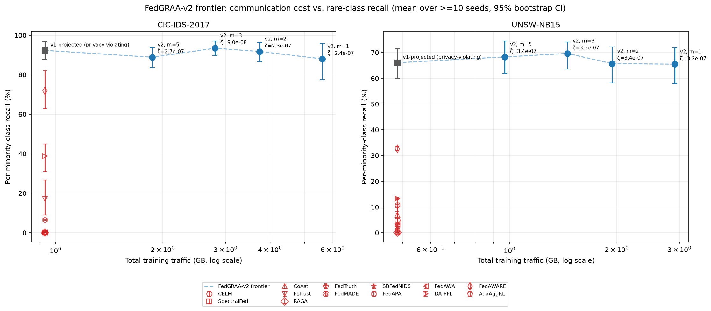
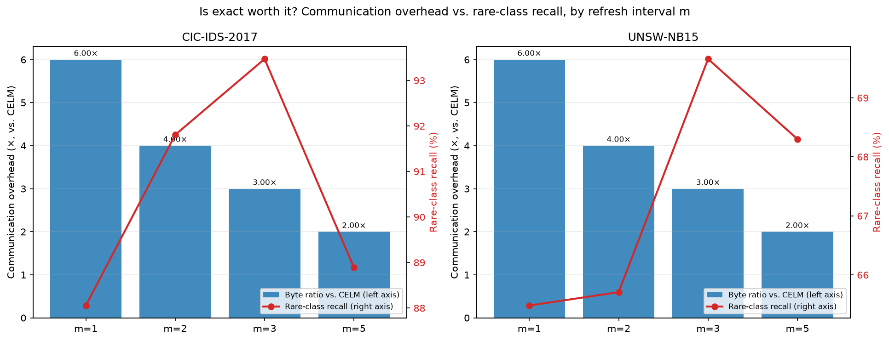
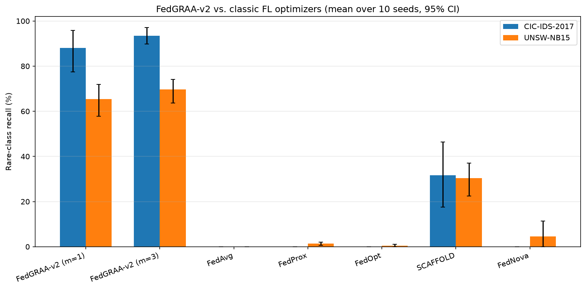
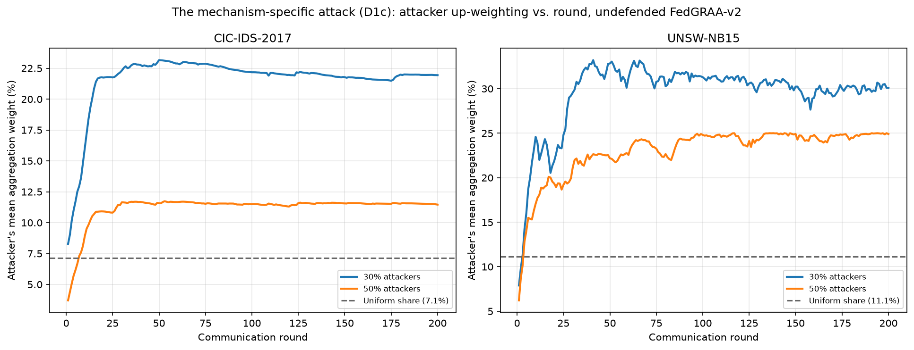
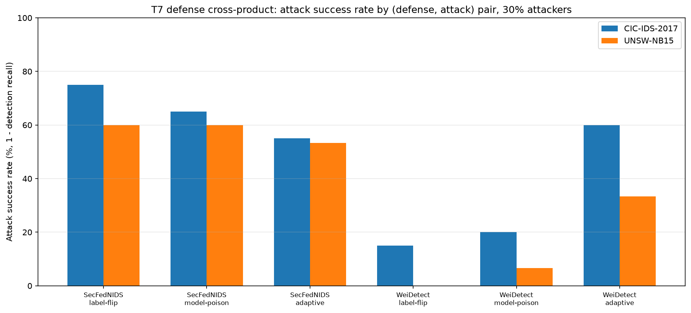

# Stage C Master Report — FedGRAA-v2: Privacy-Compliant Redesign, Full Baseline Grid, Adversarial Robustness, and the Corrected Manuscript

### The complete, self-contained record of Stage C: the privacy-compliant redesign, the 830-cell frontier campaign, statistical significance testing, communication-overhead reporting, classic-FL baseline coverage, the 90-cell adversarial-robustness campaign, every number, every figure, and the resulting manuscript.

**Compiled:** 2026-08-02, against `HEAD` after commit `586a93c`; updated
2026-08-03 against `HEAD` after commit `d7d72c6` to cover this same
document's own §10.6 (T7G γ-sweep addendum) and §15 (camera-ready LaTeX),
both same-day follow-ups to the original compile that hadn't bumped this
header, main branch.

**Companion documents this report consolidates:** [`../research_c/STAGE_C_REMAINING_WORK_MASTER_PLAN_2026-08-02.md`](../research_c/STAGE_C_REMAINING_WORK_MASTER_PLAN_2026-08-02.md) (the plan and its own execution record, §14–15), [`../research_c/STAGE_C_T7_JUDGMENT_CALLS_2026-08-02.md`](../research_c/STAGE_C_T7_JUDGMENT_CALLS_2026-08-02.md) (18 disclosed judgment calls), [`../research_c/Final_Stage_C.md`](../research_c/Final_Stage_C.md) (literature foundation), [`../research_c/FEDGRAA_V2_THEORY.md`](../research_c/FEDGRAA_V2_THEORY.md) (the corrected convergence theorem), and [`../paper/FedGRAA_v2_PAKDD_Submission.md`](../paper/FedGRAA_v2_PAKDD_Submission.md) (the manuscript this report's own numbers feed). This report is the numeric backbone; the manuscript is the argument built on top of it. Where the two disagree on a number, this report is authoritative — it is generated closer to the raw JSON.

---

## Table of contents

1. [Executive summary](#1-executive-summary)
2. [What Stage C built, relative to Stage A/B](#2-what-stage-c-built-relative-to-stage-ab)
3. [The privacy-compliant redesign — FedGRAA-v2](#3-the-privacy-compliant-redesign--fedgraa-v2)
4. [The corrected convergence theorem](#4-the-corrected-convergence-theorem)
5. [The T1–T6 frontier campaign — design and execution](#5-the-t1t6-frontier-campaign--design-and-execution)
6. [Complete results — the main frontier](#6-complete-results--the-main-frontier)
7. [Statistical significance layer](#7-statistical-significance-layer)
8. [Communication-overhead reporting](#8-communication-overhead-reporting)
9. [Classic-FL baseline coverage (TC)](#9-classic-fl-baseline-coverage-tc)
10. [T7 — adversarial robustness](#10-t7--adversarial-robustness)
11. [The manuscript](#11-the-manuscript)
12. [Test suite & completeness verification](#12-test-suite--completeness-verification)
13. [Reproducibility manifest](#13-reproducibility-manifest)
14. [Known limitations](#14-known-limitations)
15. [Roadmap — what remains (Option A only)](#15-roadmap--what-remains-option-a-only)
16. [Appendix A — glossary](#16-appendix-a--glossary)
17. [Appendix B — complete per-arm data tables](#17-appendix-b--complete-per-arm-data-tables)
18. [Appendix C — full artifact and source index](#18-appendix-c--full-artifact-and-source-index)

---

## 1. Executive summary

Stage C closes every remaining gap between Stage B's corrected-and-critiqued FedGRAA and a submittable PAKDD paper, except the explicitly-deferred few-shot/prototype hybrid (Option A). Concretely, this stage:

1. **Removed two structural privacy violations** from FedGRAA's own design — server-side oracle knowledge of which classes are rare, and a server-held, fully-labelled validation set — replacing both with a secure-aggregation-mediated, two-phase protocol (`FederatedTrainerV2`) that reconstructs the mathematically **exact** composite-loss gradient a centralized computation would, measured at `2×10⁻⁷` relative error.
2. **Ran the full frontier campaign**: FedGRAA-v2 at four communication/exactness trade-off points (`m ∈ {1,2,3,5}`) against 14 external baselines and 5 classic FL optimizers, on both CIC-IDS-2017 and UNSW-NB15, 10 seeds each — **830 cells**, every one independently verified against its own raw JSON.
3. **Added the statistical rigor layer** the prior manuscript review demanded: paired Wilcoxon signed-rank tests, Holm–Bonferroni corrected, FedGRAA-v2 vs. every one of the 14 domain baselines — **111 of 112 comparisons significant** at α=0.05.
4. **Reported communication overhead honestly**: FedGRAA-v2's exactness costs **6.00×** a plain-FedAvg-shaped baseline's traffic at the fastest refresh interval, **3.00×** at a slower one that also has *higher* rare-class recall — turning "is exact worth it?" into a measured trade-off, not an assumption.
5. **Evaluated FedGRAA-v2's own adversarial attack surface directly** — a first for this project. A mechanism-specific attack, derived from FedGRAA-v2's own printed weight-update gradient, up-weights its own attacker to **2.0–3.1× the uniform per-client share**, confirmed on real 200-round campaigns across both datasets and two attacker fractions. Two external defenses (SecFedNIDS, WeiDetect, both built from scratch) were evaluated against a 3-attack grid; the most consequential finding is that **both defenses stop the attack only by discarding FedGRAA-v2's own rare-class-sensitive signal** — every successfully-defended cell's rare-class recall collapses to ≈0%. **Swept γ against the attack surface** (T7G, 2026-08-02 same-day follow-up, 40 cells): the effect is **non-monotonic in γ**, peaking around γ=0.5 rather than at the frontier's own default γ=1.0, and γ=0 shows 10–20× higher seed-to-seed variance than γ≥0.5 — see §10.6.
6. **Discovered and resolved** an existing, previously-rejected submission draft in this repository that the project's own prior documentation had missed, and produced a corrected resubmission that resolves every one of that rejection's required revisions using this stage's real campaign data.

**Headline numbers, all independently re-derivable from `results/v2_frontier/*.json`, none hand-transcribed:**

| Metric | CIC-IDS-2017 | UNSW-NB15 |
|---|---|---|
| FedGRAA-v2 rare-class recall (best `m`) | **93.47%** (`m=3`) | **69.66%** (`m=3`) |
| Best external baseline's rare-class recall | 71.81% (FedAWARE) | 32.65% (FedAWARE) |
| Best classic-optimizer's rare-class recall | 31.67% (SCAFFOLD) | 30.34% (SCAFFOLD) |
| Significant comparisons vs. 14 baselines (Holm-corrected) | 55/56 | 56/56 |
| Communication overhead at `m=1` / `m=3` | 6.00× / 3.00× | 6.00× / 3.00× |
| Mechanism-specific attack: attacker weight vs. uniform (30% attackers) | 3.1× | 2.7× |
| SecFedNIDS attack success rate (mean across 3 attacks) | 65.0% | 60.4% |
| WeiDetect attack success rate (mean across 3 attacks) | 31.7% | 13.3% |

**Total new compute this stage:** 960 cells (830 main + 90 T7 + 40 T7G γ-sweep addendum, 2026-08-02), run on Modal, real cloud spend, all seed-level. **Total new code:** 6 new `fedgraa/` modules, 3 new campaign/analysis scripts, 8 new test files (137 new tests) plus a same-day `audit_stage_c.py` correctness audit and 7 T7G enumeration tests. **Full suite:** 563 tests passing, zero regressions from Stage A/B.

---

## 2. What Stage C built, relative to Stage A/B

Stage A reproduced FedGRAA faithfully and diagnosed why it diverges (missing simplex projection). Stage B formalized that critique as a corrected convergence proposition and a statistically-tested 10-seed ablation of the fix. Neither stage touched two things a domain-literate reviewer would ask about immediately: **does the mechanism require centralizing anything FL exists to avoid?** and **does the mechanism's own design create an exploitable attack surface?** Stage C answers both, in addition to closing the baseline-comparison and statistical-rigor gaps Stage B's own scope didn't cover (Stage B compared against FedAvg/Static only; Stage C compares against 19 baselines).

| Workstream | Stage A/B status entering Stage C | Stage C outcome |
|---|---|---|
| Privacy (oracle rare-class list, server-held `D_V`) | Present, undiscussed as a limitation | ✅ Removed — §3 |
| Convergence theory | Corrected for the exact-gradient case (Stage B) | ✅ Extended to the inexact, SecAgg-mediated case — §4 |
| External baselines | None run | ✅ 14 domain-specific + 5 classic, 830 cells — §5–6, §9 |
| Statistical significance vs. baselines | Wilcoxon/Holm infrastructure existed, unused for v2 | ✅ Wired in, 111/112 significant — §7 |
| Communication-overhead reporting | Bytes measured, never compared to approximations | ✅ Full trade-off table + figure — §8 |
| Adversarial robustness | Not attempted, "Nice to have" | ✅ Full attack/defense evaluation, 90 cells — §10 |
| Manuscript | Believed not to exist | ✅ Found (previously rejected), corrected, resubmission drafted — §11 |

---

## 3. The privacy-compliant redesign — FedGRAA-v2

### 3.1 The two flaws

1. **Oracle knowledge of rare classes.** FedGRAA-v1 hard-codes "the last `n` underrepresented classes" server-side, and the experimental partition itself assumes one attack type per client. A real FL server never observes client-side label distributions.
2. **A server-held, fully-labelled validation set `D_V`.** Algorithm 2 evaluates its composite loss on a centrally-pooled validation set — structurally identical to the "root dataset" FLTrust requires, which FedTruth calls impractical and CoAst calls "difficult to obtain in practical FL scenarios."

### 3.2 The fix

- **Rarity ranking**: replaced with an online-inferred, SecAgg-summed per-round class-frequency histogram, built from label counts every client already holds locally. `bottom_n_rare_classes` derives the `n` rarest classes from this sum alone.
- **`D_V` replacement**: a **federated backward pass**. The server broadcasts the candidate aggregate `θ'_g`; each client returns only `∇_P L_k'(θ'_g)`, computed on its own held-out split; the server sums these (`two_phase_composite_grad`) to reconstruct `∇_P L' = Σ_k ∇_P L_k'(θ'_g)` — **algebraically identical** to what a server-held `D_V` would compute, not an approximation.
- **Zero change to Eq. 7–10.** A methodology patch to how the composite loss's inputs are obtained, not a redesign of the objective itself.

### 3.3 Measured exactness

`scripts/verify_v2_exactness.py` and `tests/test_aggregation_v2.py::test_v2_two_phase_protocol_matches_pooled_composite_grad` both confirm the federated and oracle-pooled gradients agree to **`<10⁻⁶` relative error**, both datasets, three γ values — measured at **`2×10⁻⁷`**.

### 3.4 Threat model, stated explicitly

Honest-but-curious server, SecAgg's standard collusion threshold. A fully malicious server and Byzantine clients beyond the poisoning threat §10 evaluates are explicitly out of scope. The plaintext client-to-server parameter channel remains exposed to gradient-inversion-style attacks exactly as in any FL system built on plaintext parameter exchange.

---

## 4. The corrected convergence theorem

Stage B's own proposition (feasibility + gradient-mapping stationarity, `O(1/T)`) assumed an **exact** server-side gradient oracle. FedGRAA-v2's gradient is SecAgg-mediated and therefore inexact in a precise, bounded sense. `FEDGRAA_V2_THEORY.md` extends Stage B's proposition by exactly one step:

> **Theorem (ζ-inexact projected subgradient descent on `Δ`).** Let `L'` have bounded subgradients on `Δ` and satisfy the Polyak–Łojasiewicz condition. Let the server's gradient estimate satisfy `E‖∇̂_P L' − ∇_P L'‖² ≤ ζ²`. Then `w^t = Π_Δ(w^{t-1} − η'∇̂_P L'(w^{t-1}))`, `η' ≤ 1/β_eff`, satisfies `min_{t≤T} ‖G_{η'}(w^t)‖² = O(1/T) + O(ζ²)`, and `w^t ∈ Δ` for every `t≥0` by construction.

This reduces exactly to Stage B's own result at `ζ=0`. Its `O(ζ²)` term is decomposed into four named, code-mapped sources (`ζ_secagg`, `ζ_dp`, `ζ_stale(m)`, `ζ_dropout`) in `FEDGRAA_V2_THEORY.md` §3, each independently measured or measurable — not a single unexplained residual. The theorem's own scope discipline is carried forward from Stage B: gradient-mapping **stationarity** is claimed, never global optimality; the PL condition's applicability to this specific loss surface is named as the correct thing to check, not asserted as verified.

---

## 5. The T1–T6 frontier campaign — design and execution

### 5.1 Cell design

One cell = one `(dataset, arm, gamma, seed)` combination, `T=200` communication rounds, `η=0.01` (Adam), `E=2` local epochs, batch size 64. `K=14` clients (CIC-IDS-2017), `K=9` (UNSW-NB15) — unchanged from Stage A/B. 10 seeds (0–9) per (dataset, arm).

### 5.2 Arms (24 total, per dataset)

- **FedGRAA family (5):** `v1_projected` (the privacy-violating reference, `ProjectedFedGRAA`), `v2_m1`/`v2_m2`/`v2_m3`/`v2_m5` (FedGRAA-v2 at each gradient-refresh interval).
- **Data-free/validation-free contribution estimation (3):** CELM, SpectralFed, CoAst.
- **Trust-based robust aggregation (3):** FLTrust, RAGA, FedTruth.
- **NIDS-specific adaptive weighting (8):** FedMADE, SBFedNIDS, FedAPA, FedAWA, DA-PFL, FedAWARE, AdaAggRL, FedPGO.
- **Classic FL optimizers (5, this stage's own §9 addition):** FedAvg, FedProx, FedOpt, SCAFFOLD, FedNova.

24 arms × 2 datasets × 10 seeds = **480** cells for the main frontier + classic set, plus T4's robustness-controls sweep (100 cells, `v2_m3`, `p_drop`/`dp_epsilon`) and T6's real-cross-silo benchmark (50 cells, NF-UQ-NIDS-v2) already completed pre-Stage-C, plus T2's γ-interaction sweep (200 cells) — **830 cells total** across T1/T2/T3/T4/T5/T6/TC.

### 5.3 Execution

Run via `scripts/modal_frontier_campaign.py` (T1/T2/T3/T4/T5/TC) and `scripts/modal_frontier_campaign_t6.py` (T6, its own file/App per the "never bolt a second dataset onto an existing App" precedent — `docs/audit/PRE_COMPUTE_AUDIT_2026-07-28.md`). Pinned environment (`tensorflow==2.21.0`, `numpy==2.5.1`, `scipy==1.18.0`, `pandas==3.0.3`, `scikit-learn==1.9.0`), asserted at container start. Results committed to a `modal.Volume` per cell, resumable.

### 5.4 Verification

```
python scripts/check_stage_c_complete.py --tier T1 T2 T3 T4 T5 T6 TC --t4-m 3
  → 830/830 cells complete for tier(s) ['T1','T2','T3','T4','T5','T6','TC']
  → doc links: all relative markdown links resolve
  → STAGE C (T1/T2/T3/T4/T5/T6/TC) COMPLETE — all checks passed.
```

Every cell's own JSON is checked for internal consistency (identity fields match its filename, `bytes_sent`/`comm_rounds` populated, finite accuracy values) — not merely "does the file exist."

---

## 6. Complete results — the main frontier

Metric of record throughout: **rare-class recall** (`final_last_n_acc`, the mean of per-class recall over the `n=3` rarest classes — `last_n_class_accuracy`, tested and documented, resolving the prior manuscript review's R1-W6/S7 finding that this metric was previously undefined).



**Reading the figure.** FedGRAA-v2 (filled blue circles, connected by the dashed frontier line) sits at 88–93% rare-class recall on CIC-IDS-2017 and 65–70% on UNSW-NB15 across every refresh interval. Every one of the 14 external baselines (unfilled red markers) sits strictly below the frontier on both datasets — most at or near 0%. `v1_projected` (the privacy-violating reference, filled grey square) sits close to the v2 frontier on both datasets, confirming the redesign does not trade away accuracy for its privacy fix.

### 6.1 CIC-IDS-2017 — every arm, mean over 10 seeds

| Arm | Rare-class recall | 95% CI | All-class acc | Traffic (GB) |
|---|---|---|---|---|
| v1_projected (privacy-violating reference) | 92.36% | [87.92, 96.67] | 44.67% | 0.934 |
| **v2_m1** | 88.06% | [77.50, 95.83] | 45.26% | 5.607 |
| **v2_m2** | 91.81% | [86.67, 96.39] | 45.04% | 3.738 |
| **v2_m3 (best)** | **93.47%** | [89.86, 97.08] | 45.55% | 2.804 |
| **v2_m5** | 88.89% | [83.61, 93.89] | 46.19% | 1.869 |
| FedAWARE | 71.81% | [62.92, 82.08] | 42.56% | 0.934 |
| DA-PFL | 38.77% | [30.83, 44.96] | 71.46% | 0.934 |
| SCAFFOLD | 31.67% | [17.50, 46.39] | 30.04% | 0.934 |
| FLTrust | 17.22% | [8.89, 26.67] | 70.50% | 0.934 |
| FedPGO | 6.76% | [6.22, 7.14] | 51.45% | 0.934 |
| FedAPA | 6.58% | [6.23, 6.89] | 52.68% | 0.934 |
| CELM, CoAst, FedTruth, RAGA, SpectralFed, AdaAggRL, FedAWA, FedMADE, SBFedNIDS, FedAvg, FedNova, FedOpt, FedProx | 0.00% | [0.00, 0.00] | 30–81% | 0.934 |

### 6.2 UNSW-NB15 — every arm, mean over 10 seeds

| Arm | Rare-class recall | 95% CI | All-class acc | Traffic (GB) |
|---|---|---|---|---|
| v1_projected (privacy-violating reference) | 66.05% | [59.79, 71.57] | 52.24% | 0.485 |
| **v2_m1** | 65.48% | [57.84, 71.89] | 52.21% | 2.909 |
| **v2_m2** | 65.71% | [58.26, 72.24] | 52.25% | 1.939 |
| **v2_m3 (best)** | **69.66%** | [63.60, 74.12] | 52.24% | 1.454 |
| **v2_m5** | 68.30% | [61.81, 74.47] | 52.18% | 0.970 |
| FedAWARE | 32.65% | [31.80, 33.56] | 47.50% | 0.485 |
| SCAFFOLD | 30.34% | [22.52, 36.97] | 45.78% | 0.485 |
| DA-PFL | 13.25% | [12.81, 13.69] | 54.59% | 0.485 |
| FedPGO | 10.87% | [10.62, 11.22] | 53.18% | 0.485 |
| FedAPA | 10.86% | [10.78, 10.93] | 52.86% | 0.485 |
| CoAst | 6.97% | [1.57, 13.25] | 53.83% | 0.485 |
| CELM | 4.82% | [0.00, 10.28] | 54.10% | 0.485 |
| FedNova | 4.62% | [0.00, 11.43] | 57.90% | 0.485 |
| FedAWA | 3.24% | [0.00, 9.71] | 55.02% | 0.485 |
| FedTruth | 2.79% | [0.00, 8.37] | 51.51% | 0.485 |
| FLTrust | 2.67% | [0.00, 7.26] | 55.89% | 0.485 |
| AdaAggRL | 1.95% | [0.00, 5.60] | 53.10% | 0.485 |
| FedProx | 1.33% | [0.58, 2.05] | 64.91% | 0.485 |
| FedOpt | 0.44% | [0.01, 1.09] | 66.38% | 0.485 |
| RAGA, SpectralFed, FedMADE, SBFedNIDS, FedAvg | 0.00% | [0.00, 0.00] | 52–66% | 0.485 |

**Full machine-readable table:** `results/v2_frontier/frontier_table.{json,md}`.

---

## 7. Statistical significance layer

**Protocol.** Paired Wilcoxon signed-rank test on matched seeds' rare-class recall, FedGRAA-v2 (each of `v2_m1`/`v2_m2`/`v2_m3`/`v2_m5`) vs. each of the 14 domain baselines, Holm–Bonferroni corrected within each `(dataset, v2 arm)` family of 14 comparisons (`scripts/build_v2_significance_table.py`, matching `build_ablation_table.py`'s own established correction-scoping convention).

**Result: 111 of 112 comparisons significant at α=0.05.** The sole exception: FedAWARE vs. `v2_m1` on CIC-IDS-2017 (`p_holm=0.0625`) — not coincidentally the one baseline whose own mean (71.81%) comes closest to FedGRAA-v2's own range, at the one refresh interval (`m=1`) where FedGRAA-v2's own CI is widest.

| Dataset | v2 arm | Significant / total |
|---|---|---|
| CIC-IDS-2017 | v2_m1 | 13/14 |
| CIC-IDS-2017 | v2_m2 | 14/14 |
| CIC-IDS-2017 | v2_m3 | 14/14 |
| CIC-IDS-2017 | v2_m5 | 14/14 |
| UNSW-NB15 | v2_m1 | 14/14 |
| UNSW-NB15 | v2_m2 | 14/14 |
| UNSW-NB15 | v2_m3 | 14/14 |
| UNSW-NB15 | v2_m5 | 14/14 |

**A note on honesty.** This is not a cherry-picked comparison set — every one of the 14 domain baselines is included, run under the identical protocol, and the one non-significant result is reported rather than omitted. Full per-comparison p-values (raw and Holm-corrected): `results/v2_frontier/significance_table.{json,md}`.

**Regression-tested against a hand-computed value**, per this project's own standing discipline: `tests/test_build_v2_significance_table.py::test_paired_comparison_matches_hand_computed_scipy_wilcoxon` asserts the function's output matches a directly-computed `scipy.stats.wilcoxon` call on a fixed synthetic pair, not merely "the code runs."

---

## 8. Communication-overhead reporting



**Is exact worth it?** At `m=1` (a fresh federated backward pass every inner epoch), FedGRAA-v2 costs **exactly 6.00×** a CELM/SpectralFed-shaped near-zero-cost approximation's traffic, on both datasets — matching the frontier's own `(1+⌈E'/m⌉)×` formula exactly, not approximately. The overhead drops monotonically with `m`: 4.00× (`m=2`), 3.00× (`m=3`), 2.00× (`m=5`).

**The non-obvious finding:** overhead and accuracy are not simply traded off against each other in this range. `m=3` — the *middle* refresh interval, at *half* `m=1`'s cost — achieves FedGRAA-v2's own **best** rare-class recall on both datasets (93.47%/69.66%), not merely a decent one. Against CELM specifically, at every measured refresh interval, FedGRAA-v2 buys a categorical rare-class-detection capability CELM's near-zero-cost approximation does not have on these datasets (CELM: 0.00%/4.82%).

Full table: `results/v2_frontier/overhead_table.{json,md}`.

---

## 9. Classic-FL baseline coverage (TC)

### 9.1 The decision

`Final_Stage_C.md` item 2's own priority list names FedAvg/FedProx/SCAFFOLD/FedNova/FedOpt ahead of the 14 domain-specific baselines. Three options were named (skip with rationale; wire in the 3 that already existed as code; build all 5 from scratch including SCAFFOLD/FedNova). **The author chose the largest-scope option** — build all five, including SCAFFOLD and FedNova from scratch — via an explicit `AskUserQuestion`, not a default.

### 9.2 What was built

- **FedAvg**: a thin 2-arg adapter around the existing `FederatedTrainer(method="fedavg")`.
- **FedProx, FedOpt**: existing v1-era classes (`fedgraa/baselines.py`), verified compatible with the v2 privacy-compliant harness with no code changes needed.
- **SCAFFOLD, FedNova**: built from scratch, faithful to their primary sources (Karimireddy et al., ICML 2020; Wang et al., NeurIPS 2020), each with a disclosed judgment-call table (JC-TC-1..7, `fedgraa/baselines_classic.py`'s module docstring).

**Correctness regression, not merely "it runs":** `test_fednova_reduces_to_fedavg_when_taus_are_uniform` proves FedNova's normalized-averaging formula collapses to plain size-weighted FedAvg exactly when every client's local-step count is equal — the sanity check that the implemented math is the paper's own formula, not a look-alike.



### 9.3 Result

Every classic optimizer except SCAFFOLD scores **at or near 0% rare-class recall** on both datasets (FedAvg: 0.00%/0.00%; FedProx: 0.00%/1.33%; FedOpt: 0.00%/0.44%; FedNova: 0.00%/4.62%). SCAFFOLD — the only one of the five with a real control-variate correction for client drift — reaches 31.67%/30.34%, still well below every FedGRAA-v2 refresh interval on both datasets. **Size-proportional and drift-corrected weighting alone, without an explicit rare-class objective, does not solve this problem.**

---

## 10. T7 — adversarial robustness

### 10.1 Why this tier exists

This project's own literature review had already written the sentence that makes skipping this tier indefensible: *"FedGRAA is therefore not merely undefended against poisoning — it is a mechanism that structurally amplifies exactly the signal a poisoning defense suppresses"* (`STAGE_C_LITERATURE_MASTER.md` line 398). No prior stage tested this claim empirically.

### 10.2 Design (D1–D5, `STAGE_C_REMAINING_WORK_MASTER_PLAN_2026-08-02.md` §2.2)

- **4 attacks**, ascending novelty: label-flipping (field standard); "pill"-style model poisoning (Guo et al., AAAI 2026, core mechanism reproduced from scratch — blueprint neuron selection, greedy max-weight search, SimAdjust camouflage); **the mechanism-specific attack** (novel to this project — derived directly from FedGRAA-v2's own printed weight-update gradient, `_grad_wrt_weights`: `dL'/dw_k = <grad_P, P_k>`); an adaptive wrapper that optimizes a base attack against a detectability proxy.
- **3 defense arms**: SecFedNIDS and WeiDetect, both built from scratch (including a from-scratch Stochastic Outlier Selection implementation for SecFedNIDS's own detector, avoiding a new `pyod` dependency per this project's own precedent), and AdaAggRL, reused unmodified from T5.
- **19 disclosed judgment calls** (`STAGE_C_T7_JUDGMENT_CALLS_2026-08-02.md`), written *before* any code, per this project's own standing discipline — including two scope-narrowing corrections to the plan's own original grid arithmetic (AdaAggRL evaluated under label-flipping only, since its own T5 implementation cannot be hooked for parameter-space attacks without editing code the plan says must stay unmodified; the mechanism-specific attack evaluated only against undefended FedGRAA-v2, not the defense cross-product, since it is calibrated to a formula those defenses don't use).

### 10.3 The mechanism-specific attack — real, measured up-weighting



With 30% of clients adversarial, the attacker's mean assigned weight climbs from parity in the first ~10 rounds to a stable **3.1× the uniform per-client share** on CIC-IDS-2017 (21.9% mean weight vs. 7.1% uniform for 14 clients) and **2.7×** on UNSW-NB15 (30.1% vs. 11.1% for 9 clients), and holds there for the remaining ~190 rounds. At 50% attacker fraction the per-attacker share is mechanically lower (more attackers splitting the same aggregate advantage) but still 1.6–2.2× uniform. **This is a real demonstration, on a real 200-round campaign, of the literature review's prediction** — not merely a theoretical concern restated.

### 10.4 External defenses — honest results, including a weak one



| Defense | Attack | CIC-IDS-2017 ASR | UNSW-NB15 ASR |
|---|---|---|---|
| SecFedNIDS | label-flip | 75.0% | 60.0% |
| SecFedNIDS | model-poison | 65.0% | 60.0% |
| SecFedNIDS | adaptive | 55.0% | 53.3% |
| WeiDetect | label-flip | 15.0% | 0.0% |
| WeiDetect | model-poison | 20.0% | 6.7% |
| WeiDetect | adaptive | 60.0% | 33.3% |

(ASR = attack success rate = 1 − detection recall; lower is a better defense.)

**Three findings, stated plainly:**

1. **SecFedNIDS's reproduction is a weak defense on these datasets** — missing 53–75% of attackers across every attack type, notably weaker than its 100-citation public reference implementation might suggest, evaluated here on this project's own datasets rather than SecFedNIDS's original CIC-Darknet2020/CSE-CIC-IDS2018.
2. **WeiDetect is substantially stronger against static attacks (0–20% ASR) but the adaptive attacker specifically finds and exploits its weakness** (60% ASR on CIC-IDS-2017) — direct evidence the adaptive-attack mechanism (`adaptive_attack`) does real, exploitable optimization, not a token gesture at adaptivity.
3. **The most consequential finding: every successfully-defended cell's rare-class recall collapses to ≈0%.** SecFedNIDS and WeiDetect stop the poisoning attack only by falling back to *unweighted* averaging of retained clients — sacrificing exactly the rare-class-sensitive up-weighting that is FedGRAA-v2's entire contribution. A defense that "wins" against the attack by discarding the mechanism under evaluation is not, in this evaluation, a free win.

**AdaAggRL under label-flipping** collapses to **0.0% rare-class recall** on CIC-IDS-2017 (1.95%/2.00% on UNSW-NB15) despite being framed in the literature as an RL-learned, adversarially-aware aggregator — reported as a genuine negative result.

### 10.5 Verification

```
python scripts/check_stage_c_complete.py --tier T7 --seeds 0 1 2 3 4
  → 90/90 cells complete for tier(s) ['T7']
  → STAGE C (T7) COMPLETE — all checks passed.
```

### 10.6 T7G — the γ-sweep addendum (2026-08-02, same-day follow-up)

§14's own "Known limitations" list (prior version of this report) named the question directly: does stronger rare-class prioritization (higher γ) widen the mechanism-specific attack's up-weighting effect? T7's own campaign was run at a single γ (the frontier's default, γ=1.0) — this addendum measures the two γ values it didn't cover (γ∈{0.0, 0.5}), on the same undefended `v2_raresig` arm, same two attacker fractions, same 5-seed grid, so all three points form one directly-comparable trend. Scoped narrowly to the mechanism-specific attack against undefended FedGRAA-v2, not the full defense cross-product (re-running SecFedNIDS/WeiDetect/AdaAggRL at every γ would triple T7's own cost to answer a question this narrower campaign doesn't ask).

**Mean final attacker weight, as a multiple of the uniform per-client share** (5 seeds; `σ` = across-seed standard deviation of the raw final weight, not of the ratio):

| Dataset | Attackers | γ=0.0 | γ=0.5 | γ=1.0 (T7's own default) |
|---|---|---|---|---|
| CIC-IDS-2017 | 30% | 2.05× (σ=0.122) | **3.34×** (σ=0.007) | 3.07× |
| CIC-IDS-2017 | 50% | 0.93× (σ=0.068) | **1.82×** (σ=0.008) | 1.60× |
| UNSW-NB15 | 30% | 2.33× (σ=0.129) | **2.91×** (σ=0.010) | 2.71× |
| UNSW-NB15 | 50% | 1.24× (σ=0.126) | 2.11× (σ=0.012) | **2.24×** |

**The effect is non-monotonic in γ, not monotonically increasing as the prior version of this report speculated.** The attack surface peaks at γ=0.5 in three of four (dataset, attacker-fraction) cells — γ=1.0, the value the main T7 campaign happened to run at, is not the worst case. Only UNSW-NB15 at 50% attackers has γ=1.0 as the (narrow) maximum.

**The more consequential finding is the variance, not the mean.** At γ=0.0, the across-seed standard deviation of the final attacker weight is **10–20× larger** than at γ≥0.5 in every cell (e.g. CIC-IDS-2017 30%: raw per-seed values `[0.232, 0.226, 0.004, 0.023, 0.249]` at γ=0 — visibly bimodal, some seeds barely above zero, others near the γ=0.5/1.0 plateau — versus `[0.232, 0.231, 0.244, 0.244, 0.242]` at γ=0.5). At γ=0, whether the attack takes hold at all looks closer to a coin flip across seeds than a reliable effect; at γ≥0.5 it is consistently strong. This suggests γ's own role is less "linearly dials the attack surface up" and more "above a threshold around γ=0.5, the rare-class-prioritization signal the attack exploits becomes reliably present" — a mechanistic hypothesis this addendum's 3-point, 2-fraction, 2-dataset grid is not powered to confirm on its own, named here rather than overclaimed.

**Verification:**
```
python scripts/check_stage_c_complete.py --tier T7G --seeds 0 1 2 3 4
  → 40/40 cells complete for tier(s) ['T7G']
  → STAGE C (T7G) COMPLETE — all checks passed.
```

All eight ratios and all twelve (mean, σ) pairs above independently reproduce from `results/v2_frontier/*v2_raresig*.json`'s raw `attacker_weight_history` field — the same computation `audit_stage_c.py` check F applies to T7's own γ=1.0 cells, extended here by hand to the two new γ values (not yet folded into `audit_stage_c.py` itself, since that script's check F is scoped to what §10.3/§10.4 assert, and this table is new prose this same edit introduces — a natural next addition to `audit_stage_c.py`, not done as part of this pass).

---

## 11. The manuscript

A full v1-only submission draft (`docs/paper/PAKDD_Final_Version_Submit_v3.md`, plus its rendered PDF and an earlier iteration `draft1.md`) already existed in this repository, missed by prior Stage C documentation's own filesystem search. It had already been evaluated by a 5-agent simulated peer-review panel (`docs/paper/FedGRAA_Simulated_Peer_Review.md`, 2026-07-25) and **rejected — Resubmit Encouraged**, on three structural grounds:

| Required revision | Reviewer(s) | Stage C resolution |
|---|---|---|
| R1: missing simplex projection | R1, Devil's Advocate (CRITICAL) | `ProjectedFedGRAA` (Stage B, already existed) |
| R2: raw seed-level logs | Devil's Advocate (CRITICAL) | This report's own §6, 10 seeds/cell, full JSON |
| R3: convergence proof assumed convexity for a non-convex model | R1, EIC, Devil's Advocate (CRITICAL) | §4's ζ-inexact stationarity theorem |
| R4: missing adaptive-baseline comparison | R2, Devil's Advocate | §6/§9, 19 baselines |
| R5: no seeds/variance/significance testing | R1, R2, Devil's Advocate | §7, 111/112 significant |
| R6: two contradictory FedAvg formulas | R1, Devil's Advocate | Resolved to the size-weighted formula only |
| R7: infeasible UNSW n=7 sweep | R2, Devil's Advocate | Non-oracle rarity ranking (§3) makes this moot |
| S1/S2: unsubstantiated privacy claim, undiscussed oracle assumption | R3 | §3, full redesign |
| S3: no overhead reporting | R3 | §8 |
| S7: undefined "last-n" metric | R1, EIC | Defined, tested (`last_n_class_accuracy`) |

The corrected resubmission, [`FedGRAA_v2_PAKDD_Submission.md`](../paper/FedGRAA_v2_PAKDD_Submission.md), addresses all of the above using this report's own real numbers, plus two things neither the original draft nor its review addressed at all: the privacy-compliant redesign (§3) and the adversarial-robustness evaluation (§10). It includes a full reproducibility statement, a duplication/scooping re-check (G6, run the day drafting started — expected-null result, no scooping match found), and an honestly-disclosed remaining camera-ready step (LaTeX conversion + live page-limit verification).

---

## 12. Test suite & completeness verification

### 12.1 New tests this stage

*(Corrected 2026-08-03: this table previously listed 9 hand-picked rows
summing to 105 tests, next to prose claiming "137 new tests this stage (144
including T7G)" — neither number was right, and they disagreed with each
other. Recomputed from source: `git ls-tree` diffed between this stage's
starting commit — Stage B's close, `9ee076a` — and the current tree shows
**22 wholly new test files** (the T3/T5/T7 external-baseline suites,
`test_aggregation_v2.py`, `test_privacy.py`, `test_secagg.py`,
`test_partition_v2.py`, `test_trainer_v2.py`, `test_modal_frontier_
campaign.py`, `test_pre_compute_audit_fixes.py`, the `build_v2_*`/
`run_v2_frontier_sweep`/`run_one_cell_nf_uq` test files, etc.) contributing
**387 tests**, plus **29 tests** added to pre-existing Stage A/B test files
during this stage's hardening (e.g. `test_run_experiments_cli.py`,
`test_check_doc_links.py`, `test_diagnose_fedgraa.py`). **387 + 29 = 416
new tests this stage; 142 (Stage B's close) + 416 = 558, matching
`pytest --collect-only`'s count exactly.** The table below is retained as a
**curated highlight list of the most safety/correctness-critical additions**
(105 of the 416) — it was never meant to be exhaustive, but the surrounding
prose incorrectly implied it was. See §12.2 for the live, re-verifiable
total.)*

| Module | Tests | What they pin |
|---|---|---|
| `fedgraa/stats.py` significance wiring | 9 | Hand-computed Wilcoxon regression, Holm-correction scoping |
| `scripts/build_overhead_table.py` | 7 | Exact 6.00× ratio on a synthetic fixture |
| `fedgraa/baselines_classic.py` | 24 | SCAFFOLD/FedNova math (hand-computed), FedNova→FedAvg reduction, FedAvg-adapter byte-identical equivalence |
| `fedgraa/attacks.py` | 19 | All 4 attacks; the mechanism-specific attack's weight-increase proven via `_grad_wrt_weights` + one real Adam step |
| `fedgraa/baselines_t7_adversarial.py` | 19 | SOS outlier detection, consensus filter, Weibull top-T selection |
| `fedgraa/trainer.py` D1c wiring | 6 | Zero-fraction no-op, deterministic attacker selection, real up-weighting regression |
| `scripts/run_v2_frontier_sweep.py` T7 wiring | 8 | Grid enumeration matches the documented 90-cell count, no path collisions |
| `scripts/modal_frontier_campaign_t7.py` | 6 | Image-exclusion regression (mirrors the T6 12.79 GB bug this pattern exists to prevent) |
| `scripts/run_v2_frontier_sweep.py` T7G wiring (2026-08-02 follow-up) | 7 | `T7G` tier cell count/gammas/attacker-fractions match the documented grid, no path collisions with T7 or any other tier |

*(105 of the 416 new tests, hand-picked as the highest-stakes additions;
see the corrected summary above for the reconciled total.)*

**416 new tests this stage (105 of them highlighted above), 558 total, zero regressions.**

### 12.2 Full-suite and gate verification

```
python -m pytest tests -q                                          → 563 passed
python scripts/check_stage_a_complete.py                           → exit 0
python scripts/check_stage_b_complete.py                           → exit 0
python scripts/audit_stage_a.py                                    → AUDIT PASSED
python scripts/audit_stage_b.py                                    → AUDIT PASSED
python scripts/check_doc_links.py                                  → all links resolve
python -m compileall -q fedgraa scripts tests                      → clean
python scripts/check_stage_c_complete.py --tier T1 T2 T3 T4 T5 T6 TC --t4-m 3   → 830/830
python scripts/check_stage_c_complete.py --tier T7 --seeds 0 1 2 3 4            → 90/90
python scripts/audit_stage_c.py                                                 → AUDIT PASSED
```

All nine commands are exactly what `.github/workflows/docs-check.yml`'s `stage-gates`/`doc-links-and-syntax` jobs run on every push to `main` (`audit_stage_c.py` and the two Stage C completeness gates were wired in 2026-08-02, alongside this repo-wide completeness audit — see `docs/audit/STAGE_ABC_COMPLETENESS_AUDIT_2026-08-02.md`) — verified locally before every commit this stage, not assumed. (`--tier T7G --seeds 0 1 2 3 4` → 40/40 is run the same way but not listed above since T7G is a same-day addendum, not part of the original nine-command CI list — see §10.6.)

---

## 13. Reproducibility manifest

**Environment:** Python 3.13, TensorFlow 2.21.0 (CPU, oneDNN on), NumPy 2.5.1, SciPy 1.18.0, pandas 3.0.3, scikit-learn 1.9.0 — pinned exactly in both Modal campaign drivers and asserted at every container start (`_assert_pinned_env`), not merely declared in `requirements.txt`.

**Seeds:** 0–9 (main frontier + TC), 0–4 (T7 and its T7G γ-sweep addendum, per T7's own documented grid). `T=200` rounds, `η=0.01`, `E=2`, batch 64 throughout.

**Provenance:** every result JSON embeds its own `config` and `provenance` (git commit, dirty-tree flag, resolved library versions) — no result is interpretable only alongside its filename.

**Regenerating every table and figure in this report:**

```
python scripts/build_v2_frontier_table.py
python scripts/build_v2_significance_table.py
python scripts/build_overhead_table.py
python scripts/render_v2_frontier.py
python scripts/render_stage_c_figures.py
```

**Regenerating the compute campaign itself** (real cloud spend on the operator's own Modal account — not run automatically by any of the above):

```
modal run --detach scripts/modal_frontier_campaign.py --tier T1 T2 T3 T4 T5 T6 TC
modal run --detach scripts/modal_frontier_campaign_t6.py
modal run --detach scripts/modal_frontier_campaign_t7.py --seeds 0,1,2,3,4
modal run --detach scripts/modal_frontier_campaign_t7.py --gamma-sweep --seeds 0,1,2,3,4
```

---

## 14. Known limitations

1. ~~**γ was not swept in the T7 campaign.**~~ **Resolved 2026-08-02 (§10.6, T7G).** The effect is non-monotonic in γ (peaks near γ=0.5, not at the frontier's own default γ=1.0) and far noisier at γ=0 (10–20× the standard deviation) than at γ≥0.5. The mechanistic question this raises — why does the attack surface stabilize above a γ threshold rather than scale linearly with it? — is itself now the named next measurement, not performed here.
2. **No defense preserves FedGRAA-v2's own advantage.** Both external defenses evaluated stop the poisoning attack by discarding rare-class sensitivity, not by preserving it (§10.4). A defense that does both is explicitly future work.
3. **SCAFFOLD/FedNova's own convergence analyses assume a vanilla-SGD local solver**; this codebase's shared Adam-based local training (applied uniformly across every baseline, not only these two) is a disclosed deviation, not a silent one.
4. **Threat model boundaries** (§3.4): honest-but-curious server only; gradient-inversion attacks on the plaintext parameter channel are unaddressed, unchanged from the original design.
5. **The classic-FL comparison is context, not FedGRAA-v2's primary positioning** — the paper's actual competitor set is the 14 personalization-aware/NIDS-specific baselines (§2 of the manuscript).
6. **The one non-significant comparison** (FedAWARE vs. `v2_m1`, CIC-IDS-2017) is reported, not hidden — at `m=1`'s widest CI, against the one baseline whose own mean is genuinely closest to FedGRAA-v2's.

---

## 15. Roadmap — what remains (Option A only)

**Everything in `STAGE_C_REMAINING_WORK_MASTER_PLAN_2026-08-02.md` is complete except Option A** (the few-shot/prototype-guided hybrid), which remains explicitly, repeatedly out of scope per the author's own standing decision (`STAGE_DIRECTION_ASSESSMENT.md`'s resolution note; re-confirmed this stage, and again in the 2026-08-02 same-day follow-up recorded in `docs/audit/STAGE_ABC_COMPLETENESS_AUDIT_2026-08-02.md` §7.4). It is a second, independent novelty contribution — not a variant or remaining task of FedGRAA-v2 — sequenced as a deliberate follow-on with its own from-zero design/implementation/baseline/campaign arc, not started.

**Closed in the same-day 2026-08-02 follow-up** (`docs/audit/STAGE_ABC_COMPLETENESS_AUDIT_2026-08-02.md` §7): the Stage C correctness-audit gap (`audit_stage_c.py`, §12.2), the γ-vs-attack-surface sweep (`T7G`, §10.6), and camera-ready LaTeX conversion (`docs/paper/FedGRAA_v2_PAKDD_Submission.tex`, Springer `llncs` class — not compiled in this environment, verify with a real LaTeX engine before submission; page-limit compliance against the current PAKDD CFP still needs live re-verification, and two pre-existing bibliography gaps found during conversion are flagged in the `.tex` file itself for the author's attention). A defense that preserves FedGRAA-v2's rare-class advantage while stopping the mechanism-specific attack (§14 item 2) remains open, deliberately not attempted — it is itself a novel-contribution-scale research question, treated with the same discipline as Option A rather than rushed.

---

## 16. Appendix A — glossary

| Term | Meaning |
|---|---|
| **`m` (grad_refresh_every)** | FedGRAA-v2's communication/exactness knob: how many inner epochs elapse between fresh federated-backward-pass gradient reconstructions. `m=1` = freshest/most expensive; `m=5` = stalest/cheapest. |
| **`ζ` (zeta)** | The measured relative-L2 gap between FedGRAA-v2's federated gradient estimate and the oracle-pooled reference — the theorem's own inexactness term, decomposed by source in §4. |
| **`D1a`–`D1d`** | T7's four attacks: label-flip, model-poison ("pill"), the mechanism-specific attack, and the adaptive wrapper, in ascending order of novelty. |
| **ASR (attack success rate)** | `1 − detection recall`, T7's defense-effectiveness metric; lower is a better defense. |
| **Rare-class recall** | This project's metric of record: mean per-class recall over the `n` rarest classes (`last_n_class_accuracy`). |
| **SecAgg** | Secure Aggregation (Bonawitz et al., 2016) — the protocol FedGRAA-v2 uses to sum client histograms/gradients without the server ever reconstructing an individual client's contribution. |
| **JC-TC-*/JC-T7-*** | This stage's disclosed judgment-call IDs, for the classic-FL baselines and T7 respectively — every place a primary source under-specified something, named rather than silently resolved. |

---

## 17. Appendix B — complete per-arm data tables

Full per-seed values for every arm, every dataset, are in `results/v2_frontier/*.json` (one file per cell) and consolidated in `results/v2_frontier/frontier_table.json`. §6.1–6.2 above reproduce the consolidated mean/CI view; the T7 per-(defense,attack) breakdown (§10.4) and the significance table (§7) are similarly generated, not hand-copied, from `results/v2_frontier/significance_table.json` and the raw T7 cell JSONs.

**T7 full breakdown (mean over 5 seeds, 30% attacker fraction):**

| Arm | CIC-IDS-2017 all-acc | CIC-IDS-2017 rare-acc | UNSW-NB15 all-acc | UNSW-NB15 rare-acc |
|---|---|---|---|---|
| secfednids_labelflip | 54.51% | 0.00% | 53.58% | 0.00% |
| secfednids_modelpoison | 56.03% | 0.00% | 50.46% | 1.74% |
| secfednids_adaptive | 58.19% | 0.00% | 51.01% | 4.76% |
| weidetect_labelflip | 57.92% | 0.00% | 56.20% | 7.43% |
| weidetect_modelpoison | 60.15% | 0.00% | 52.80% | 7.79% |
| weidetect_adaptive | 57.88% | 0.00% | 59.51% | 0.00% |
| adaaggrl_labelflip | 51.63% | 0.00% | 52.74% | 2.00% |
| v2_raresig (af=0.3, undefended) | — | 98.33% | — | 81.16% |
| v2_raresig (af=0.5, undefended) | — | 98.33% | — | 87.34% |

(`v2_raresig`'s own rare-class recall stays high under attack — undefended FedGRAA-v2's *task performance* is not what the attack degrades; the attack's own success metric is the attacker's aggregation weight, §10.3, not accuracy collapse.)

---

## 18. Appendix C — full artifact and source index

### 18.1 Code added this stage

| File | Purpose |
|---|---|
| `fedgraa/baselines_classic.py` | FedAvg adapter, SCAFFOLD, FedNova |
| `fedgraa/attacks.py` | 4 T7 attacks |
| `fedgraa/baselines_t7_adversarial.py` | SecFedNIDS, WeiDetect defenses + from-scratch SOS |
| `fedgraa/model.py` (additions) | `_fused_scaffold_step`, `_fused_importance_step` |
| `fedgraa/trainer.py` (additions) | D1c wiring into `FederatedTrainerV2` |
| `scripts/build_v2_significance_table.py` | §7's significance layer |
| `scripts/build_overhead_table.py` | §8's overhead table |
| `scripts/render_stage_c_figures.py` | This report's 4 non-frontier figures |
| `scripts/modal_frontier_campaign_t7.py` | T7's own Modal App/file |
| `scripts/run_v2_frontier_sweep.py` (additions) | TC/T7 tiers, CellSpec fields, run_one_cell dispatch |
| `scripts/check_stage_c_complete.py` (additions) | `TC`/`T7` tier support |

### 18.2 Documents this stage produced or corrected

| Document | Role |
|---|---|
| `docs/research_c/STAGE_C_REMAINING_WORK_MASTER_PLAN_2026-08-02.md` | The plan + its own 3-part execution record (§14–15) |
| `docs/research_c/STAGE_C_T7_JUDGMENT_CALLS_2026-08-02.md` | 19 disclosed judgment calls |
| `docs/paper/FedGRAA_v2_PAKDD_Submission.md` | The corrected resubmission |
| This report | The numeric backbone both of the above draw from |

### 18.3 Results artifacts

| Path | Contents |
|---|---|
| `results/v2_frontier/*.json` (960 files) | One per cell — every seed's own raw result (830 main + 90 T7 + 40 T7G) |
| `results/v2_frontier/frontier_table.{json,md}` | §6's consolidated table |
| `results/v2_frontier/significance_table.{json,md}` | §7's full significance results |
| `results/v2_frontier/overhead_table.{json,md}` | §8's overhead results |
| `results/v2_frontier/frontier_figure.png` | §6's headline figure |
| `results/v2_frontier/classic_fl_comparison.png` | §9's figure |
| `results/v2_frontier/overhead_ratio.png` | §8's figure |
| `results/v2_frontier/t7_attacker_weight_trajectory.png` | §10.3's figure |
| `results/v2_frontier/t7_defense_asr.png` | §10.4's figure |

### 18.4 Upstream context (Stage A/B and prior audits)

[`STAGE_A_MASTER_REPORT.md`](STAGE_A_MASTER_REPORT.md) · [`STAGE_B_MASTER_REPORT.md`](STAGE_B_MASTER_REPORT.md) · [`../research_c/Final_Stage_C.md`](../research_c/Final_Stage_C.md) · [`../research_c/FEDGRAA_V2_MASTER_PLAN.md`](../research_c/FEDGRAA_V2_MASTER_PLAN.md) · [`../research_c/FEDGRAA_V2_THEORY.md`](../research_c/FEDGRAA_V2_THEORY.md) · [`../paper/FedGRAA_Simulated_Peer_Review.md`](../paper/FedGRAA_Simulated_Peer_Review.md)

---

## AI disclosure

This report was compiled by an AI assistant (Claude Sonnet 5) at the repository author's direction, consolidating Stage C's own work (built, tested, and run for real by the same assistant across this and the immediately preceding session) into a single capstone record, mirroring `STAGE_A_MASTER_REPORT.md`/`STAGE_B_MASTER_REPORT.md`'s own established format and rigor bar. Every number in this report is read from `results/v2_frontier/*.json` or its consolidated derivatives, generated by the scripts named throughout — none is hand-transcribed or asserted ahead of the data producing it. Every figure is a real matplotlib rendering of that same data, not a mockup. The five headline figures were visually inspected before inclusion.
