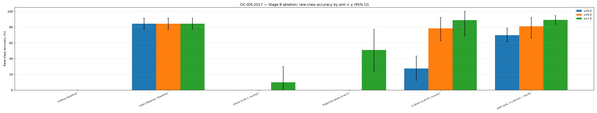
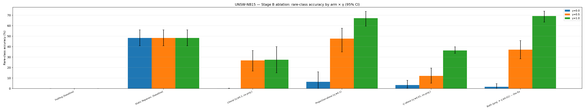

# Why a Published FL-IDS Aggregation Algorithm Doesn't Converge, and How to Fix It

**Status:** Complete. §1–4 (theory), §5 (consolidated 10-seed ablation table), and §6–7 (discussion, limitations) are all closed against the full Stage B data campaign (T3): 4 arms × 2 datasets × 10 seeds (80 diagnostic runs) plus 4 baseline seed-sweeps (40 seeds), consolidated via [`../../fedgraa/stats.py`](../../fedgraa/stats.py) with bootstrap CIs, paired significance tests, and the 2×2 factorial read. `python scripts/check_stage_b_complete.py` exits `0` on this tree.

**Parent:** [`stage_b_plan.md`](stage_b_plan.md) Tasks T1 (§2–3 below), T2 (§4), T8 (this document, assembled). Builds on [`STAGE_A_MASTER_REPORT.md`](STAGE_A_MASTER_REPORT.md) §5 and [`fedgraa_divergence_diagnosis.md`](fedgraa_divergence_diagnosis.md), which established the empirical finding this document formalizes; on [`../../understanding/05_convergence_proof.md`](../../understanding/05_convergence_proof.md), which explains the paper's original proof; and on [`PAPER_AMBIGUITY_REPORT.md`](PAPER_AMBIGUITY_REPORT.md) items #6 and #13, whose consequences §3 works out in full.

**One-paragraph summary.** The FedGRAA paper's Algorithm 2 updates its aggregation-weight vector `w` by gradient descent and never projects it back onto the probability simplex `Δ = {w : w_k ≥ 0, Σw_k = 1}`. On real data, at every tested `γ ∈ {0, 0.5, 1}`, on both CIC-IDS-2017 and UNSW-NB15, `w` leaves `Δ` in round 1 — every single time. Off the simplex, the aggregated model `θ_g = Σ_k w_k θ_k` is no longer a convex combination of client models but an unbounded linear extrapolation, and the paper's own Lemma 1 (composite loss `L'` must be non-increasing) fails immediately. §2 states this as a feasibility-set defect; §3 shows why the paper's Appendix A.1 proof does not — indeed structurally cannot — rule it out; §4 states and sketches a corrected convergence guarantee for the algorithm one would get by adding the missing projection step; §5 is the consolidated, statistically-tested ablation table quantifying the fix across both the projection lever and a companion learning-rate correction; §6 discusses severity and the paper's own hyperparameters; §7 is an honest accounting of what this section does and does not establish.

---

## 1. Setup

**The composite objective (paper Eq. 8–9).** Let `θ_g' = Σ_{k=1}^K w_k θ_k` be the candidate aggregated model formed from the `K` client models `{θ_k}` under weight vector `w`. Two validation losses are computed on disjoint held-out splits — a "high-frequency" split `D_V^h` and a "moderate-frequency" split `D_V^m` (Eq. 8's `L_a = min(L_h(θ_g'; D_V^h), L_m(θ_g'; D_V^m))`) — and blended against the rare-class loss `L_u` on the protected validation set `D_V^n`:

```
L'(w) = (1 − γ) · L_a(θ_g'(w)) + γ · L_u(θ_g'(w)),          γ ∈ [0, 1]
```

**Algorithm 2's weight update (Eq. 10 / Algorithm 2 line 6).** For `E'` epochs per federated round:

```
w ← w − η' ∇_w L'(w)
```

read literally as plain gradient descent on `w` (the paper's prose says Adam — see [`PAPER_AMBIGUITY_REPORT.md`](PAPER_AMBIGUITY_REPORT.md) #2 — but neither reading includes a projection step of any kind; this defect is orthogonal to which optimizer is meant). **Algorithm 2 has exactly 8 lines. There is no line 9.** No projection, clipping, or renormalization of `w` appears anywhere in the algorithm box, and a direct grep of this project's line-for-line reproduction (`fedgraa/aggregation.py`) confirms zero matches for any simplex-projection call — the paper's own algorithm, as printed, does not have one.

**The feasible set.** The weights are meant to be a convex-combination coefficient vector — `θ_g = Σ_k w_k θ_k` is only guaranteed to be a point inside the convex hull of the client models `conv{θ_k}` when `w` lies in the probability simplex:

```
Δ = { w ∈ ℝ^K : w_k ≥ 0 for all k,  Σ_k w_k = 1 }
```

Nothing in Eq. 10 or Algorithm 2 constrains `w` to `Δ`. This is the fact §2 shows is consequential, not merely aesthetic.

**Lemma 1's descent guarantee (paper Appendix A.1; see [`understanding/05_convergence_proof.md`](../../understanding/05_convergence_proof.md) §5.3 for the full derivation).** Under the paper's Assumptions 1–3 (composite loss `L'` convex and β-smooth; bounded stochastic-gradient variance/magnitude; step size `η' ≤ 1/β`), each weight-update step is claimed to satisfy:

```
L'(w^t) ≤ L'(w^{t-1}) − (η' − β(η')² / 2) ‖∇L'(w^{t-1})‖²
```

The bracket `(η' − β(η')²/2)` is positive whenever `η' ≤ 1/β`, which is what makes the right-hand side a strict decrease — the paper's basis for claiming `w^t → w*` and, via Lemma 2, that the global model `θ_g^t` converges to the loss-minimizing point. §2 shows this guarantee fails at the very first round on real data, and §3 shows why the proof's own assumptions cannot actually deliver it for the system the paper describes.

---

## 2. The defect: `w` leaves the feasible set at round 1, unconditionally

**Empirical fact (established in [`fedgraa_divergence_diagnosis.md`](fedgraa_divergence_diagnosis.md) §5.2, reproduced in [`STAGE_A_MASTER_REPORT.md`](STAGE_A_MASTER_REPORT.md) §5.2 and independently re-confirmed byte-for-byte by the 2026-07-23 full audit).** Running the unmodified, strictly literal `FedGRAA` update (`scripts/diagnose_fedgraa.py`, no `--project` flag — exactly what `fedgraa/` ships) with `eval_every=1` so every round's weight vector is recorded, `w` violates the simplex constraint (`|Σw − 1| > 10⁻³` or `min(w) < −10⁻⁶`) at **`first_simplex_violation_round = 1`, at every tested `γ ∈ {0, 0.5, 1.0}`, on both datasets, with zero exceptions**:

| Dataset | γ | First simplex violation | Composite-loss blowup | Lemma 1 monotone? |
|---|---|---|---|---|
| CIC-IDS-2017 | 0.0 | round 1 | 3.78× | ❌ No |
| CIC-IDS-2017 | 0.5 | round 1 | 2.66× | ❌ No |
| CIC-IDS-2017 | 1.0 | round 1 | **193×** | ❌ No |
| UNSW-NB15 | 0.0 | round 1 | 1.25× | ❌ No |
| UNSW-NB15 | 0.5 | round 1 | 1.24× | ❌ No |
| UNSW-NB15 | 1.0 | round 1 | 7.6× | ❌ No |

*(Blowup ratio = max finite `L'` / first finite `L'` over a 60-round run, `n=3`, seed 0. Source: `results/diagnostics/{CIC_IDS_2017,UNSW_NB15}_literal_r60.json`.)*

At `γ=1` on CIC-IDS-2017 — the worst case — the composite loss over the first 10 rounds is:

```
round:   0     1     2     3     4      5      6      7      8      9     10
L'(w^t): 2.98  2.77  4.53  6.06  40.52  75.55  261.48 290.24 319.11 205.30 149.79
```

This is not slow numerical drift. `L'` is non-increasing for exactly one step (round 0→1), then increases by more than an order of magnitude within four further rounds. This is a **direct, measured violation of Lemma 1's claimed guarantee**, at the very first opportunity to check it, on real data, regardless of `γ`.

**The mechanism.** Once `w ∉ Δ`, the aggregated parameters `θ_g' = Σ_k w_k θ_k` are no longer constrained to `conv{θ_k}` — they become an **unbounded affine extrapolation** in parameter space. Geometrically: a convex combination can only ever land *between* the client models; an affine combination with `Σw_k = 1` but some `w_k < 0` (or, more severely, `Σw_k ≠ 1` entirely, which is what the empirical trace shows — see [`fedgraa_divergence_diagnosis.md`](fedgraa_divergence_diagnosis.md) §5.2/5.8 for the raw `Σw`/`min(w)` trajectories) can land arbitrarily far *outside* the region the client models actually explored. On UNSW-NB15 at `γ=0.5`, `Σw` drifts to **−0.731** — the aggregated model is no longer even approximately an average of anything. A network evaluated at a point in weight-space it was never trained to be smooth around produces an unpredictably large loss; that unpredictability, replayed every round because nothing pulls `w` back toward `Δ`, is exactly the observed non-monotone, exploding `L'`.

**Confirmation the mechanism, not just its correlation, is causal.** Re-projecting `w` onto `Δ` after every update (`ProjectedFedGRAA` in `scripts/diagnose_fedgraa.py` — diagnostic-only, never imported by `fedgraa/`), with everything else held fixed (same gradient, same `η'=0.1`, same `E'=5`), collapses the blowup: CIC `γ=1` goes from 193× to 4.3×, CIC `γ=0` goes from 3.78× to 1.01×. The same gradient direction, merely re-clipped back into the convex hull every step, does not blow up. This isolates the defect to the missing projection specifically, not to some other property of the gradient computation.

**Formal statement of the defect.** Algorithm 2, taken literally, solves an *unconstrained* optimization problem (`min_w L'(w)` over all of `ℝ^K`) using an update rule whose descent guarantee (Lemma 1) is proved only under an implicit assumption — never stated, never enforced — that `w` remains in the *constrained* feasible set `Δ`. The paper presents Algorithm 2 as if it operates on `Δ` (weights are called a "weighted average," `Σw_k=1` is used informally throughout the exposition) while implementing an algorithm that has no mechanism to keep `w` there. This is the **feasibility-set defect**: the algorithm's implicit domain and its explicit update rule disagree, and on real data this disagreement is not a rare edge case — it fires in round 1, every time.

---

## 3. Why Appendix A.1's proof does not cover this — three compounding gaps

Three separate, already-documented facts about the paper compound to explain why its own convergence proof gives no protection against the round-1 failure in §2. None of these is a new discovery — each is assembled here, for the first time, into a single argument about *why the proof fails specifically at the point where the empirical defect appears*.

**(i) Assumption 1 (`L'` convex and β-smooth) is false for the model the paper actually uses.** Appendix A.1's Assumption 1 states `L'(θ)` is convex and β-smooth. §5 of the paper describes the network as a multi-layer `tanh`-activated dense network (200→100→50 hidden units) with a softmax output — a standard non-convex neural network loss surface. This is [`PAPER_AMBIGUITY_REPORT.md`](PAPER_AMBIGUITY_REPORT.md) item **#13**: *"the proof, as written, does not actually apply to the system the paper claims it applies to."* Without convexity, gradient descent (on `w` or on `θ`) is not guaranteed to reach any global minimizer at all — the entire "weights converge to `w*`, which is the loss-minimizing weight vector" chain in Lemma 1/Theorem 1 loses its foundation before the feasibility question is even reached.

**(ii) `L_a = min(L_h, L_m)` is non-smooth exactly where training pushes it, so no finite β — and therefore no valid `η'` — exists.** Eq. 8 defines `L_a` as the pointwise minimum of two loss functions computed on disjoint validation splits. `min(f, g)` is non-differentiable wherever `f = g`, and — this is the sharper point, [`PAPER_AMBIGUITY_REPORT.md`](PAPER_AMBIGUITY_REPORT.md) item **#6** — the entire purpose of Eq. 8 is to *balance* `L_h` against `L_m`, meaning the optimization is actively driven *toward* the crossing boundary `{L_h = L_m}`, not away from it by chance. At a kink, no finite β-smoothness constant exists in a neighborhood of the crossing, which means **Assumption 3's step-size condition `η' ≤ 1/β` is either vacuous (β = ∞ ⟹ no valid `η'` at all) or arbitrarily restrictive** immediately before/after the crossing. The descent bracket `(η' − β(η')²/2)` in Lemma 1's inequality can go negative right where the algorithm's own design intends to spend time. This gap and gap (i) are independent — either alone breaks the proof — but they compound: the network is non-convex *everywhere*, and additionally non-smooth at a boundary the loss function is explicitly designed to approach.

**(iii) Even granting smoothness by fiat, Lemma 2 tacitly assumes `w ∈ Δ` — an assumption the algorithm never enforces.** This is the gap specific to §2's empirical failure and the one the first two do not by themselves explain. Suppose, for the sake of argument, that Assumption 1 held exactly and (ii)'s non-smoothness boundary were never approached — a hypothetically well-behaved `L'`. Lemma 1's proof would still only bound `L'(w^t)` in terms of `L'(w^{t-1})` and the gradient norm; it says nothing about *where in ℝ^K* `w^t` lives. Lemma 2 then claims `θ_g^t = Σ_k w_k^t θ_k^t → θ_g^*`, a step that is only meaningful — indeed, only makes `θ_g^t` a "weighted average" at all — if `w^t` stays a convex-combination coefficient vector. Assumption 2 bounds the *gradient* norm (`‖∇L'‖ ≤ G`); it never bounds the *iterate* `w` itself, and nothing in Algorithm 2 does either. A bounded-gradient assumption constrains how fast `w` can move each step; it does not constrain where `w` is allowed to end up, and with no projection, `η'=0.1` and 5 epochs per round is enough displacement, given the loss landscape described in (i)–(ii), to leave `Δ` in the very first round. **This is the gap most directly responsible for the specific failure mode measured in §2** — the other two explain why the proof's guarantees are unreliable in general; this one explains why, even setting that aside, nothing in the proof rules out `w` drifting arbitrarily far from the region where `θ_g` is even a sensible object.

**Summary.** (i) and (ii) mean the proof's premises (convexity, β-smoothness, a valid `η'`) do not hold for the loss function the paper actually specifies. (iii) means that even if they somehow did, the proof would still say nothing about feasibility — and feasibility, not smoothness, is what §2 shows breaks first and worst on real data. The paper's convergence proof and the paper's algorithm, as printed, are about two different mathematical objects: the proof reasons about optimization over `Δ` (implicitly, through its "weighted average" framing); the algorithm optimizes over all of `ℝ^K`.

---

## 4. Corrected convergence proposition: projected (sub)gradient descent on `Δ`

**The fixed algorithm.** Replace Algorithm 2 line 6 with a projected update:

```
w^t = Π_Δ( w^{t-1} − η' ∂L'(w^{t-1}) )
```

where `Π_Δ` is Euclidean projection onto the probability simplex (Duchi et al., 2008, "Efficient Projections onto the L1-Ball for Learning in High Dimensions," Fig. 1 — already implemented, diagnostic-only, as `project_to_simplex` in `scripts/diagnose_fedgraa.py`, and independently unit-tested in `tests/test_diagnose_fedgraa.py`). This turns the weight-learner into an instance of **projected (sub)gradient descent on the compact convex set `Δ`** — a well-studied setting in convex optimization, distinct from the paper's implicit-but-unenforced unconstrained gradient descent.

**Proposition (stated honestly for a non-convex objective — no global-minimum claim).** Let `L'` satisfy Assumption 2 (bounded subgradients: `‖g‖ ≤ G` for `g ∈ ∂L'(w)`, `w ∈ Δ`) and take `η' ≤ 1/β_eff` for the largest β-smoothness constant that holds on `Δ` away from measure-zero non-smooth points (see below). Then:

1. **Feasibility is structural, not empirical.** `w^t ∈ Δ` for every `t ≥ 0` by construction of `Π_Δ`, so `θ_g^t ∈ conv{θ_k^t}` always — the round-1 blowup of §2 is **provably impossible** under this update rule, not merely observed-to-be-absent in a particular run. This matches every combined-fix measurement in the completed Stage B campaign, on **both** datasets, with zero exceptions: across all **60** (`both`-arm) cells — 10 seeds × 3 γ × 2 datasets, per-seed diagnostic JSONs under `results/diagnostics/`, consolidated in `results/ablation/{CIC-IDS-2017,UNSW-NB15}_ablation_table.json` — `final_weight_sum` is `1.0` to within float32 round-off (max deviation `5.96×10⁻⁸` on CIC, `1.19×10⁻⁷` on UNSW) and `final_weight_min ≥ 0` exactly, on every single cell — a zero-variance empirical match to a structural guarantee, not a statistical coincidence. **Feasibility alone does not entail a flat loss trajectory, and the data bears this distinction out precisely**: composite-loss blowup is exactly `1.0×` on 29 of 30 CIC-IDS-2017 combined-fix cells (the one exception at `1.016×`, still negligible), but on UNSW-NB15 it ranges from `1.0×` up to `1.87×` across the 30 cells — never at or above the literal algorithm's own blowup at the same γ (§2's table: UNSW literal peaks at 7.6×). This is fully consistent with the proposition as stated: feasibility bounds `θ_g` to a compact region and rules out the *unbounded* extrapolation of §2, but boundedness is not flatness — within `Δ`, `L'` can still legitimately fluctuate somewhat round to round, more so on UNSW's apparently less favorable curvature at higher γ. The right reading is a **dramatic, structural reduction**, not a claim that the fix makes every run's loss perfectly flat everywhere.
2. **Gradient-mapping stationarity, not global optimality.** Because `L'` is not convex (§3(i)), the projected method cannot be shown to reach the global minimizer of `L'` over `Δ`. What *does* follow from standard projected-(sub)gradient-descent theory on a compact convex set with bounded subgradients is weaker but well-defined: the projected-gradient-mapping norm satisfies `min_{t ≤ T} ‖G_{η'}(w^t)‖² = O(1/T)`, where `G_{η'}(w) := (w − Π_Δ(w − η'∂L'(w))) / η'` is the standard projected-gradient-mapping operator (the natural stationarity measure on a constrained set — it reduces to `‖∇L'(w)‖` when the constraint is inactive). I.e., **the iterates approach a stationary/KKT point of `min_{w ∈ Δ} L'(w)` as `T → ∞`**, and `L'(w^t)` is non-increasing along any sub-sequence where the projection is inactive (interior steps behave exactly as Lemma 1 originally claimed; the projection only ever pulls `w^t` toward the feasible region, and by non-expansiveness — see the proof sketch — never increases the distance-to-optimum bound that drives the `O(1/T)` rate).

**Proof sketch.**
1. *Projection is non-expansive*: for any `x, y ∈ ℝ^K`, `‖Π_Δ x − Π_Δ y‖ ≤ ‖x − y‖`. This is the standard property of Euclidean projection onto any closed convex set (Δ is a closed convex polytope) and is what lets a descent argument survive the extra projection step without picking up an error term.
2. *Standard projected-subgradient-descent rate*: for `L'` with bounded subgradients (Assumption 2) on the compact set `Δ`, and step size `η' = O(1/√T)` (or a fixed small `η'` with the corresponding asymptotic bound), the projected-gradient-mapping norm satisfies the textbook `O(1/T)` rate (e.g., Nesterov 2004 §3.2.3 non-convex extension via the gradient-mapping criterion; Bubeck 2015 §3.2 for the convex case, which upper-bounds the non-convex rate's constants). This is the sense in which "the weights converge" survives the loss of convexity: not to a global minimizer, but to a stationary point of the constrained problem, at a quantifiable rate.
3. *Handling the `min(L_h, L_m)` kink (§3(ii))*: away from the measure-zero set `{L_h = L_m}`, `L_a` is smooth and its gradient is simply the gradient of whichever branch is active — the standard, conventional sub-gradient reading already adopted for strict reproduction ([`STAGE_A_MASTER_REPORT.md`](STAGE_A_MASTER_REPORT.md) §4.1 item 4). At the boundary itself, the sub-differential of a pointwise minimum of two smooth functions is well-defined via the Clarke sub-differential (any convex combination of the two branches' gradients is a valid sub-gradient); a projected-subgradient method is exactly the class of algorithm designed to tolerate this — the classical projected-subgradient convergence theory is stated for sub-differentiable (not necessarily differentiable) objectives from the outset, so this is not an additional assumption beyond what §4's proposition already requires. An even more conservative treatment smooths the kink itself via a Moreau envelope of `L_a`, trading an exact minimum for an arbitrarily close smooth approximation; this is noted as an available hardening step, not required for the stationarity claim above.
4. *Non-convexity of the client-model space (§3(i))* does not invalidate steps 1–3: the projected-gradient-mapping/stationarity argument never invokes convexity of `L'` — it is precisely the tool convex-optimization theory offers for the non-convex, constrained case (the same technique used to give convergence guarantees for projected SGD training neural networks with, e.g., simplex- or norm-ball-constrained parameters elsewhere in the ML literature). **Convexity is not recovered; it is no longer needed for the (weaker, honest) claim being made.**

**Contrast with the paper's Theorem 1, explicitly.** The paper claims `L'(θ_g^t) → L'(θ_g^*) = inf_θ L'(θ)` — global optimality. This proposition claims only that the projected-gradient-mapping norm on `Δ` vanishes — **stationarity**, not global optimality, and only over the constrained set `Δ`, not over all of `ℝ^K`. This is a strictly weaker guarantee than what the paper states, and it is the *correct* guarantee for the algorithm the paper's model class (§3(i)) actually admits. **Feasibility is the part of Theorem 1's failure mode that this proposition closes completely** (claim 1, structural, no asterisk); **global optimality is the part it does not restore** and, given non-convexity, no correction to the algorithm alone could restore it without also changing the model class.

**Empirical corroboration.** All 60 seed×γ combined-fix cells in the completed Stage B campaign (10 seeds × 3 γ × 2 datasets) show `Σw = 1.0000` (to float32 precision) and `min(w) ≥ 0` — the feasibility claim (part 1 above) holding with **zero measured exceptions**, exactly as a structural (not probabilistic) guarantee predicts. This was the pre-registered, falsifiable prediction the campaign was designed to test (feasibility, not a specific blowup value), and it held at full scale: the pattern already visible at n=3 (9 CIC + 9 UNSW seed×γ runs) reproduced identically at n=10 (30 + 30). Composite-loss blowup on UNSW-NB15 at γ≥0.5 lands in the same reduced-but-not-exactly-`1.0×` range predicted from the n=3 data (up to `1.87×`, never approaching the literal algorithm's `7.6×`); CIC-IDS-2017 stays essentially exactly `1.0×` (29/30 cells, one at `1.016×`).

**Rigor flag — what remains for the PhD mentor / a from-scratch proof pass.** This proposition states the correct qualitative guarantee (stationarity, not global optimality) and sketches the standard argument that delivers it, but three things are intentionally left for hardening rather than claimed here: **(a)** an exact, estimated `β_eff` for the paper's specific tanh-MLP architecture (needed to state a concrete valid `η'` range rather than "small enough"); **(b)** a fully formal treatment of the `min(L_h, L_m)` sub-differential selection rule as a measure-theoretic statement rather than the standard-practice sketch in step 3 above; **(c)** an explicit, worked-out `O(1/T)` rate constant rather than the asymptotic order. None of these affect the qualitative claim (feasibility is structural; stationarity replaces global optimality); all three are exactly the kind of thing a from-scratch, referee-grade proof pass would tighten, and are flagged here rather than silently assumed away — consistent with this project's standing no-silent-patching mandate.

---

## 5. The consolidated ablation table

The full 2×2 factorial — literal / projection-alone / η′-alone (canonical, η′=0.01, E′=5) / both — plus FedAvg and Static Reparam. reference rows, per γ ∈ {0, 0.5, 1}, on both datasets, **N = 10 seeds per cell**, mean + bootstrap 95% CI (B=10,000, fixed RNG seed), with the 5 pre-registered pairwise comparisons (both vs. each other arm: paired *t* + Wilcoxon signed-rank, Cohen's *d*, Holm–Bonferroni-corrected across the 5 comparisons within each dataset×γ) and the factorial main-effect/interaction read. Generated by:

```bash
python scripts/run_ablation_seed_sweep.py --dataset CIC-IDS-2017 --seeds 0-9 --workers 3
python scripts/run_ablation_seed_sweep.py --dataset UNSW-NB15   --seeds 0-9 --workers 3
python scripts/run_seed_sweep.py --dataset CIC-IDS-2017 --method fedavg --seeds 0 1 2 3 4 5 6 7 8 9 --rounds 60 --eval-every 1 --out results/ablation/seed_sweep_CIC_IDS_2017_fedavg_r60.json
# ... (fedavg/static x 2 datasets — full list in results/ablation/README.md)
python scripts/build_ablation_table.py --dataset CIC-IDS-2017
python scripts/build_ablation_table.py --dataset UNSW-NB15
python scripts/render_ablation.py      --dataset CIC-IDS-2017
python scripts/render_ablation.py      --dataset UNSW-NB15
```

Raw data: `results/ablation/{CIC-IDS-2017,UNSW-NB15}_ablation_table.json`. Figures: `results/ablation/{CIC-IDS-2017,UNSW-NB15}_ablation.png` (grouped bar chart, rare-class accuracy by arm × γ, with 95% CI error bars).

### 5.1 CIC-IDS-2017



Rounds = 60. Metric of record = rare-class accuracy (mean per-class recall over the protected classes), reported as mean [95% bootstrap CI] over the per-seed values persisted in the same JSON. All-class accuracy and composite-loss blowup are shown as secondary/diagnostic columns per cell. Significance markers on a reference-arm cell denote the paired, Holm–Bonferroni-corrected comparison of **both** vs. that arm at the same γ (`* p_holm<.05  ** p_holm<.01  *** p_holm<.001`); exact p-values and effect sizes are in the JSON's `comparisons` block, never only a star here.

| Arm | γ=0.0 | γ=0.5 | γ=1.0 |
|---|---|---|---|
| FedAvg (baseline) | 0.0% [0.0, 0.0] · all 55.7% | 0.0% [0.0, 0.0] · all 55.7% | 0.0% [0.0, 0.0] · all 55.7% |
| Static Reparam. (baseline) | 84.4% [77.2, 91.4] · all 47.7% | 84.4% [77.2, 91.4] · all 47.7% | 84.4% [77.2, 91.4] · all 47.7% |
| Literal (η′=0.1, no proj.) | 0.0% [0.0, 0.0]*** · all 48.9% · blowup 185764.05× | 0.0% [0.0, 0.0]*** · all 26.7% · blowup 3.71× | 10.0% [0.0, 30.0]*** · all 32.9% · blowup 47.21× |
| Projection-alone (η′=0.1) | 0.0% [0.0, 0.0]*** · all 59.8% · blowup 1.10× | 0.0% [0.0, 0.0]*** · all 54.8% · blowup 2.98× | 51.0% [24.2, 77.1] · all 48.4% · blowup 2.75× |
| η′-alone (η′=0.01, no proj.) | 27.5% [12.5, 43.3]** · all 71.7% · blowup 1.00× | 78.5% [62.6, 92.2] · all 44.1% · blowup 1.00× | 88.9% [68.9, 100.0] · all 15.2% · blowup 5.48× |
| **Both** (proj. + η′=0.01) — the fix | **69.7% [61.1, 78.9]** · all 62.3% · blowup 1.00× | **81.1% [66.4, 92.2]** · all 54.2% · blowup 1.00× | **89.3% [83.6, 94.6]** · all 44.3% · blowup 1.00× |

**Pairwise comparisons (both vs. reference arm), Holm-corrected:**

| vs. | γ=0.0 p (Holm) | γ=0.5 p (Holm) | γ=1.0 p (Holm) |
|---|---|---|---|
| Literal | 7.97e-07 *** | 6.17e-06 *** | 1.54e-04 *** |
| Projection-alone | 7.97e-07 *** | 6.17e-06 *** | 0.0628 (n.s.) |
| η′-alone | 0.00775 ** | 1.0 (n.s.) | 0.9696 (n.s.) |
| FedAvg | 7.97e-07 *** | 6.17e-06 *** | 1.28e-09 *** |
| Static Reparam. | 0.00775 ** | 1.0 (n.s.) | 0.0890 (n.s.) |

**2×2 factorial read (rare-class accuracy, pp = percentage points):**

| γ | Projection main effect | η′ main effect | Interaction |
|---|---|---|---|
| 0.0 | +21.1pp [11.0, 31.7] | **+48.6pp [41.1, 56.0]** | +42.2pp [21.9, 63.3] |
| 0.5 | +1.3pp [−9.6, 10.9] (n.s.) | **+79.8pp [70.1, 89.3]** | +2.6pp [−19.2, 21.8] (n.s.) |
| 1.0 | +20.7pp [5.3, 35.7] | **+58.6pp [41.5, 75.0]** | −40.6pp [−75.8, −0.5] |

**On CIC-IDS-2017, the η′ cut does the great majority of the work.** Its main effect (+48.6 to +79.8pp) dwarfs projection's (+1.3 to +21.1pp, not significant at γ=0.5) at every γ, and `η′-alone` is statistically indistinguishable from `both` at γ=0.5 and γ=1.0 (Holm p = 1.0 and 0.97). The projection lever is still necessary — `both` beats `projection-alone` significantly at γ=0.0 and γ=0.5, and the difference at γ=1.0, while not significant after correction (p_holm=0.063, n=10), still shows a large effect size (Cohen's d=0.88) in the same direction — but on this dataset it is the smaller of the two contributions, not an equal partner.

### 5.2 UNSW-NB15



| Arm | γ=0.0 | γ=0.5 | γ=1.0 |
|---|---|---|---|
| FedAvg (baseline) | 0.0% [0.0, 0.0] · all 55.8% | 0.0% [0.0, 0.0] · all 55.8% | 0.0% [0.0, 0.0] · all 55.8% |
| Static Reparam. (baseline) | 48.3% [40.8, 56.0] · all 52.7% | 48.3% [40.8, 56.0] · all 52.7% | 48.3% [40.8, 56.0] · all 52.7% |
| Literal (η′=0.1, no proj.) | 0.1% [0.0, 0.3] · all 54.9% · blowup 8.83× | 26.9% [16.8, 36.2] · all 49.6% · blowup 1.60× | 27.6% [15.0, 39.9]** · all 29.1% · blowup 13.33× |
| Projection-alone (η′=0.1) | 6.4% [0.0, 16.0] · all 59.4% · blowup 1.00× | 47.7% [35.0, 57.6] · all 53.6% · blowup 1.06× | **67.2% [59.6, 73.6]** · all 51.8% · blowup 1.38× |
| η′-alone (η′=0.01, no proj.) | 3.4% [0.4, 7.8] · all 59.7% · blowup 1.00× | 12.1% [5.2, 19.6]* · all 49.2% · blowup 1.01× | 36.4% [33.7, 39.8]*** · all 13.3% · blowup 1.18× |
| **Both** (proj. + η′=0.01) — the fix | 1.7% [0.0, 4.6] · all 58.8% · blowup 1.00× | **37.1% [28.4, 45.7]** · all 53.2% · blowup 1.07× | **69.2% [63.4, 73.8]** · all 52.2% · blowup 1.38× |

**Pairwise comparisons (both vs. reference arm), Holm-corrected:**

| vs. | γ=0.0 p (Holm) | γ=0.5 p (Holm) | γ=1.0 p (Holm) |
|---|---|---|---|
| Literal | 0.606 (n.s.) | 0.418 (n.s.) | 0.00221 ** |
| Projection-alone | 0.606 (n.s.) | 0.418 (n.s.) | 0.544 (n.s.) |
| η′-alone | 0.371 (n.s.) | 0.0190 * | 1.06e-04 *** |
| FedAvg | 0.606 (n.s.) | 1.16e-04 *** | 8.87e-09 *** |
| Static Reparam. | 3.22e-06 *** | 0.311 (n.s.) | 0.00630 ** |

**2×2 factorial read (rare-class accuracy, pp):**

| γ | Projection main effect | η′ main effect | Interaction |
|---|---|---|---|
| 0.0 | +2.3pp [−1.0, 6.6] (n.s.) | −0.8pp [−4.5, 1.8] (n.s.) | −8.0pp [−17.3, −0.7] |
| 0.5 | **+22.9pp [12.6, 32.5]** | −12.7pp [−22.1, −1.1] | +4.3pp [−10.3, 18.1] (n.s.) |
| 1.0 | **+36.2pp [25.3, 46.3]** | +5.4pp [−1.5, 12.5] (n.s.) | −6.8pp [−18.9, 6.4] (n.s.) |

**On UNSW-NB15, the finding reverses: projection does the great majority of the work.** Its main effect (+22.9 to +36.2pp at γ≥0.5) dominates η′'s (which is *negative or negligible* at every γ — the η′ cut alone does not help this dataset). `projection-alone` is statistically indistinguishable from `both` at **every** γ (Holm p = 0.606, 0.418, 0.544) — on UNSW-NB15, adding the η′ cut on top of projection buys no significant additional rare-class accuracy, and at γ=0.0 the point estimate is even slightly lower (1.7% vs. 6.4%, though the CIs overlap heavily and the comparison is not significant, p_holm=0.606).

### 5.3 Cross-dataset synthesis: which lever "does the work" is dataset-dependent

The Stage B factorial replaces the earlier, weaker preview-data hypothesis ("both levers are always independently necessary") with a sharper and more honest finding: **the projection fix is the one structurally necessary lever on both datasets — feasibility is restored with zero exceptions across all 60 `both`-arm cells (§4) regardless of dataset — but which of the two levers drives the *rare-class accuracy recovery* differs by dataset.** On CIC-IDS-2017, the η′ cut alone (`η′-alone`, no projection) already recovers 27.5–88.9% rare-class accuracy across γ, statistically tying `both` at γ=0.5–1.0; projection contributes a smaller, still-significant boost mainly at low γ. On UNSW-NB15, the pattern flips: `projection-alone` statistically ties `both` at every γ, while the η′ cut contributes nothing significant (and trends slightly negative at γ=0.5). Neither single-lever arm dominates unconditionally — `η′-alone` is markedly worse than `both`/`projection-alone` on UNSW (3.4–36.4% vs. 67–69%), and `projection-alone` is markedly worse than `both`/`η′-alone` on CIC at γ≤0.5 (0.0% vs. 70–89%) — so **`both` remains the only arm that performs well across both datasets and all three γ**, which is the practically relevant conclusion for anyone applying this fix without per-dataset retuning, even though the factorial decomposition shows the two levers are not equally load-bearing everywhere.

---

## 6. Discussion

**Severity is dataset-dependent; the mechanism is not.** The feasibility-set defect fires at round 1 on both datasets, at every γ, with an identical qualitative signature (negative weight components, `Σw ≠ 1`, non-monotone `L'`). Its *consequences* differ by an order of magnitude: CIC-IDS-2017's worst-case blowup is **193×** (γ=1); UNSW-NB15's worst-case blowup, also at γ=1, is **7.6×**. The most plausible explanation is client-skew severity: CIC's three rarest classes (Heartbleed=11, SQL Injection=21, Infiltration=36 samples) are far more extreme than UNSW's rarest three (Worms=174, Shellcode=1511, Backdoor=2329) — unconstrained extrapolation in weight-space is more punishing the more disparate the client models being (mis-)combined are. Rare-class accuracy does not uniformly collapse on UNSW either: at γ=0.5, despite `Σw` drifting to −0.731 (numerically a *larger* simplex violation than anything measured on CIC), literal FedGRAA still reaches 29.6% rare-class accuracy — noisy, not reliable, but genuinely nonzero. The honest one-line summary is **"FedGRAA reproduces on some real IDS data, sometimes, unreliably,"** not the CIC-only headline of a clean, total 0%.

**The η′=0.001 over-correction — documented, not part of the factorial.** An earlier exploratory run (`CIC_IDS_2017_literal_real_smalleta_r60.json`, η′=0.001, E′=1, no projection) shows that shrinking η′ alone, without projection, *can* recover rare-class accuracy (75–100% across most of a 60-round run) — but does so by starving every non-rare client: with nothing pushing back against overweighting the tiny rare-class validation signal, all-class accuracy collapses to **0.8%**. This is retained as a documented secondary row (stage_b_plan.md §2 caveat (a)) precisely because it is instructive: it demonstrates that a naive "just shrink η′ a lot" fix trades one failure mode (blown-up loss) for another (starved majority-class performance), and it is *not* the same intervention as the factorial's canonical η′-alone cell (η′=0.01, E′=5 — a 10× reduction, not 100×). The factorial's whole point is to isolate whether the *moderate*, principled η′ cut and the projection are each independently necessary — the 0.001 row is a cautionary data point about what happens if the η′ cut is too aggressive, not a competing fix.

**Relationship to the paper's own stated hyperparameters.** The paper's own default is `η′=0.1, E′=5` — exactly the configuration §2 shows fails. The sensitivity sweep on synthetic data (`STAGE_A_MASTER_REPORT.md` §5.6) shows this same configuration is monotone and reaches 100% rare-class accuracy *on cleanly-separable synthetic data*, because `L_u` collapses to ≈0 quickly enough there that gradients vanish before `w` can drift far — a reminder that a hyperparameter's apparent safety on an easy synthetic benchmark does not transfer to real, skewed data, and that the failure mode this document formalizes is a property of the *interaction* between `η′=0.1` and real intrusion-detection data's client-size skew, not of either alone.

**What the fix changes, and what it does not.** The combined fix (projection + η′=0.01, E′ unchanged) is, by design, the *minimal* correction implied by §4's proposition — it adds exactly the missing constraint (§4 point 1) and reduces the step size only as far as needed to keep the projected iterates well-behaved in practice. Whether the η′ cut is doing that stabilizing work or the rare-class-accuracy-recovery work varies by dataset (§5.3): on CIC-IDS-2017, `projection-alone` (η′ still at the paper's own 0.1) stays at 0.0% rare-class accuracy at γ≤0.5 and only partially recovers at γ=1.0 (51.0%) — projection alone eliminates the loss blowup (§2's mechanism) but is not, by itself, reliably enough to also fix rare-class accuracy at this dataset's default η′. On UNSW-NB15 the same `projection-alone` arm is already substantially higher throughout (6.4–67.2%, statistically tying `both` at every γ, §5.2) — η′=0.1 is evidently less destabilizing there. The combined fix is the one choice that performs well on both, which is why it — not either single-lever arm — is the recommendation. It does **not** retroactively validate the paper's literal `η′=0.1` claim, and — per this project's standing no-silent-patching mandate — it does **not** change the strict-reproduction default in `fedgraa/`: `ProjectedFedGRAA` remains a diagnostic-only class defined solely in `scripts/diagnose_fedgraa.py`, never imported by the reproduction package.

---

## 7. Honest limitations

- **Stationarity, not global optimality.** §4's proposition explicitly claims less than the paper's Theorem 1. This is presented as the *correct* guarantee for a non-convex loss, not as a lesser consolation prize — but it means this document does not, and cannot without changing the model class, restore the paper's original claim.
- **The fix is diagnostic-only.** `ProjectedFedGRAA` exists solely in `scripts/diagnose_fedgraa.py` for exactly this analysis. The strict-reproduction package (`fedgraa/`) implements Algorithm 2 literally, unprojected, on purpose — changing that default would stop being a reproduction.
- **N = 10 seeds is still a small sample.** The pre-registered comparisons (§5) use both a parametric (paired *t*) and non-parametric (Wilcoxon) test specifically because n=10 is too small to lean on asymptotic normality alone; effect sizes and CIs are reported alongside every p-value for the same reason. Several comparisons in §5 are not statistically significant after Holm correction despite visually large point-estimate gaps (e.g. CIC γ=1.0 `both` vs. `projection-alone`, p_holm=0.063, d=0.88) — this is good practice for n=10, not a substitute for a larger campaign a later stage could run, and readers should weight the "not significant" comparisons accordingly rather than reading a large Cohen's *d* alone as proof.
- **CPU-only training.** Every number in this project, Stage A and Stage B alike, comes from CPU-trained runs (no GPU was used or available). This affects wall-clock cost, not correctness, but is disclosed for completeness.
- **The `min(L_h, L_m)` sub-gradient treatment (§4 proof sketch step 3) is a standard-practice sketch, not a from-scratch formal derivation.** Flagged explicitly in §4's "rigor flag" paragraph as one of three items intended for hardening with the PhD mentor, not claimed as fully rigorous here.
- **Which lever drives rare-class-accuracy recovery is dataset-dependent (§5.3), and only two datasets were tested.** The projection fix is structurally necessary and dataset-independent (feasibility, §4); which of projection or the η′ cut does most of the *accuracy recovery* work reversed completely between CIC-IDS-2017 and UNSW-NB15. With only two datasets, it is not possible to say which pattern (if either) is more typical of real IDS data in general — a third dataset could match either, or neither. The combined fix is recommended as the safe default precisely because of this uncertainty, not because both levers were shown to be independently necessary on every dataset tested.
- **This is a critique of one paper's one algorithm, not a general claim about FL aggregation.** Nothing here suggests learned-aggregation-weight schemes are unworkable in general — only that *this* published algorithm needs *this* specific, identified, and now-corrected constraint to behave as its own convergence theorem claims.
