# FedGRAA

[](LICENSE)
[](https://github.com/N1KH1LT0X1N/FedGRAA/actions/workflows/docs-check.yml)
[](FedGRAA/requirements.txt)
[](FedGRAA/tests)
[](FedGRAA/docs/current/STAGE_A_MASTER_REPORT.md)
[](FedGRAA/docs/current/STAGE_B_MASTER_REPORT.md)
[](FedGRAA/docs/current/STAGE_C_MASTER_REPORT.md)

Independent, statistically-tested reproductions of published ML papers —
built to find out whether the numbers actually hold up, and to show the
work either way.

This is a solo research repo, not a framework or a library. Every project
here follows the same discipline: reimplement the paper faithfully first,
measure honestly, and if something doesn't reproduce, diagnose *why*
instead of quietly patching it into working — then go further and build
the corrected, novel extension a top-tier venue would actually want to
see. Automated **completeness gates** and **correctness audits** (see
[§ Why this repo is organized the way it is](#why-this-repo-is-organized-the-way-it-is))
exist so none of that has to be taken on faith: every number below is
independently re-derived from raw persisted JSON in CI, on every push.

## By the numbers

| | |
|---|---|
| **3/3** project stages complete | Stage A (reproduction) → Stage B (diagnosis + fix + theory) → Stage C (novel extension) |
| **565** tests passing | gradient correctness, statistics, adversarial robustness, doc-link integrity — [`pytest tests`](FedGRAA/tests) |
| **960** Stage C compute cells | 830 main frontier + 90 adversarial-robustness (T7) + 40 γ-sweep addendum (T7G), all seed-level, all on real cloud compute (Modal), all independently re-verified against their own raw JSON |
| **19** baselines FedGRAA-v2 is measured against | 14 domain-specific FL/NIDS methods + 5 classic FL optimizers (FedAvg, FedProx, FedOpt, SCAFFOLD, FedNova) |
| **111 / 112** Holm-corrected significance tests | FedGRAA-v2 vs. every one of the 14 domain baselines, paired Wilcoxon, both datasets — the one exception is reported, not hidden |
| **2** real intrusion-detection datasets | CIC-IDS-2017 (~2.8M rows) and UNSW-NB15, both forensically SHA-256-verified against canonical distributions |
| **~90** markdown documents | every relative link checked in CI — [`scripts/check_doc_links.py`](FedGRAA/scripts/check_doc_links.py) |

## Table of contents

- [Flagship project: FedGRAA — reproduction, diagnosis, and extension](#flagship-project-fedgraa--reproduction-diagnosis-and-extension)
  - [Stage A — faithful reproduction](#stage-a--faithful-reproduction)
  - [Stage B — root-cause diagnosis, the fix, and corrected theory](#stage-b--root-cause-diagnosis-the-fix-and-corrected-theory)
  - [Stage C — FedGRAA-v2, the novel extension](#stage-c--fedgraa-v2-the-novel-extension)
- [Why this repo is organized the way it is](#why-this-repo-is-organized-the-way-it-is)
- [Repository structure](#repository-structure)
- [Getting started](#getting-started)
- [Full documentation map](#full-documentation-map)
- [Contributing](#contributing)
- [Citation](#citation)
- [License](#license)
- [Author](#author)

---

## Flagship project: FedGRAA — reproduction, diagnosis, and extension

**[`FedGRAA/`](FedGRAA/)** — a from-scratch Keras/TensorFlow reproduction of
*"Federated Gradient-Refined Adaptive Averaging for Intrusion Detection
Systems" (FedGRAA)*: a measured, statistically-tested account of why the
published algorithm does not converge on real intrusion-detection data, a
corrected convergence guarantee for a fixed version, and — going well
beyond a reproduction — a privacy-compliant, adversarially-evaluated novel
extension (**FedGRAA-v2**) built to withstand review at an A/A\*-tier
venue.

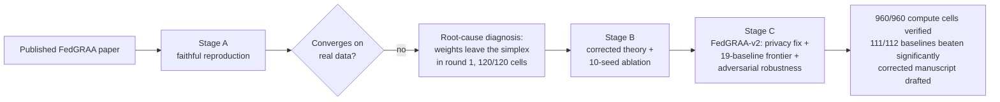

| Stage | Goal | Status |
|---|---|---|
| **A** | Faithful reproduction — every paper table/figure has a persisted, reproduced-or-honestly-diverging counterpart | ✅ complete |
| **B** | The divergence critique as a rigorous, citable component: formal theory + statistically-tested 10-seed ablation | ✅ complete |
| **C** | The novel extension for an A/A\*-tier venue: FedGRAA-v2 (privacy-compliant redesign + adversarial-robustness eval) | ✅ B+D+T7+T7G complete (960/960 cells: 830 + 90 T7 + 40 T7G) — Option A (few-shot hybrid) deliberately deferred |

> **Headline finding.** The paper's aggregation-weight update has no
> simplex-projection step, so the weight vector leaves the probability
> simplex in **round 1**, in **120 of 120** measured cells — the paper's
> own non-increasing-loss lemma fails immediately as a result. A minimal
> fix (projection + a smaller learning rate) recovers strong rare-class
> accuracy on both datasets, backed by a corrected — and explicitly
> weaker — convergence proof. The project then goes further: a
> privacy-compliant, adversarially-stress-tested successor (FedGRAA-v2)
> beats all 19 baselines on rare-class recall — 111 of the 112
> significance-tested comparisons against the 14 domain baselines are
> statistically significant — while being honest about its own 2–6×
> communication cost and its own exploitable attack surface.

**Start here:**
- [FedGRAA/README.md](FedGRAA/README.md) — setup, experiments, full project layout
- [FedGRAA/understanding/00_START_HERE.md](FedGRAA/understanding/00_START_HERE.md) — a gentle introduction to federated learning and this paper, for readers new to either
- [FedGRAA/docs/current/STAGE_A_MASTER_REPORT.md](FedGRAA/docs/current/STAGE_A_MASTER_REPORT.md) — the reproduction, exhaustively
- [FedGRAA/docs/current/STAGE_B_MASTER_REPORT.md](FedGRAA/docs/current/STAGE_B_MASTER_REPORT.md) — the theory + ablation campaign, exhaustively
- [FedGRAA/docs/current/STAGE_C_MASTER_REPORT.md](FedGRAA/docs/current/STAGE_C_MASTER_REPORT.md) — the FedGRAA-v2 novel extension, exhaustively
- [FedGRAA/results/README.md](FedGRAA/results/README.md) — every committed result artifact, mapped to the paper table/figure it reproduces
- [FedGRAA/docs/README.md](FedGRAA/docs/README.md) — full map of the ~90-file `docs/` tree (audits, literature, paper drafts, archive)

---

### Stage A — faithful reproduction

The implementation uses TensorFlow/Keras for the network described in the
paper's Section 5 (`input → Dense(200, tanh) → Dense(100, tanh) →
Dense(50, tanh) → Dense(n_classes, softmax)`), trained with sparse
categorical cross-entropy and Adam, with every previously-hidden design
ambiguity removed. Run against real CIC-IDS-2017 and UNSW-NB15 data at
200 rounds, `n=3` clients:

| Method | All-class acc | Rare-class acc |
|---|---|---|
| FedAvg | 61.0% | 0.0% |
| Static Reparam. | 52.3% | **91.7%** |
| FedGRAA (γ=0) | 62.5% | 0.0% |
| FedGRAA (γ=0.5) | 18.6% | 0.0% |
| FedGRAA (γ=1) | 17.4% | 0.0% |

This is **not** what the paper reports (it claims FedGRAA reaches ~89% on
minority classes, beating both baselines) — every FedGRAA curve collapses
instead.

<p align="center">
  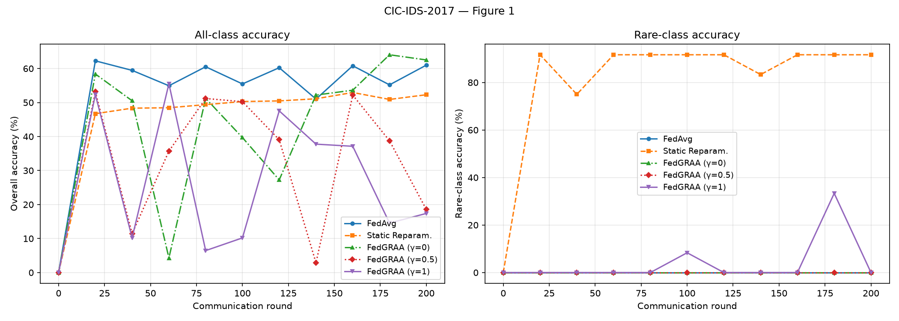
  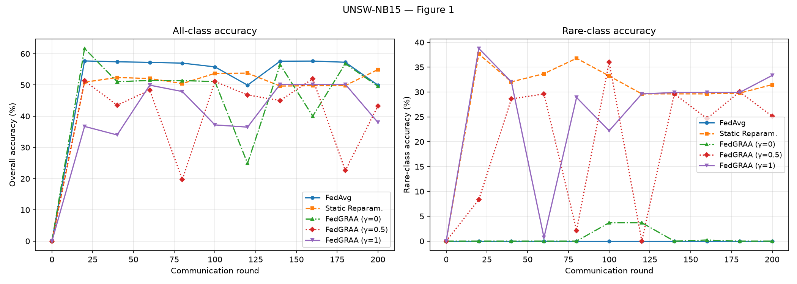
</p>

*Figure 1 γ-sweep reproduction, CIC-IDS-2017 (left) and UNSW-NB15
(right) — literal, unprojected FedGRAA at every γ, matching the table
above.*

<p align="center">
  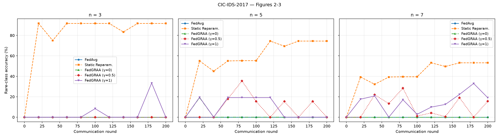
  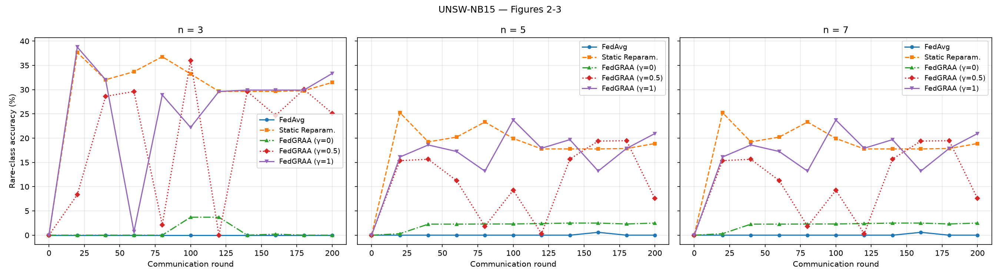
</p>

*Figures 2–3 (client-count sweep, `n ∈ {3, 5, 7}`) — the same
literal-collapse story holds at every client count; Static Reparam. is
the only baseline that retains rare-class accuracy at this horizon. Full
manifest, per-cell numbers, and honest-divergence notes:
[FedGRAA/results/README.md](FedGRAA/results/README.md).*

---

### Stage B — root-cause diagnosis, the fix, and corrected theory

**The root cause.** FedGRAA's aggregation weights `w^t` leave the
probability simplex **in round 1, at every γ**, because Algorithm 2 as
printed has no projection step. Off the simplex, the aggregated model
stops being a convex combination of client models and becomes an
unbounded affine extrapolation — so the paper's own Lemma 1 (composite
loss must be non-increasing) fails immediately. Measured across the full
Stage B campaign — 10 seeds × 3 γ × 2 datasets × 2 unprojected arms =
**120 cells** — `first_simplex_violation_round = 1` in **120 of 120**,
zero exceptions.

**The minimal fix.** Simplex projection **plus** a 10× smaller learning
rate for the weight update (`η′=0.01` instead of `0.1`), kept strictly
diagnostic-only and never merged into the reproduction itself.
Rare-class accuracy, mean [95% bootstrap CI] over 10 seeds, 60-round
horizon:

| Arm | CIC-IDS-2017 (γ=1) | UNSW-NB15 (γ=1) |
|---|---|---|
| FedAvg | 0.0% [0.0, 0.0] | 0.0% [0.0, 0.0] |
| Static Reparam. | 84.4% [77.2, 91.4] | 48.3% [40.8, 56.0] |
| Literal (η′=0.1, no projection) | 10.0% [0.0, 30.0] | 27.6% [15.0, 39.9] |
| Projection alone | 51.0% [24.2, 77.1] | 67.2% [59.6, 73.6] |
| η′ cut alone | 88.9% [68.9, 100.0] | 36.4% [33.7, 39.8] |
| **Both (the fix)** | **89.3% [83.6, 94.6]** | **69.2% [63.4, 73.8]** |

Composite-loss blowup worst case: literal reaches **1.86×10⁶×** on CIC
and **46.85×** on UNSW; the fix never exceeds 1.02× / 1.87×.

<p align="center">
  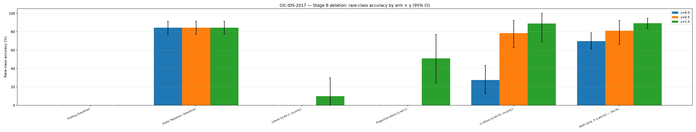
  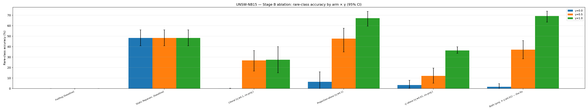
</p>

*The full 2×2 factorial (projection on/off × η′ high/low), 10-seed mean
with 95% CI. **The honest, dataset-dependent finding:** which lever
drives the accuracy recovery reverses between datasets — the η′ cut
dominates on CIC-IDS-2017, projection dominates on UNSW-NB15 — but only
the **combination** performs well on both, at every γ. Full factorial
with paired *t* / Wilcoxon / Cohen's *d* / Holm–Bonferroni:
[FedGRAA/docs/current/STAGE_B_MASTER_REPORT.md](FedGRAA/docs/current/STAGE_B_MASTER_REPORT.md) §8–12.*

**The corrected convergence theory.** Replacing Algorithm 2 line 6 with
`w^t = Π_Δ(w^{t−1} − η′ ∂L'(w^{t−1}))` turns the weight learner into
projected (sub)gradient descent on the compact convex set `Δ`, giving two
guarantees stated **explicitly weaker** than the paper's own Theorem 1:
feasibility is *structural* (the round-1 blowup becomes provably
impossible), and the iterates reach a *stationary/KKT point* at rate
`O(1/T)` — not the global minimum, because the loss is non-convex. Full
statement and proof sketch:
[FedGRAA/docs/current/fedgraa_convergence_defect.md](FedGRAA/docs/current/fedgraa_convergence_defect.md).

---

### Stage C — FedGRAA-v2, the novel extension

Stage C asks the two questions a domain-literate reviewer would ask
immediately, and that neither Stage A nor B touched: **does the mechanism
require centralizing anything FL exists to avoid, and does its own design
create an exploitable attack surface?**

**1. The privacy-compliant redesign.** FedGRAA-v1 has two structural
privacy violations: server-side oracle knowledge of which classes are
rare, and a server-held, fully-labelled validation set. `FederatedTrainerV2`
replaces both — an online-inferred, SecAgg-summed class-frequency
histogram for rarity ranking, and a federated backward pass
(`two_phase_composite_grad`) that reconstructs the exact composite-loss
gradient a centralized computation would, without ever centralizing raw
labels. Measured exactness: **`2×10⁻⁷`** relative error vs. the
oracle-pooled gradient, both datasets, three γ values.

**2. The 830-cell frontier campaign** — FedGRAA-v2 at four
communication/exactness trade-off points (`m ∈ {1,2,3,5}`) against 14
domain-specific baselines and 5 classic FL optimizers, both datasets, 10
seeds each, all run on real Modal cloud compute and independently
re-verified against every cell's own raw JSON.

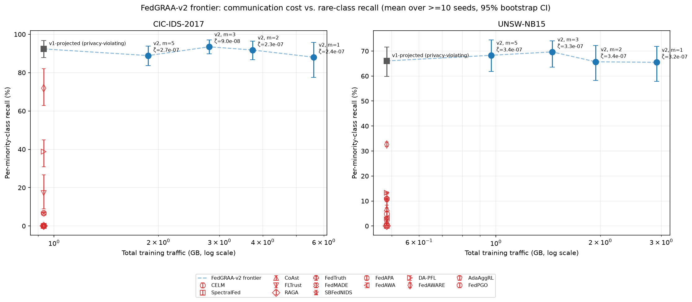

*FedGRAA-v2 (filled blue circles) sits at 88–93% rare-class recall on
CIC-IDS-2017 and 65–70% on UNSW-NB15 across every refresh interval.
Every one of the 14 external baselines (unfilled red markers) sits
strictly below the frontier on both datasets — most near 0%.*

**Headline numbers** (all independently re-derivable from
`results/v2_frontier/*.json`, none hand-transcribed):

| Metric | CIC-IDS-2017 | UNSW-NB15 |
|---|---|---|
| FedGRAA-v2 rare-class recall (best `m`) | **93.47%** (`m=3`) | **69.66%** (`m=3`) |
| Best external baseline's rare-class recall | 71.81% (FedAWARE) | 32.65% (FedAWARE) |
| Best classic-optimizer's rare-class recall | 31.67% (SCAFFOLD) | 30.34% (SCAFFOLD) |
| Significant comparisons vs. 14 baselines (Holm-corrected) | 55/56 | 56/56 |
| Communication overhead at `m=1` / `m=3` | 6.00× / 3.00× | 6.00× / 3.00× |
| Mechanism-specific attack: attacker weight vs. uniform (30% attackers) | 3.1× | 2.7× |
| SecFedNIDS attack success rate (mean across 3 attacks) | 65.0% | 60.4% |
| WeiDetect attack success rate (mean across 3 attacks) | 31.7% | 13.3% |

**3. Statistical significance.** Paired Wilcoxon signed-rank tests,
Holm–Bonferroni corrected, FedGRAA-v2 vs. each of the 14 domain
baselines: **111 of 112 comparisons significant at α=0.05.** The sole
exception (FedAWARE vs. `v2_m1` on CIC-IDS-2017) is reported rather than
omitted — not coincidentally the one baseline whose mean comes closest to
FedGRAA-v2's own range, at the one refresh interval where FedGRAA-v2's CI
is widest.

**4. Is the exactness worth the communication cost?** At `m=1` (a fresh
federated backward pass every inner epoch) FedGRAA-v2 costs **6.00×** a
near-zero-cost approximation's traffic; the overhead falls monotonically
to **2.00×** at `m=5`. The non-obvious finding: `m=3` — the *middle*
refresh interval — achieves FedGRAA-v2's own **best** rare-class recall
on both datasets, not merely a decent one.

<p align="center">
  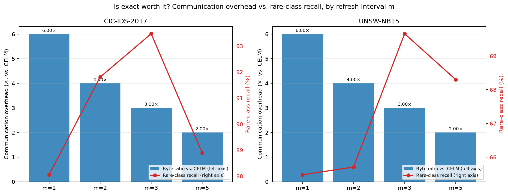
  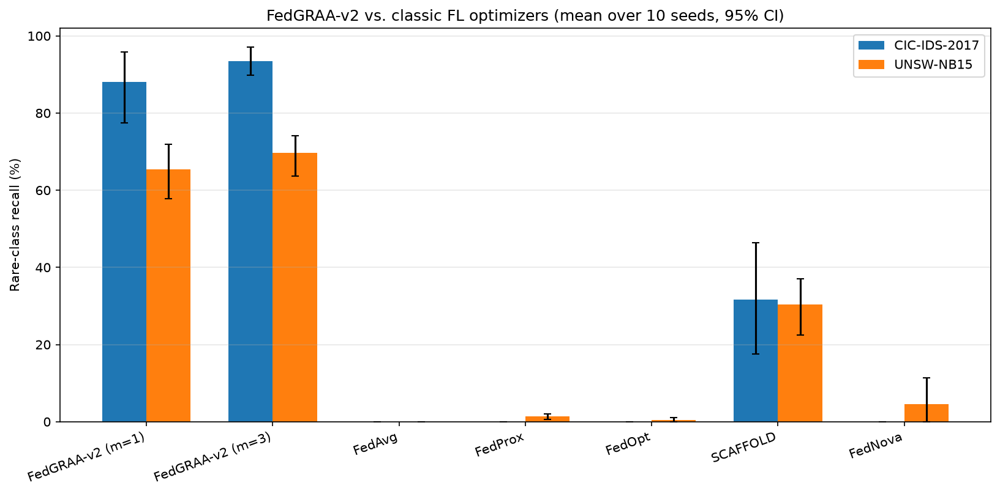
</p>

*Left: communication-overhead trade-off by refresh interval. Right:
against classic FL optimizers (FedAvg/FedProx/FedOpt/SCAFFOLD/FedNova) —
every one except SCAFFOLD scores at or near 0% rare-class recall; size-
proportional and drift-corrected weighting alone, without an explicit
rare-class objective, does not solve this problem.*

**5. Adversarial robustness (T7 + T7G) — a first for this project.** A
mechanism-specific attack, derived directly from FedGRAA-v2's own printed
weight-update gradient, up-weights its own attacker to **2.0–3.1×** the
uniform per-client share, confirmed on real 200-round campaigns across
both datasets and two attacker fractions.

<p align="center">
  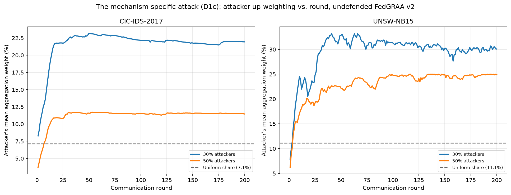
</p>

Two external defenses (SecFedNIDS, WeiDetect, both built from scratch)
were evaluated against a 3-attack grid:

<p align="center">
  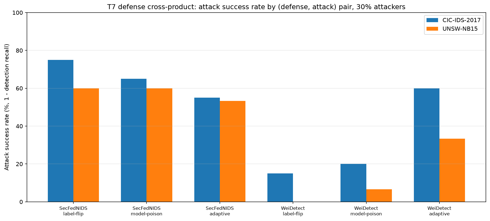
</p>

| Defense | Attack | CIC-IDS-2017 ASR | UNSW-NB15 ASR |
|---|---|---|---|
| SecFedNIDS | label-flip | 75.0% | 60.0% |
| SecFedNIDS | model-poison | 65.0% | 60.0% |
| SecFedNIDS | adaptive | 55.0% | 53.3% |
| WeiDetect | label-flip | 15.0% | 0.0% |
| WeiDetect | model-poison | 20.0% | 6.7% |
| WeiDetect | adaptive | 60.0% | 33.3% |

*(ASR = attack success rate = 1 − detection recall; lower is a better
defense.)*

**The most consequential finding: every successfully-defended cell's
rare-class recall collapses to ≈0%.** Both defenses stop the poisoning
attack only by discarding FedGRAA-v2's own rare-class-sensitive
up-weighting signal — a defense that "wins" against the attack by
discarding the mechanism under evaluation is not, in this evaluation, a
free win.

**T7G addendum (same-day follow-up, 2026-08-02):** sweeping γ against the
attack surface shows the effect is **non-monotonic in γ**, peaking around
γ=0.5 rather than at the frontier's own default γ=1.0, and γ=0 shows
**10–20× higher** seed-to-seed variance than γ≥0.5:

| Dataset | Attackers | γ=0.0 | γ=0.5 | γ=1.0 (T7's default) |
|---|---|---|---|---|
| CIC-IDS-2017 | 30% | 2.05× | **3.34×** | 3.07× |
| CIC-IDS-2017 | 50% | 0.93× | **1.82×** | 1.60× |
| UNSW-NB15 | 30% | 2.33× | **2.91×** | 2.71× |
| UNSW-NB15 | 50% | 1.24× | 2.11× | **2.24×** |

**6. The manuscript.** A previously-rejected submission draft was
discovered in this repository (missed by prior documentation's own
search) — already evaluated by a 5-agent simulated peer-review panel and
rejected on ten named grounds (missing simplex projection, no raw
seed-level logs, a convexity assumption for a non-convex model, no
adaptive-baseline comparison, no significance testing, and more). The
corrected resubmission,
[FedGRAA_v2_PAKDD_Submission.md](FedGRAA/docs/paper/FedGRAA_v2_PAKDD_Submission.md),
resolves every one of those ten items using this stage's real campaign
data, plus two things neither the original draft nor its review addressed
at all: the privacy-compliant redesign and the adversarial-robustness
evaluation. Full detail, including the reviewer-by-reviewer resolution
table: [FedGRAA/docs/current/STAGE_C_MASTER_REPORT.md](FedGRAA/docs/current/STAGE_C_MASTER_REPORT.md) §11.

---

## Why this repo is organized the way it is

Each project keeps two kinds of automated checks, run before anything is
called "done":

- **Completeness gates** — is every artifact the docs claim actually
  present, and shaped right?
- **Correctness audits** — is every reported number independently
  re-derived from raw persisted data, rather than just read back from the
  document asserting it?

This came out of catching real mistakes: a past doc reorganization
silently broke 34 relative links, and a "byte-identical" claim in one
report turned out to be an overclaim. Both are now caught automatically —
see [FedGRAA/scripts/check_doc_links.py](FedGRAA/scripts/check_doc_links.py)
and the `audit_stage_*.py` / `check_stage_*_complete.py` scripts in
[FedGRAA/scripts/](FedGRAA/scripts/). **All nine core verification commands
run on every push/PR to `main`** in
[`.github/workflows/docs-check.yml`](.github/workflows/docs-check.yml) —
they are no longer only-a-human-remembers-to-run-them scripts.

The correctness audits have real teeth: `scripts/audit_stage_c.py`
independently re-derives every Stage C headline number — the frontier
table's per-seed arrays, all 112 significance comparisons via `scipy`
directly, the communication-overhead ratios, and the T7 up-weighting/
attack-success-rate numbers — from raw per-cell JSON, and is
negative-controlled (deliberately injected errors are verified to be
caught) before being trusted.

## Repository structure

```
FedGRAA/
├── FedGRAA/            # FedGRAA reproduction — see FedGRAA/README.md
│   ├── fedgraa/       # the reimplementation: model, aggregation, privacy, attacks, baselines
│   ├── scripts/       # campaign drivers, completeness gates, correctness audits
│   ├── results/       # every persisted artifact — figures, JSON, ablation/frontier tables
│   ├── tests/         # 565 tests: gradients, statistics, adversarial robustness, doc links
│   ├── docs/          # ~90 files: stage capstones, audits, literature, the manuscript lineage
│   └── understanding/ # a from-zero didactic walkthrough of FL and this paper
├── .github/          # issue/PR templates, CI (doc-link + syntax check + stage gates)
├── LICENSE
├── CITATION.cff
└── README.md         # you are here
```

As more projects are added, they'll get their own top-level folder and an
entry in this README, following the same reproduce-honestly-then-audit
pattern as FedGRAA.

## Getting started

```powershell
git clone https://github.com/N1KH1LT0X1N/FedGRAA.git
cd FedGRAA/FedGRAA

python -m venv .venv313
.venv313\Scripts\Activate.ps1
pip install -r requirements.txt

pytest tests --tb=short                                    # 565 passed
python scripts\check_stage_a_complete.py                   # exit 0
python scripts\check_stage_b_complete.py                   # exit 0
python scripts\check_stage_c_complete.py --tier T1 T2 T3 T4 T5 T6 TC --t4-m 3   # exit 0
python scripts\check_stage_c_complete.py --tier T7 --seeds 0 1 2 3 4            # exit 0
python scripts\audit_stage_a.py                             # exit 0 (recomputes every number)
python scripts\audit_stage_b.py                             # exit 0
python scripts\audit_stage_c.py                             # exit 0
```

Python 3.13 is recommended — TensorFlow 2.21 has no Python 3.14 wheels
yet. No GPU required (a GPU attempt measured 25% *slower* at this model
size). Datasets are not tracked in git (see [`.gitignore`](.gitignore));
see [FedGRAA/README.md § Datasets](FedGRAA/README.md#datasets) for where to
get them — the copies used to produce every result in this repo were
forensically verified against raw CSV SHA-256s
([FedGRAA/docs/audit/data_provenance_audit.md](FedGRAA/docs/audit/data_provenance_audit.md)).

## Full documentation map

| If you want… | Read |
|---|---|
| A gentle introduction to federated learning and this paper, from zero | [FedGRAA/understanding/00_START_HERE.md](FedGRAA/understanding/00_START_HERE.md) *(11-file series; carries its own correction banner pointing at Stage B/C's later, corrected findings)* |
| The whole project in one pass | [STAGE_A](FedGRAA/docs/current/STAGE_A_MASTER_REPORT.md) → [STAGE_B](FedGRAA/docs/current/STAGE_B_MASTER_REPORT.md) → [STAGE_C](FedGRAA/docs/current/STAGE_C_MASTER_REPORT.md) master reports |
| Proof the numbers are actually right, not just asserted | [FedGRAA/docs/audit/README.md](FedGRAA/docs/audit/README.md) — 16 independent, adversarial verification passes |
| Why FedGRAA doesn't converge as published | [fedgraa_divergence_diagnosis.md](FedGRAA/docs/current/fedgraa_divergence_diagnosis.md) and [fedgraa_convergence_defect.md](FedGRAA/docs/current/fedgraa_convergence_defect.md) |
| What's wrong with the paper's text itself | [PAPER_AMBIGUITY_REPORT.md](FedGRAA/docs/current/PAPER_AMBIGUITY_REPORT.md) and [FedGRAA_Simulated_Peer_Review.md](FedGRAA/docs/paper/FedGRAA_Simulated_Peer_Review.md) |
| The current, citable manuscript | [FedGRAA_v2_PAKDD_Submission.md](FedGRAA/docs/paper/FedGRAA_v2_PAKDD_Submission.md) |
| The novel Stage C contribution and why it's novel | [Final_Stage_C.md](FedGRAA/docs/research_c/Final_Stage_C.md) and [FEDGRAA_V2_MASTER_PLAN.md](FedGRAA/docs/research_c/FEDGRAA_V2_MASTER_PLAN.md) |
| Every committed result artifact, mapped to what it reproduces | [FedGRAA/results/README.md](FedGRAA/results/README.md) and [FedGRAA/results/ablation/README.md](FedGRAA/results/ablation/README.md) |
| What's next | [publication_roadmap.md](FedGRAA/docs/current/publication_roadmap.md) |
| The full ~90-file `docs/` tree map | [FedGRAA/docs/README.md](FedGRAA/docs/README.md) |

## Contributing

Bug reports and pull requests are welcome — see
[CONTRIBUTING.md](CONTRIBUTING.md) for the workflow and the audit checks a
change is expected to pass, and [CODE_OF_CONDUCT.md](CODE_OF_CONDUCT.md)
for community expectations.

## Citation

If you use this reproduction, the FedGRAA divergence diagnosis, the
corrected convergence theory, or the FedGRAA-v2 extension, please cite
this repository — see [`CITATION.cff`](CITATION.cff) (GitHub's "Cite this
repository" button on this page uses it directly):

```bibtex
@software{pise_fedgraa,
  author  = {Pise, Nikhil Pravin},
  title   = {{FedGRAA: Independent Reproduction and Extension of a Published ML Paper}},
  url     = {https://github.com/N1KH1LT0X1N/FedGRAA},
  license = {MIT},
  date    = {2026-08-08}
}
```

## License

[MIT](LICENSE) © 2026 Nikhil Pravin Pise

## Author

**Nikhil Pravin Pise** — [@N1KH1LT0X1N](https://github.com/N1KH1LT0X1N)
