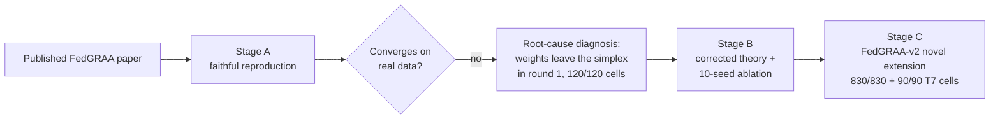

# Research

[](LICENSE)
[](https://github.com/N1KH1LT0X1N/Research/actions/workflows/docs-check.yml)
[](PAKDD/requirements.txt)
[](PAKDD/docs/current/STAGE_A_MASTER_REPORT.md)
[](PAKDD/docs/current/STAGE_B_MASTER_REPORT.md)
[](PAKDD/docs/current/STAGE_C_MASTER_REPORT.md)

Independent, statistically-tested reproductions of published ML papers —
built to find out whether the numbers actually hold up, and to show the work
either way.

This is a solo research repo, not a framework or a library. Every project
here follows the same discipline: reimplement the paper faithfully first,
measure honestly, and if something doesn't reproduce, diagnose *why* instead
of quietly patching it into working. Automated "completeness gates" and
"correctness audits" (see below) exist so those claims don't have to be taken
on faith.

## Flagship project: PAKDD — FedGRAA reproduction

**[`PAKDD/`](PAKDD/)** — a from-scratch Keras/TensorFlow reproduction of
*"Federated Gradient-Refined Adaptive Averaging for Intrusion Detection
Systems" (FedGRAA)*, plus a measured, statistically-tested account of why the
published algorithm does not converge on real intrusion-detection data, and a
corrected convergence guarantee for the fixed version.



| Stage | Goal | Status |
|---|---|---|
| **A** | Faithful reproduction — every paper table/figure has a persisted, reproduced-or-honestly-diverging counterpart | ✅ complete |
| **B** | The divergence critique as a rigorous, citable component: formal theory + statistically-tested 10-seed ablation | ✅ complete |
| **C** | The novel extension for an A/A\*-tier venue: FedGRAA-v2 (privacy-compliant redesign + adversarial-robustness eval) | ✅ B+D+T7 complete (830/830 + 90/90 cells) — Option A (few-shot hybrid) deliberately deferred |

**Headline finding:** the paper's aggregation-weight update has no
simplex-projection step, so the weight vector leaves the probability simplex
in **round 1**, in **120 of 120** measured cells — the paper's own
non-increasing-loss lemma fails immediately as a result. A minimal fix
(projection + a smaller learning rate) recovers strong rare-class accuracy on
both datasets, backed by a corrected — and explicitly weaker — convergence
proof.

**Start here:**
- [PAKDD/README.md](PAKDD/README.md) — setup, experiments, full project layout
- [PAKDD/understanding/00_START_HERE.md](PAKDD/understanding/00_START_HERE.md) — a gentle introduction to federated learning and this paper, for readers new to either
- [PAKDD/docs/current/STAGE_A_MASTER_REPORT.md](PAKDD/docs/current/STAGE_A_MASTER_REPORT.md) — the reproduction, exhaustively
- [PAKDD/docs/current/STAGE_B_MASTER_REPORT.md](PAKDD/docs/current/STAGE_B_MASTER_REPORT.md) — the theory + ablation campaign, exhaustively
- [PAKDD/docs/current/STAGE_C_MASTER_REPORT.md](PAKDD/docs/current/STAGE_C_MASTER_REPORT.md) — the FedGRAA-v2 novel extension, exhaustively

## Why this repo is organized the way it is

Each project keeps two kinds of automated checks, run before anything is
called "done":

- **Completeness gates** — is every artifact the docs claim actually present,
  and shaped right?
- **Correctness audits** — is every reported number independently
  re-derived from raw persisted data, rather than just read back from the
  document asserting it?

This came out of catching real mistakes: a past doc reorganization silently
broke 34 relative links, and a "byte-identical" claim in one report turned
out to be an overclaim. Both are now caught automatically — see
[PAKDD/scripts/check_doc_links.py](PAKDD/scripts/check_doc_links.py) and the
`audit_stage_*.py` / `check_stage_*_complete.py` scripts in
[PAKDD/scripts/](PAKDD/scripts/).

## Repository structure

```
Research/
├── PAKDD/            # FedGRAA reproduction — see PAKDD/README.md
├── .github/          # issue/PR templates, lightweight CI (doc-link + syntax check)
├── LICENSE
└── README.md         # you are here
```

As more projects are added, they'll get their own top-level folder and an
entry in this README, following the same reproduce-honestly-then-audit
pattern as PAKDD.

## Getting started

```powershell
git clone https://github.com/N1KH1LT0X1N/Research.git
cd Research/PAKDD

python -m venv .venv313
.venv313\Scripts\Activate.ps1
pip install -r requirements.txt

pytest tests --tb=short                                    # 563 passed
python scripts\check_stage_a_complete.py                   # exit 0
python scripts\check_stage_b_complete.py                   # exit 0
python scripts\check_stage_c_complete.py --tier T1 T2 T3 T4 T5 T6 TC --t4-m 3   # exit 0
python scripts\check_stage_c_complete.py --tier T7 --seeds 0 1 2 3 4            # exit 0
```

Python 3.13 is recommended — TensorFlow 2.21 has no Python 3.14 wheels yet.
Datasets are not tracked in git (see [`.gitignore`](.gitignore)); see
[PAKDD/README.md § Datasets](PAKDD/README.md#datasets) for where to get them.

## Contributing

Bug reports and pull requests are welcome — see
[CONTRIBUTING.md](CONTRIBUTING.md) for the workflow and the audit checks a
change is expected to pass.

## License

[MIT](LICENSE) © 2026 Nikhil Pravin Pise

## Author

**Nikhil Pravin Pise** — [@N1KH1LT0X1N](https://github.com/N1KH1LT0X1N)
